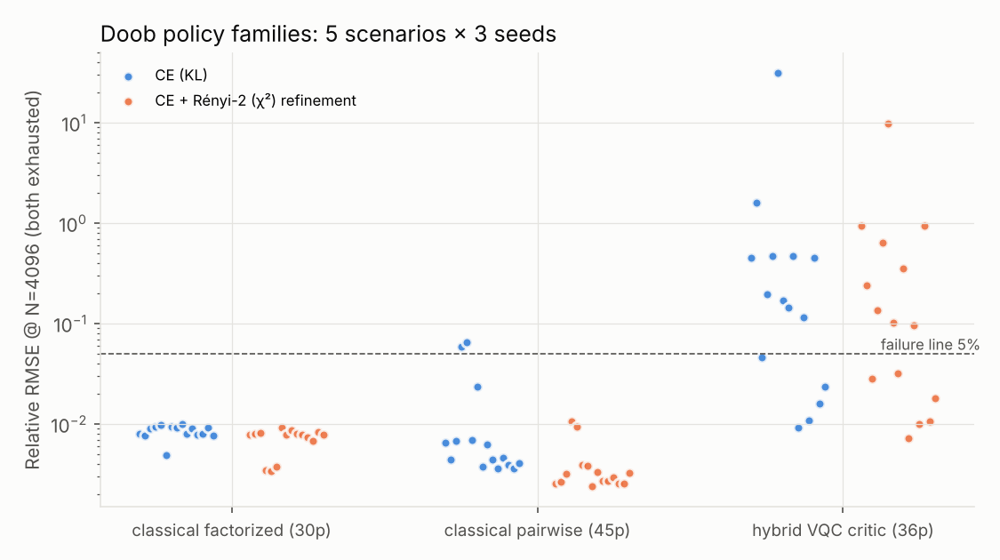
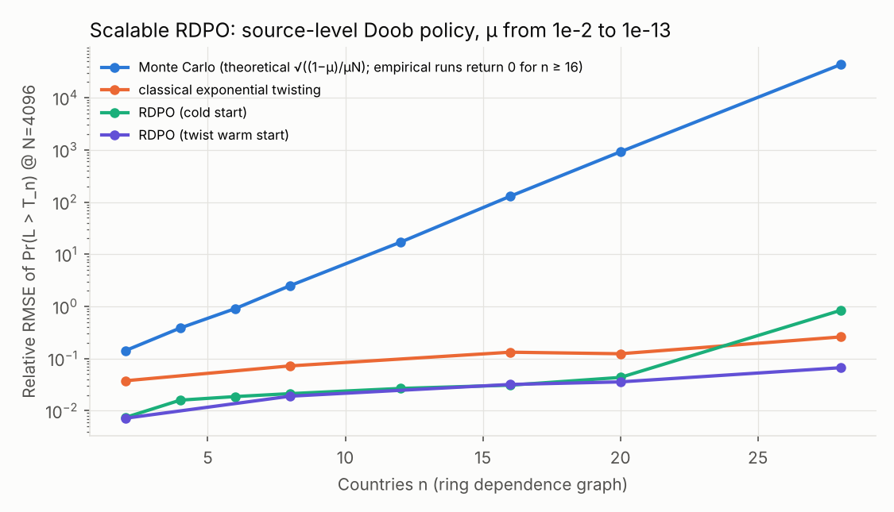
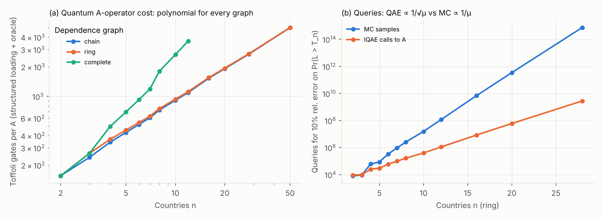
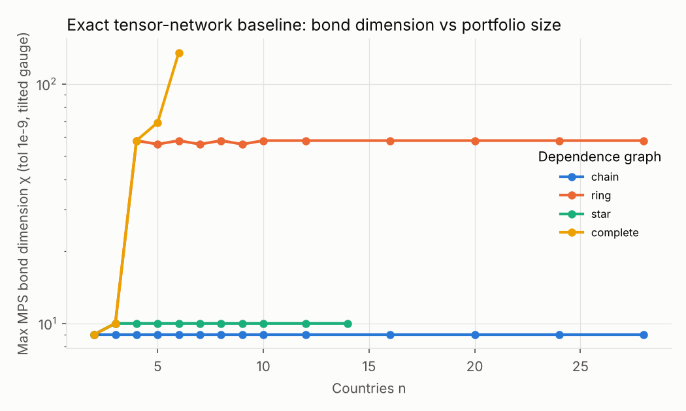

# Summary

**The problem.** Pooled catastrophe bonds are priced and stress-tested on *joint tails*: how often
several countries pay out, or are exhausted, together. For the ADB benchmark (Kyrgyz Republic +
Tajikistan, earthquake + precipitation, 3-year term) the probability that both bonds are exhausted
is ≈ 3×10⁻⁵. Monte Carlo returns exactly zero for it in 95–100% of runs at 1,024 paths, and exact
enumeration grows as 10ⁿ with the number of countries. The bottleneck is **accuracy per query in
the rare joint tail, and how it scales with portfolio size**.

**Our approach.** The zero-variance importance-sampling (IS) proposal is the Doob h-transform of
the loss process. Equivalently, it is the optimal policy of a KL-regularised (soft) reinforcement
learning problem. **Rényi-Doob Policy Optimization (RDPO)** learns a compact approximation of this
policy by cross-entropy policy search. It then refines the policy with a Rényi-2 (χ²) policy
gradient, because χ², not KL, is the divergence that controls IS variance. **Q-RDPO** carries the
same change of measure into quantum amplitude estimation (QAE). Two observations make this work.
First, payouts are capped, so the portfolio loss distribution loads *exactly* into a structured
"Poisson-source" circuit with O(n + |E|) qubits and gates for any dependence graph. Second,
exponentially twisting the source registers makes the importance weight bounded, so the QAE
amplitude decays only with a large-deviation gap rather than with μ.

**Evidence from the prototype (all reproducible, 35 tests):**

| Claim | Result |
|---|---|
| Exact reproduction of the brief | 3 checkpoints + all 25 reference values (stop-loss to the dollar) |
| Accuracy per query on the benchmark | "both exhausted": median relative RMSE **0.30%** at 4,096 paths, 0/15 failed fits, **≈ 100–400× lower** than the best of the four reference baselines |
| Scaling (2 → 28 countries) | Pr(L > T): relative RMSE **0.7% → 6.7%** while μ falls from 1e-2 to **1e-13**; Monte Carlo returns 0 for n ≥ 16; **3–5× better** than classical exponential twisting at every n |
| Quantum query complexity | twisted Q-RDPO, 28 countries: **3.4×10⁴** QAE calls vs 7.6×10¹⁴ Monte Carlo samples (vs 2.8×10⁹ for untwisted QAE) |
| Quantum resource efficiency | exact structured loading: **52 logical qubits, 156 Toffolis** per call for ADB (vs 97 / 3,808 for generic state preparation) |
| Near-term feasibility | 8-qubit, depth-9 QCBM proposal sampler; noise bias of +9% to +60% removed to **≤ 0.6%** by calibrating the sampled law with 10⁵ shots |

**What we do not claim.** There is no quantum advantage on the 2-country benchmark (exact
enumeration takes 0.2 ms). We report ourselves that exact tensor networks solve *sparse* dependence
graphs classically at any size. QAE needs early-fault-tolerant error rates (≤ 10⁻⁶ per two-qubit
gate). A quantum wall-clock advantage is plausible only for **large, densely dependent portfolios
with very rare targets**, and that is the regime the Deep Development phase is designed to test.

Code, data and the full technical report: **<https://github.com/CL0908/adb-quantum-challenge>**
(`REPORT.md` holds every table behind this proposal).

---

# 1. Problem and Approach

## 1.1 Framing the joint-loss problem

A portfolio covers countries i = 1…n with parametric payouts c_i(X) driven by a joint outcome X ~ p.
Every quantity of interest is an expectation μ = E_p[f(c₁(X), …, c_n(X))]. In the ADB benchmark,
earthquake payouts accrue in quarter steps of a USD 70m sub-limit (capped), precipitation pays a
USD 10m sub-limit at most once, and dependence enters through *shared events* (common shocks)
that hit both countries. We target the brief's five quantities: expected loss, joint attachment,
Pr(L > 80m), stop-loss E[(L − 80m)⁺] and the joint-exhaustion probability.

Two features define the difficulty:

1. **Rare joint tails.** The decision-relevant quantities (joint exhaustion, exceedance of a pooled
   threshold) have probabilities of 10⁻³–10⁻¹³, and the dependence structure that drives them is
   exactly what historical data cannot constrain. Models must therefore be *stress-tested across
   scenarios* (the brief's five scenarios), which multiplies the number of rare-event estimates.
2. **Portfolio scale.** With two perils per country the annual state space is 10ⁿ; pooled
   facilities covering 5–30 countries are realistic for regional risk pools.

## 1.2 State of the art

**Industry practice.** Catastrophe models (vendor platforms and the open-source Oasis Loss
Modelling Framework) chain hazard, vulnerability and financial modules. Portfolio metrics are
obtained by aggregating simulated event or year loss tables, typically by plain Monte Carlo over
10⁴–10⁵ simulated years. Cross-country dependence enters through shared events or through copulas
(Joe 2014). The known weakness is precision in the far joint tail at fixed simulation budget,
which is precisely the brief's bottleneck. Classical variance-reduction tools (stratification,
quasi-Monte Carlo, importance sampling, the cross-entropy method; Glasserman 2003; Owen 1997;
Rubinstein & Kroese 2004) help, but they need problem-specific proposal design, which is rarely
done in production.

**Quantum methods for risk.** Quantum amplitude estimation offers a quadratic speedup in query
complexity for Monte Carlo (Brassard et al. 2002; Montanaro 2015), with risk applications in
Woerner & Egger (2019) and a correlated-default credit model (Egger et al. 2021), the closest
published analogue to shared-event catastrophe risk. Practical variants avoid phase estimation
(Suzuki et al. 2020; Grinko et al. 2021). End-to-end resource studies show that state preparation
and arithmetic dominate costs and that advantage requires fault tolerance (Chakrabarti et al. 2021;
Herman et al. 2023). Distribution loading by quantum generative models (QCBM, qGAN, QBM, quantum
copulas; Benedetti et al. 2019; Zoufal et al. 2019; Amin et al. 2018; Zhu et al. 2022) is the
standard near-term route, but these models are usually *trained to reproduce p*, which does not
address rare-event variance. Tensor networks (Han et al. 2018; Orús 2014) are the main
quantum-inspired classical alternative.

**Gap we address.** None of these works treats the *change of measure* (which distribution to
sample or load) as the central learnable object, measures it with the divergence that actually
controls variance, and carries it consistently into a quantum loader whose cost scales with the
portfolio's dependence graph.

## 1.3 Proposed approach

```
                 soft Bellman / Doob h-transform
 ADB model ──►  π*(y|s) ∝ p(y)·V(s⊕y)    (zero-variance IS policy)
                        │
          ┌─────────────┴──────────────┐
          ▼                            ▼
  RDPO (classical, runs today)    Q-RDPO (quantum estimation stage)
  log Ṽ_θ: O(n) features          exact Poisson-source loading circuit
  CE policy search (KL)           exponentially twisted source registers
  + Rényi-2 policy gradient (χ²)  → bounded weight → IQAE, O(1/√a) queries
          │                            │
          └──────► unbiased estimates of all portfolio targets ◄─────┘
```

**Step 1: the zero-variance policy is a soft-RL policy.** For a non-negative payoff f, the optimal
IS proposal over the term is the Doob h-transform q\*(y | s) ∝ p(y)·V(s ⊕ y), where
V_t(s) = E[f | state s at time t] solves log V_t(s) = log Σ_y p(y) V_{t+1}(s ⊕ y). This is the soft
Bellman equation of a KL-regularised control problem (Todorov 2009; Kappen 2005): log V is a soft
value function and q\* is its Boltzmann policy. On two countries V can be computed exactly
(our strongest classical baseline). At scale it cannot, so we *learn* it.

**Step 2: RDPO (classical, information-theoretic RL).** We parametrise
log Ṽ_θ(s) = Σ_i θ_i·ψ(a_i, r_i) + θ_g·g(L) with per-country threshold features and global loss
features (O(n) parameters). We sample the portfolio **source by source**: each independent
Poisson source has a finite capped-increment law with ≤ 25 values, so the policy's normaliser is a
sum over ≤ 25 values, never over 10ⁿ states. Training has two stages:

* *Cross-entropy policy search* (minimises KL(p\*‖q)): multilevel elite sets, convex updates.
* *Rényi-2 policy gradient* (minimises χ²(p\*‖q) = E_q[(wf)²]/μ² − 1, i.e. the IS variance itself):
  REINFORCE with reward −(w·f)². This step repairs CE fits that have small KL but heavy-tailed
  weights. Such policies exist, and we observed them.

The likelihood ratio keeps every estimate **unbiased**: a poorly learned policy only increases
variance. A one-parameter exponential twist (the large-deviation Doob transform of total loss)
gives a warm start.

**Step 3: Q-RDPO (quantum estimation stage).** Because each capped source has a finite increment
law, the term distribution is loaded *exactly* by preparing one small register per source
(3, 6 or 1 qubits), adding increments into per-country sum registers with in-place adders, and
evaluating the payoff in an oracle. Twisting each source register, q_k(x) ∝ p_k(x)·exp(η ℓ_k(x)),
changes only amplitudes, so loading costs nothing extra. The weight becomes a bounded function of
total loss, so the amplitude estimated by QAE is a = μ·exp(ηT − Λ(η)) rather than μ.

**Step 4: honest classical boundaries.** We built the strongest classical competitors ourselves:
zero-variance backward induction, and an exact tensor network (MPS) compressed in a *tilted*
gauge so that tail targets keep relative precision. These define where quantum methods are and are
not needed.

## 1.4 Expected advantage

| Dimension | Versus | Expected advantage (measured in prototype) |
|---|---|---|
| **Accuracy per query** (classical RDPO, today) | the brief's MC / Sobol / stratified / IS | 100–400× lower relative RMSE on joint exhaustion at equal paths; 21–72× for the CE-trained policy even when its training paths are charged (the optional Rényi-2 repair adds 80k paths) |
| **Scaling of accuracy with portfolio size** | MC, exponential twisting | error 0.7% → 6.7% for μ = 10⁻² → 10⁻¹³; MC needs ~10¹² paths for 3% at n = 16 |
| **Query complexity** (quantum) | MC; classical IS with the same twist | 1/√a vs 1/μ: 3.4×10⁴ vs 7.6×10¹⁴ at n = 28; vs the same classical twist ≈ 3× fewer queries at n = 28, growing with n |
| **Resource efficiency** (quantum) | generic state preparation (Grover–Rudolph / Möttönen) | ~25× fewer Toffolis per call, ~2× fewer qubits; ~10× lower T-count end-to-end for ADB |
| **Representation** (theory) | classical latent (common-cause) models | a k-dim quantum latent fits the joint tail 6–64× better at small k; no gain at equal parameter count |

## 1.5 Feasibility on current and near-term hardware

* **Today (classical):** RDPO runs on a laptop CPU. Fitting at 28 countries takes about 1 minute,
  and it is GPU-friendly (batched path sampling).
* **Near-term (NISQ):** the 8-qubit QCBM proposal sampler has depth 9 and 32 CZ gates, which is
  feasible on current trapped-ion, neutral-atom and superconducting devices. We identified and
  solved the main practical issue: hardware noise biases IS weights by +9% to +60%, and calibrating
  the law that is actually sampled (post-readout) removes the bias to ≤ 0.6% with 10⁵ shots.
* **Early fault tolerance:** QAE on the structured circuit needs ~50–600 logical qubits and
  3×10³–1.2×10⁵ CNOTs per Grover iterate. Noisy maximum-likelihood AE beats MC only for two-qubit
  error ≤ 10⁻⁶ (break-even at 10⁻⁵). This is an early-fault-tolerant workload, not a NISQ one, and
  we say so.

## 1.6 Scalability and adaptability

* **Scaling.** RDPO: O(n) parameters, O(n + |E|) cost per path; demonstrated to 28 countries.
  Q-RDPO: O(n + |E|) qubits and gates for *any* dependence graph, including dense ones, where the
  exact MPS bond dimension grows (χ = 58 → 135 from 4 to 6 fully connected countries).
* **Adaptability.** The framework needs only (i) independent shock sources with finite (capped)
  effects and (ii) a payoff on aggregated states. This covers multi-peril parametric insurance,
  sovereign risk pools, correlated credit defaults with capped exposures (the Egger et al. 2021
  structure), pandemic and supply-chain disruption bonds, compound climate events, and reliability
  of networked infrastructure (cascading failures).

---

# 2. Technical Rationale

## 2.1 Why these algorithms suit the task

| Choice | Reason |
|---|---|
| **Doob h-transform as the target object** | It is the unique zero-variance proposal for non-negative payoffs, so approximating it is the principled route to variance reduction, not a heuristic tilt. |
| **Soft-RL / policy parametrisation** | The h-transform *is* a soft-optimal policy, so RL machinery (value-function approximation, policy search) applies directly and scales through function approximation. |
| **Cross-entropy, then Rényi-2** | CE is robust for reaching rare levels (multilevel). Rényi-2 optimises the quantity that matters (variance) and repairs heavy-tailed fits: in our experiments the failure rate fell from 2/15 to 0/15 and the exact per-path std from 14.5 to 0.60. |
| **Source-level sampling** | It replaces a 10ⁿ normaliser with ≤ 25-value normalisers and makes cost linear in sources. It is exact because capped increments compose: min(a + min(x,4), 4) = min(a + x, 4). |
| **Structured (Poisson-source) loading** | It is exact with no truncation of Poisson counts, its gate count follows the dependence graph rather than 10ⁿ, and it parallelises across sources. |
| **Exponential twisting inside the circuit** | It costs nothing to load and bounds the weight. This turns IS-inside-QAE from harmful (unbounded weights, a ≪ μ) into helpful (a = μ·exp(I(T))). |
| **Iterative / maximum-likelihood AE** | These avoid quantum phase estimation (Grinko et al. 2021; Suzuki et al. 2020) and admit noise-aware likelihoods as error mitigation. |
| **QCBM as near-term sampler** | It is shallow and hardware-native; with calibrated weights it is an unbiased near-term use of quantum sampling. |

## 2.2 Benchmarks

*Classical (all implemented):* plain MC; scrambled Sobol (8 scrambles, t-interval); stratification
by first payout year; the brief's importance sampling; zero-variance backward induction (exact,
2 countries); cross-entropy IS (log-linear, factorised and pairwise); classical exponential
twisting (Glasserman 2003); exact tilted-gauge MPS (to 28 countries).

*Quantum (all implemented, exact simulation):* QCBM proposal vs classical proposal families;
generic Möttönen loading + IQAE; structured loading + IQAE; twisted structured loading + IQAE;
noisy MLAE with and without noise-aware mitigation; variational quantum critic (hybrid quantum RL).

*Reference values:* the brief's Table 5 (reproduced exactly), dense 10ⁿ enumeration (n ≤ 6) and the
exact MPS.

---

# 3. Prototype Results (validation of the approach)

## 3.1 Exact reproduction

All checkpoints match the brief (92.62% no-EQ year; rain 96.526 / 1.474 / 0.526%; 89.40% no-payout
year). All 25 reference values match to the printed precision, for example base-scenario stop-loss
USD 282,355 and joint exhaustion 0.003163%. Two independent cross-checks agree: enumeration of all
10⁶ paths, and a 2×10⁶-year raw event simulation. A structural result used throughout: the 3-year
capped convolution equals the 3-year continuous-time chain, expm(3G), to 10⁻¹⁶.

## 3.2 Accuracy per query on the benchmark



| Joint exhaustion, N = 4,096 | median rel. RMSE | worst | failed fits |
|---|---|---|---|
| best brief baseline (IS), per scenario | 0.40–1.21 | — | — |
| learned Doob, factorized (CE) | 0.0090 | 0.0099 | 0/15 |
| learned Doob, pairwise (CE) | 0.0046 | 0.065 | 2/15 |
| **RDPO (pairwise, CE + Rényi-2)** | **0.0030** | **0.0105** | **0/15** |
| hybrid quantum critic (VQC, CE + Rényi-2) | 0.10 | 9.9 | 9/15 |

RDPO's gain is concentrated on rare targets. On expected loss, scrambled Sobol remains best, and we
recommend it there.

## 3.3 Scaling with portfolio size



| graph | n | μ (exact, MPS) | MC | exp. twisting | **RDPO** |
|---|---|---|---|---|---|
| ring | 2 | 1.2e-2 | 0.14 | 0.038 | **0.0072** |
| ring | 8 | 3.9e-5 | 2.5 | 0.072 | **0.019** |
| ring | 16 | 1.5e-8 | 129 (all runs 0) | 0.13 | **0.032** |
| ring | 28 | 1.3e-13 | 4.3×10⁴ (all runs 0) | 0.26 | **0.067** |
| complete | 7 | 2.9e-4 | 0.91 | 0.071 | **0.016** |

## 3.4 Quantum stage



* Structured loading is **exact**: a sparse-statevector simulation reproduces the full joint
  distribution to 10⁻¹⁶ and the ADB targets as QAE amplitudes.
* Twisting reduces QAE calls at n = 28 from 2.8×10⁹ to 3.4×10⁴ (a = 8.8×10⁻⁴ instead of 1.3×10⁻¹³).
* The QCBM proposal beats the brief's IS (4–11×) and a factorized classical family, but not a
  log-linear classical family.

## 3.5 Classical boundary: where quantum is *not* needed



For chain, star and ring dependence the exact MPS bond dimension is constant (9 / 10 / 58), so all
targets are computed exactly for 28 countries in under 70 s. For fully connected dependence it grows
(58 → 135 from 4 to 6 countries). Compressing in a tilted (Doob) gauge is essential: plain SVD
truncation incurs up to 2% error on the rarest target even at tolerance 10⁻¹². Bulk information
measures (mutual information, entanglement ≤ 0.1 bit) do *not* predict the representation size that
tail accuracy needs (χ ≈ 60).

## 3.6 Negative and mixed results we report

* No quantum advantage at benchmark scale (exact enumeration: 0.2 ms).
* The QCBM never beats a 15-parameter classical log-linear proposal.
* State-dependent proposals inside QAE cut calls 54× but cost ~100× more per call to load.
* The hybrid variational critic is unreliable on the rarest target. At constant depth it is also
  classically simulable.
* QAE needs ≤ 10⁻⁶ two-qubit error to beat MC.

---

# 4. Resource Estimation

All counts are logical-level estimates from explicit component formulas (`src/quantum/resources.py`,
`structured_loading.py`, `nisq.py`), not compiled circuits. Assumptions: Toffoli = 4 T or 6 CNOT;
Ross–Selinger rotation synthesis (T ≈ 3·log₂(1/δ), total synthesis error 10⁻³); QROM lookups by unary
iteration; surface code with physical error 10⁻³, 1 µs cycles and 4 magic-state factories.

## 4.1 Quantum: fault-tolerant estimation stage (Q-RDPO)

| Instance (target, rel. error) | logical qubits | CNOT / Grover iterate | CNOT depth / iterate | A-calls (IQAE) | shots (total) | T-count | code distance | physical qubits | runtime (est.) |
|---|---|---|---|---|---|---|---|---|---|
| ADB, joint exhaustion, 1%, generic loading (baseline) | 97 | ~4.9×10⁴ | — | 1.6×10⁶ | ~700 | 1.7×10¹¹ | 33 | 2.4×10⁵ | ~180 days |
| ADB, joint exhaustion, 1%, structured loading | 52 | 3,220 | ~660 | 1.8×10⁶ | ~700 | 1.8×10¹⁰ | 29 | 1.1×10⁵ | ~16 days |
| ADB, Pr(L>80m), 1%, **twisted** structured | 61 | 6,484 | ~660 | 3.8×10⁴ | ~500 | 3.6×10⁸ | 27 | 1.1×10⁵ | ~8 h |
| 8 countries (ring), Pr(L>T), 10%, twisted | 200 | 3.3×10⁴ | ~900 | 6.5×10³ | ~400 | 4.2×10⁸ | 27 | 3.2×10⁵ | ~9 h |
| 16 countries (ring), 10%, twisted | 371 | 6.7×10⁴ | ~1,100 | 1.3×10⁴ | ~450 | 1.8×10⁹ | 29 | 6.5×10⁵ | ~1.6 days |
| 28 countries (ring), 10%, twisted | 624 | 1.2×10⁵ | ~1,500 | 3.4×10⁴ | ~490 | 8.7×10⁹ | 31 | 1.2×10⁶ | ~8.6 days |
| 7 countries (complete), 10%, twisted | 290 | 6.1×10⁴ | ~1,240 | 6.4×10³ | ~400 | 1.0×10⁹ | 29 | 5.1×10⁵ | ~22 h |

Shots are total measured circuit executions (≈ 100 per IQAE round); the cost lies in circuit depth
(up to a few hundred Grover iterations per shot), not in the number of shots.

## 4.2 Quantum: near-term components

| Component | qubits | depth | two-qubit gates | shots | error mitigation |
|---|---|---|---|---|---|
| QCBM proposal sampler (ADB) | 8 | 9 (4 layers) | 32 CZ | 3 per path (one per year) + 10⁵ calibration | calibrated sampled law in IS weights (bias ≤ 0.6%); post-selection of invalid codes (≈ 2% leak) |
| Variational quantum critic (2 countries) | 4 (2 per country) | 3 layers | 12 CZ | ~10³ per feature estimate | readout calibration; zero-noise extrapolation (planned) |
| Low-depth MLAE (ADB) | 52 | (2k+1)·~660 CNOT layers, k ≤ 4 at p₂ = 10⁻⁴ | (2k+1)·3,220 | 100 per depth | noise-aware maximum likelihood (fits the decay jointly; removes up to 30× bias) |

**Ideal hardware modality.** Dependence graphs translate into interactions between country
registers through shared-source registers. Dense portfolios therefore need all-to-all connectivity:
**trapped ions** or **reconfigurable neutral atoms** (parallel Rydberg gates also match the
source-parallel preparation). On 2D superconducting lattices, SWAP routing inflates CNOT counts
10–40× (e.g. 3.2×10³ → 3.8×10⁴ per iterate for ADB). Chain and ring portfolios map to a line on
any modality.

## 4.3 Classical compute

| Task | Hardware | Time | Memory |
|---|---|---|---|
| Exact ADB model, 5 scenarios | 1 CPU core | 0.2 ms per scenario | < 1 MB |
| RDPO fit, 2 countries (CE + Rényi-2) | 1 core | 3–5 s | < 100 MB |
| Source-level RDPO fit, 28 countries | 1 core | ≈ 1 min (8k CE + 40k Rényi-2 paths) | < 500 MB |
| Exact tilted MPS, 28 countries (ring) | 1 core | 68 s | < 1 GB |
| Full prototype pipeline (all phases) | 4-core Xeon 2.1 GHz, 15 GB RAM | ≈ 3 h | < 4 GB |
| Deep Development (planned) | GPU (QAI Ventures credits) | batched RDPO sweeps over 10³ scenarios / 50+ countries | — |

---

# 5. Work Plan (Deep Development Phase)

The plan is written in weeks from the start of the Deep Development phase (W1). The calendar column
shows one possible mapping to the November 2026 – January 2027 window named in the call; the
schedule shifts one-to-one if the phase starts later.

| Weeks | Calendar (indicative) | Work package | Milestone / deliverable | Go / no-go criterion |
|---|---|---|---|---|
| W1–2 | Nov 2026 | **WP1 Platform port.** Port RDPO and the samplers to a GPU framework; onboard to the QAI Ventures sandbox; package as a Python library with a stable API. | M1: library v0.1, prototype numbers reproduced on GPU | all 35 tests pass; ≥ 10× throughput |
| W3–5 | Nov–Dec 2026 | **WP2 Realistic portfolios.** Extend beyond the two-country grid: degree-normalised dense dependence, heterogeneous perils, 10–50 countries, scenario sweeps; exact references via tilted MPS where possible. | M2: scaling report on dense graphs | RDPO ≤ 10% rel. RMSE at μ ≤ 10⁻⁸ with ≤ 10⁵ paths |
| W6–8 | Dec 2026 | **WP3 Quantum stage on real toolchains.** Compile the structured (twisted) loading circuit and oracle with a production SDK for n = 2–4; replace formula counts with compiled counts; run the QCBM sampler with calibration mitigation on sandbox hardware or noisy emulators. | M3: compiled resource tables; hardware/emulator sampler results | compiled counts within 2× of estimates; mitigated bias ≤ 1% |
| W9–10 | Jan 2027 | **WP4 Variance-based QAE and state-dependent loading.** Implement variance-based QAE (Montanaro 2015) and loading of state-dependent RDPO policies via QROM; update the end-to-end cost model and crossover analysis. | M4: crossover map (n, density, μ) vs best classical | explicit region where Q-RDPO query/T-cost beats classical, or a documented negative result |
| W11–12 | Jan 2027 | **WP5 Validation and delivery.** Validation against independent reference values; documentation; demo notebook; business case. | M5: final report, codebase, demo | all deliverables of the call |

## 5.1 Main risks and fallbacks

| Risk | Likelihood | Impact | Mitigation / fallback |
|---|---|---|---|
| Dequantization: classical tensor networks or twisting also solve dense cases | medium | high | We already report it for sparse graphs. Fallback: position the product as the best classical estimator (RDPO) with a quantum-ready estimation stage, and publish the crossover map either way. |
| CE / Rényi-2 instability at scale | medium | medium | twist warm start (already fixes n = 28); conditional Rényi-2 repair; pilot-ESS model selection; defensive mixtures keep estimates unbiased |
| Quantum hardware noise too high for QAE | high (near term) | medium | the NISQ deliverable is the calibrated QCBM sampler; QAE stays a resource-estimated early-FT component |
| Compiled gate counts exceed formula estimates | medium | medium | report compiled numbers; optimise adders and QROM (Gidney-style), and parallelise sources |
| Realistic hazard data unavailable for more countries | medium | low | synthetic but calibrated extensions (as in the prototype); the method needs only source laws |
| Single-person team capacity | medium | medium | the scope is modular (WP1–WP5 deliver independently); WP4 is the first to descope |

---

# 6. Commercialization and Impact

**Where it fits in existing workflows.** RDPO is a drop-in *estimation engine*. It sits between a
catastrophe model's event or source-level output (hazard × vulnerability × financial terms) and
the portfolio metrics that pricing, structuring and monitoring teams consume:

* **Structuring parametric bonds and multi-country facilities:** joint attachment and exhaustion
  probabilities, expected loss and stop-loss layers, computed precisely enough to compare pooling
  options and trigger designs across many scenarios.
* **Stress testing and model risk:** fast, precise re-estimation of tail metrics under alternative
  dependence assumptions. This is exactly the brief's scenario analysis, where data cannot pin down
  the dependence.
* **Regulatory and solvency tail metrics** (e.g. 1-in-200-year losses) for insurers and
  reinsurers holding pooled sovereign risk.

**Integration path.** (i) An open Python library with a model-agnostic API (source laws + payoff in,
unbiased estimates + error bars out). (ii) A plug-in for the open-source Oasis Loss Modelling
Framework's simulation stage. (iii) A hosted API for risk pools and development-bank teams.
(iv) An optional quantum backend for the estimation stage as fault-tolerant hardware matures. The
classical engine creates value immediately; the quantum stage is a forward-compatible upgrade path,
not a dependency.

**Potential users.** Multilateral development banks' disaster risk financing teams (structuring
bonds such as ADB's Kyrgyz–Tajik Disaster Relief Bond); regional sovereign risk pools
(Caribbean, Pacific, African and Southeast Asian facilities); reinsurers and insurance-linked
securities investors pricing pooled tails; catastrophe-model vendors and Oasis users; rating
agencies and supervisors validating tail metrics.

**Deployment considerations.** Unbiasedness and reproducibility are built in (likelihood ratios,
fixed seeds, exact reference checks), which supports model validation. The engine is CPU/GPU-light
and transparent: the learned policy is a small set of interpretable feature weights. Main adoption
barriers are integration with proprietary vendor models (mitigated by working at source / event
level) and validation requirements (mitigated by exact benchmarks such as the tilted MPS on
sparse portfolios).

**Broader applicability.** The same structure (independent shocks with capped effects, rare joint
outcomes) appears in correlated credit portfolios, pandemic and parametric health bonds,
supply-chain disruption insurance, compound climate extremes (heat–drought–flood), power-grid and
infrastructure reliability, and operational risk. RDPO's information-theoretic training (Rényi-2
policy gradients) is generic to rare-event simulation; Q-RDPO's structured loading applies wherever
a distribution is a product of independent local sources.

**Impact.** Better joint-tail precision lowers model uncertainty loadings in pricing, so pooled
cover becomes cheaper for vulnerable countries. It also makes trigger and pooling decisions more
defensible, which supports faster post-disaster liquidity (UN SDG 13).

---

# 7. Team Profile

**Tan Chun Loong, sole team member and lead (all roles: research, implementation, quantum
algorithms, resource estimation, business case).**
Undergraduate, Applied Physics with a Second Major in Quantum Technology, Nanyang Technological
University, Singapore (CGPA 4.8/5.0, First Class Honours; 2024–2028).

*Directly relevant research*

* **URECA Research Fellow, Thermodynamics of Mitigating Ignorance (Prof. Mile Gu, NTU,
  2026–2027).** Studies the thermodynamic cost of an agent acting on beliefs that differ from
  reality, quantified by the relative entropy between belief and truth. This includes optimal
  belief revision over a finite horizon by dynamic programming (backward induction) and whether
  quantum-encoded beliefs reduce this cost in model-based reinforcement learning. This is the
  same information-theoretic RL thread as RDPO: value functions by backward induction and
  divergence-controlled policies.
* **Quantum Security Research Intern, QUASAR-CREATE Thrust 2, Fraunhofer Singapore (2026–).**
  Theoretical security evaluation of QKD protocols under realistic device imperfections.
* **URECA Research Fellow, Atmosphere–Ocean Interaction Models (Prof. François Gay-Balmaz, NTU,
  2025–2026).** Fokker–Planck equations, fluctuation–dissipation relations and stochastic
  thermodynamics for reduced climate models, i.e. the stochastic-process foundations of hazard models.
* **Odyssey Research Program (Prof. Loh Zhi Heng, NTU, 2025).** Ultrafast spectroscopy data
  analysis (> 100 GB).

*Relevant quantum and AI projects*

* MIT iQuHack 2026 (sole Singapore representative): Clifford+T compilation optimisation, comparing
  T-count reduction methods. This is directly relevant to the T-count resource estimates here.
* SEA Quantathon 2025 finalist: wildfire response via warm-start QAOA with satellite data (disaster
  management, SDG 13).
* QAI Ventures GenQ Hackathon 2025: quantum reservoir computing for sustainable-finance systemic risk.
* Winner, SuperAI NEXT Hackathon 2026: AI risk-scoring platform for maritime fuel verification
  (product, insurer-facing go-to-market).

*Community and skills.* Founder of Quantum Wings (quantum literacy outreach, > 500 students);
Country Lead (Singapore), Qiskit Fall Fest 2026; invited speaker at ASEAN Quantum Summit 2025 and
other venues; member of the Open Quantum Institute. Python, C++, Qiskit, QiliSDK, Lean; Qiskit
certifications (QBronze → QCobalt); TU Delft quantum networks course.

*Why this profile fits.* The project needs stochastic processes (hazard modelling), information
theory and dynamic programming (RDPO), quantum algorithms and compilation (Q-RDPO resource
estimation), and a disaster-risk application focus. All four are present in current work. A short
CV is attached as an annex.

---

# 8. Platform Requirement

No platform access is needed at this stage. All prototype work was done on our own compute (a
4-core CPU, no GPU, no quantum hardware). For Deep Development we would use the QAI Ventures
sandbox for (i) GPU-accelerated RDPO sweeps, (ii) compilation of the structured loading circuits
with production toolchains, and (iii) noisy-emulator or hardware runs of the QCBM proposal sampler.

---

# 9. Lightweight Prototype: Package Contents

* **Source code:** <https://github.com/CL0908/adb-quantum-challenge>. `src/` holds the modules for
  every phase, `tests/` 35 tests, `results/` all JSON outputs, `figures/` all plots, and `REPORT.md`
  the full technical report with every table.
* **Environment:** Python 3.13.18; numpy 2.5.3, scipy 1.18.1, matplotlib 3.11.2, pytest 9.2.0
  (`requirements.txt`). Linux x86-64.
* **Hardware / simulator:** 4-core Intel Xeon @ 2.10 GHz, 15 GB RAM, CPU only. All quantum circuits
  are simulated by simulators written for this project: an exact real-amplitude statevector
  simulator (QCBM, variational critic), an exact sparse-statevector simulator (structured and
  twisted loading), and an exact IQAE/MLAE emulator from ideal or depolarised measurement
  statistics. No quantum SDK or hardware was used.
* **Reproducibility:** every experiment uses fixed seeds recorded in its output; one command per
  phase (README); full pipeline ≈ 3 h on the hardware above.
* **AI use:** the code, experiments and documents were developed with Claude Code (Anthropic) as
  an AI pair-programmer and writing assistant, following the author's research plan. The author
  directed the research questions and design choices and reviewed the results; all numbers come
  from the scripts in the repository.

---

# References

Amin, M. H. et al. (2018). Quantum Boltzmann machine. *Phys. Rev. X* 8, 021050.

Arouna, B. (2004). Adaptive Monte Carlo method, a variance reduction technique. *Monte Carlo Methods Appl.* 10(1).

Benedetti, M. et al. (2019). A generative modeling approach for benchmarking and training shallow quantum circuits. *npj Quantum Inf.* 5, 45.

Brassard, G., Høyer, P., Mosca, M. & Tapp, A. (2002). Quantum amplitude amplification and estimation. *Contemp. Math.* 305.

Chakrabarti, S. et al. (2021). A threshold for quantum advantage in derivative pricing. *Quantum* 5, 463.

Dieng, A. B. et al. (2017). Variational inference via χ upper bound minimization. *NeurIPS*.

Egger, D. J., García Gutiérrez, R., Cahué Mestre, J. & Woerner, S. (2021). Credit risk analysis using quantum computers. *IEEE Trans. Comput.* 70(12).

Embrechts, P., Klüppelberg, C. & Mikosch, T. (1997). *Modelling Extremal Events for Insurance and Finance.* Springer.

Fawzi, H., Gouveia, J., Parrilo, P. A., Robinson, R. Z. & Thomas, R. R. (2015). Positive semidefinite rank. *Math. Program.* 153.

Fiorini, S., Massar, S., Pokutta, S., Tiwary, H. R. & de Wolf, R. (2012). Linear vs. semidefinite extended formulations. *STOC*.

Glasser, I., Sweke, R., Pancotti, N., Eisert, J. & Cirac, J. I. (2019). Expressive power of tensor-network factorizations for probabilistic modeling. *NeurIPS*.

Glasserman, P. (2003). *Monte Carlo Methods in Financial Engineering.* Springer.

Grinko, D., Gacon, J., Zoufal, C. & Woerner, S. (2021). Iterative quantum amplitude estimation. *npj Quantum Inf.* 7, 52.

Grover, L. & Rudolph, T. (2002). Creating superpositions that correspond to efficiently integrable probability distributions. arXiv:quant-ph/0208112.

Han, Z.-Y., Wang, J., Fan, H., Wang, L. & Zhang, P. (2018). Unsupervised generative modeling using matrix product states. *Phys. Rev. X* 8, 031012.

Herman, D. et al. (2023). Quantum computing for finance. *Nat. Rev. Phys.* 5, 450.

Joe, H. (2014). *Dependence Modeling with Copulas.* CRC Press.

Kappen, H. J. (2005). Path integrals and symmetry breaking for optimal control theory. *J. Stat. Mech.* P11011.

Li, Y. & Turner, R. E. (2016). Rényi divergence variational inference. *NeurIPS*.

Montanaro, A. (2015). Quantum speedup of Monte Carlo methods. *Proc. R. Soc. A* 471.

Möttönen, M., Vartiainen, J. J., Bergholm, V. & Salomaa, M. M. (2004). Transformation of quantum states using uniformly controlled rotations. *Quantum Inf. Comput.* 5(6).

Orús, R. (2014). A practical introduction to tensor networks. *Ann. Phys.* 349, 117.

Owen, A. B. (1997). Scrambled net variance for integrals of smooth functions. *Ann. Statist.* 25(4).

Rubinstein, R. Y. & Kroese, D. P. (2004). *The Cross-Entropy Method.* Springer.

Suzuki, Y. et al. (2020). Amplitude estimation without phase estimation. *Quantum Inf. Process.* 19, 75.

Tanaka, T. et al. (2021). Amplitude estimation via maximum likelihood on noisy quantum computer. *Quantum Inf. Process.* 20, 293.

Todorov, E. (2009). Efficient computation of optimal actions. *PNAS* 106(28).

Woerner, S. & Egger, D. J. (2019). Quantum risk analysis. *npj Quantum Inf.* 5, 15.

Zhu, E. Y. et al. (2022). Generative quantum learning of joint probability distribution functions. *Phys. Rev. Research* 4, 043092.

Zoufal, C., Lucchi, A. & Woerner, S. (2019). Quantum generative adversarial networks for learning and loading random distributions. *npj Quantum Inf.* 5, 103.
