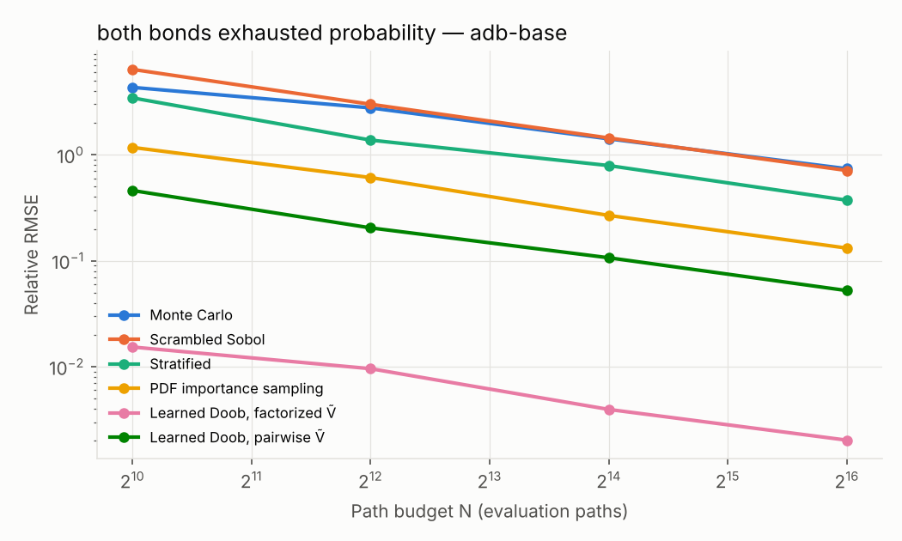
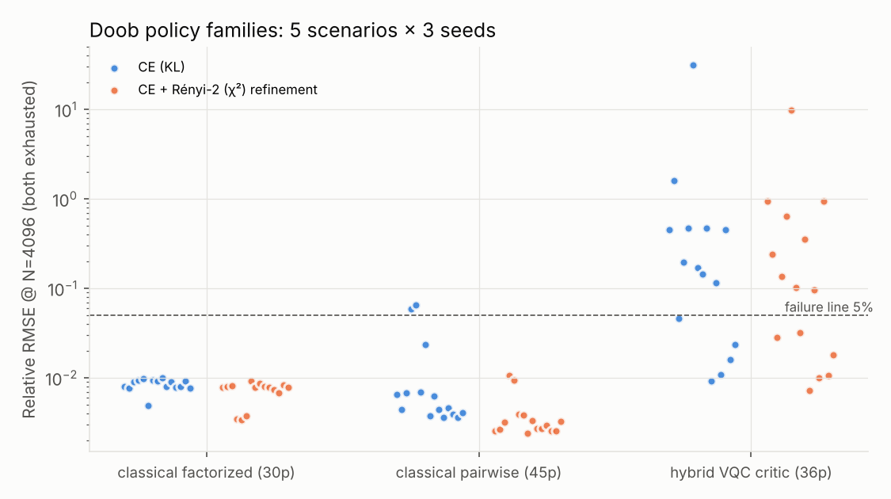
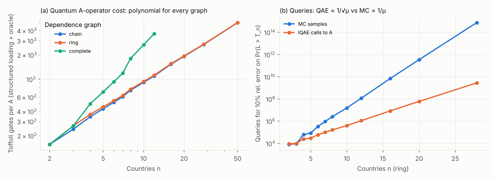

<a id="readme-top"></a>

<!-- PROJECT SHIELDS -->
![Python][python-shield] ![NumPy][numpy-shield] ![SciPy][scipy-shield] ![Tests][tests-shield] ![Status][status-shield]

<!-- PROJECT TITLE -->
<br />
<div align="center">
  <h2 align="center">Information-Theoretic Reinforcement Learning for Joint Catastrophe Tails</h2>
  <h3 align="center">Quantum Enhanced Rényi-Doob Policy Optimization</h3>

  <p align="center">
    ADB Quantum Challenge: Joint-Loss Modelling for Natural Catastrophe Risk (Phase 1 prototype)
    <br />
    <a href="REPORT.md"><strong>Read the technical report »</strong></a>
    <br />
    <br />
    <a href="#usage">Reproduce</a>
    &middot;
    <a href="#key-results">Key results</a>
    &middot;
    <a href="#roadmap">Phase 2 roadmap</a>
  </p>
</div>

<!-- TABLE OF CONTENTS -->
<details>
  <summary>Table of Contents</summary>
  <ol>
    <li><a href="#about-the-project">About The Project</a>
      <ul>
        <li><a href="#method-in-one-picture">Method in one picture</a></li>
        <li><a href="#key-results">Key results</a></li>
        <li><a href="#what-we-do-not-claim">What we do not claim</a></li>
        <li><a href="#built-with">Built With</a></li>
      </ul>
    </li>
    <li><a href="#getting-started">Getting Started</a></li>
    <li><a href="#usage">Usage</a></li>
    <li><a href="#project-layout">Project Layout</a></li>
    <li><a href="#roadmap">Roadmap</a></li>
    <li><a href="#license">License</a></li>
    <li><a href="#contact">Contact</a></li>
    <li><a href="#acknowledgments">Acknowledgments</a></li>
  </ol>
</details>

<!-- ABOUT THE PROJECT -->
## About The Project



Catastrophe bonds pooled across countries are priced and stress-tested on **joint tails**: how
often several countries' bonds pay out, or are exhausted, together. For the ADB benchmark
(Kyrgyz Republic + Tajikistan, earthquake + precipitation, 3-year term) the probability that
**both bonds are exhausted is ≈ 3×10⁻⁵**. Monte Carlo returns exactly zero for it in 95–100% of
runs at 1,024 paths, and exact enumeration grows as 10ⁿ with portfolio size.

This repository is a reproducible prototype of:

* **RDPO (Rényi-Doob Policy Optimization).** The zero-variance importance-sampling proposal is the
  optimal policy of a KL-regularised (soft) control problem, i.e. the Doob h-transform of the loss
  process. RDPO learns a compact O(n)-parameter approximation of it by cross-entropy policy
  search. It then refines the policy with a **Rényi-2 (χ²) policy gradient**, because χ², not KL,
  controls IS variance.
* **Q-RDPO (quantum estimation stage).** Payouts are capped, so every Poisson source has a finite
  increment law, and the term distribution loads **exactly** into a structured quantum circuit
  with **O(n + |E|) qubits and gates for any dependence graph**. Amplitude estimation on it needs
  O(1/√μ) queries vs O(1/μ) for Monte Carlo.
* **Honest classical baselines,** including our own strongest ones: zero-variance backward
  induction and an exact tensor network compressed in a tilted (Doob) gauge.

### Method in one picture

```
                 soft Bellman / Doob h-transform
 ADB model ──►  π*(y|s) ∝ p(y)·V(s⊕y)   (zero-variance IS policy)
                        │
          ┌─────────────┴──────────────┐
          ▼                            ▼
  RDPO (classical, today)        Q-RDPO (quantum, scalable concept)
  log Ṽ_θ: O(n) features         exact Poisson-source loading circuit
  CE policy search (KL)          O(n+|E|) qubits & gates
  + Rényi-2 policy gradient (χ²) + IQAE: O(1/√μ) queries
          │                            │
          └──────► unbiased estimates of the 5 portfolio targets ◄──────┘
```

### Key results

| Result | Number | Where |
|---|---|---|
| Exact reproduction of the brief (3 checkpoints + 25 reference values) | all match; stop-loss to the dollar | REPORT §1 |
| RDPO on "both bonds exhausted" (5 scenarios × 3 seeds, N = 4,096) | median rel. RMSE **0.30%**, 0/15 failures | REPORT §7.4 |
| vs. best reference baseline (MC / Sobol / stratified / IS) at equal paths | **≈ 100–400× lower error** | REPORT §3, §7.4 |
| Rényi-2 repair of a failed CE fit (exact per-path std) | 14.5 → 0.60 | REPORT §7.4 |
| Structured quantum loading for ADB, per call of A | 52 qubits, 156 Toffolis (vs 97 / 3,808 generic) | REPORT §7.1 |
| QAE vs MC queries, Pr(L > T), 28-country ring | 2.8×10⁹ vs 7.6×10¹⁴ | REPORT §7.2 |
| Exact tilted MPS, 28 countries (chain / ring) | χ = 9 / 58, 7–68 s, tail error ≤ 1e-9 | REPORT §5 |

<p align="center">
  
  
</p>

### What we do not claim

* **No quantum advantage on the 2-country benchmark.** Exact enumeration takes 0.2 ms, while a
  fault-tolerant QAE run needs ~10¹⁰ T gates.
* For **sparse dependence graphs** (chain, ring, star) an exact tilted tensor network solves the
  problem classically at any portfolio size. A quantum advantage is only plausible for **dense
  dependence graphs and very rare targets**.
* The **variational quantum critic** for the RDPO policy is a scalable architecture, but it was
  unreliable on the rarest target (9–10/15 failed runs), and at constant depth it is classically
  simulable.
* Quantum circuits are simulated **exactly and noise-free** in NumPy; resource counts come from
  component formulas, not compiled circuits.

<p align="right">(<a href="#readme-top">back to top</a>)</p>

### Built With

* [![Python][python-shield]](https://www.python.org/) 3.13
* [![NumPy][numpy-shield]](https://numpy.org/) / [![SciPy][scipy-shield]](https://scipy.org/), plus matplotlib and pytest
* Our own exact real-amplitude statevector simulator (QCBM, VQC), sparse statevector simulator
  (structured loading), and IQAE emulator. **No quantum SDK or hardware.**

<p align="right">(<a href="#readme-top">back to top</a>)</p>

<!-- GETTING STARTED -->
## Getting Started

### Prerequisites

Python ≥ 3.11, CPU only (the full pipeline was run on 4 cores).

### Installation

1. Clone the repository
   ```sh
   git clone https://github.com/CL0908/adb-quantum-challenge.git
   ```
2. Install the dependencies
   ```sh
   pip install numpy scipy matplotlib pytest
   ```
3. Run the tests (32 tests, ~10 s)
   ```sh
   python -m pytest -q tests/
   ```

<p align="right">(<a href="#readme-top">back to top</a>)</p>

<!-- USAGE -->
## Usage

Each phase writes `results/<phase>.json`. Fixed seeds are recorded in every file.

```sh
PYTHONPATH=. python -m src.model.exact              # Phase 0  exact reproduction       (< 1 s)
PYTHONPATH=. python -m src.baselines.run_baselines   # Phase 1  reference baselines       (~ 3 min)
PYTHONPATH=. python -m src.learned.run_learned       # Phase 2  learned Doob policy (CE)  (~ 40 min)
PYTHONPATH=. python -m src.quantum.run_quantum       # Phase 3  QCBM, IQAE, resources     (~ 15 min)
PYTHONPATH=. python -m src.tensor.scaling            # Phase 4  tilted MPS scaling        (~ 20 min)
PYTHONPATH=. python -m src.causal.latent_dimension   # Phase 5  quantum latent dimension  (~ 20 min)
PYTHONPATH=. python -m src.quantum.run_structured    # Phase 6  Q-RDPO structured loading (~ 5 min)
PYTHONPATH=. python -m src.hybrid.run_hybrid         # Phase 6  RDPO, VQC critic, entropy (~ 10 min)
PYTHONPATH=. python -m src.figures                   # figures/
```

<p align="right">(<a href="#readme-top">back to top</a>)</p>

## Project Layout

```
src/model/                         exact ADB model (compound Poisson fit, CTMC, rain, term, targets)
src/baselines/                     MC, scrambled Sobol, stratified, IS, zero-variance Doob
src/learned/                       RDPO: log-linear Doob policy, CE policy search, Rényi-2 refinement
src/quantum/                       QCBM, IQAE, resource model, structured Poisson-source loading
src/hybrid/                        variational quantum critic, entropy diagnostics
src/tensor/                        n-country synthetic model, tilted-gauge MPS, exact targets
src/causal/                        classical (NMF) vs quantum (PSD) latent dimension
tests/                             32 tests
results/  figures/                 all numbers and plots used in REPORT.md
```

<!-- ROADMAP -->
## Roadmap

- [x] Phase 0: exact reproduction of the brief
- [x] Phase 1: reference baselines + zero-variance backward induction
- [x] Phase 2: learned Doob policy (CE policy search)
- [x] Phase 3: QCBM proposal, IQAE emulation, resource estimates
- [x] Phase 4: exact tilted-gauge tensor networks to 28 countries
- [x] Phase 5: classical vs quantum latent dimension
- [x] Phase 6: RDPO (Rényi-2 refinement), structured quantum loading, variational quantum critic
- [ ] Scalable RDPO for n ≥ 4 countries (source-level policy, no 10ⁿ normaliser)
- [ ] End-to-end Q-RDPO: load the RDPO proposal in the structured circuit + variance-based QAE
- [ ] Dense-dependence benchmark (degree-normalised complete / random graphs) where MPS χ blows up
- [ ] Noise models, shot noise and hardware runs for the QCBM / VQC components

See [REPORT.md §8](REPORT.md) for the Phase 2 plan and risks.

<p align="right">(<a href="#readme-top">back to top</a>)</p>

<!-- LICENSE -->
## License

No license has been chosen yet; all rights reserved until one is added.

<!-- CONTACT -->
## Contact

Project link: [https://github.com/CL0908/adb-quantum-challenge](https://github.com/CL0908/adb-quantum-challenge)

<!-- ACKNOWLEDGMENTS -->
## Acknowledgments

* ADB Quantum Challenge brief and reference values
* Glasserman (2003); Owen (1997); Egger et al. (2021); Grinko et al. (2021); Montanaro (2015);
  Chakrabarti et al. (2021); Todorov (2009); Kappen (2005); Arouna (2004); Fawzi et al. (2015);
  Glasser et al. (2019). Full list in [REPORT.md §10](REPORT.md).
* README layout: [Best-README-Template](https://github.com/othneildrew/Best-README-Template)
* **AI use:** code and report were written with Claude Code (Anthropic) following the team's plan;
  every number comes from the scripts in this repository.

<p align="right">(<a href="#readme-top">back to top</a>)</p>

<!-- MARKDOWN LINKS & IMAGES -->
[python-shield]: https://img.shields.io/badge/Python-3.13-3776AB?style=for-the-badge&logo=python&logoColor=white
[numpy-shield]: https://img.shields.io/badge/NumPy-013243?style=for-the-badge&logo=numpy&logoColor=white
[scipy-shield]: https://img.shields.io/badge/SciPy-8CAAE6?style=for-the-badge&logo=scipy&logoColor=white
[tests-shield]: https://img.shields.io/badge/tests-32%20passing-2ea44f?style=for-the-badge
[status-shield]: https://img.shields.io/badge/status-Phase%201%20prototype-orange?style=for-the-badge
