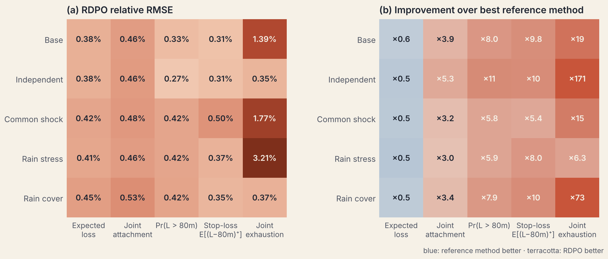
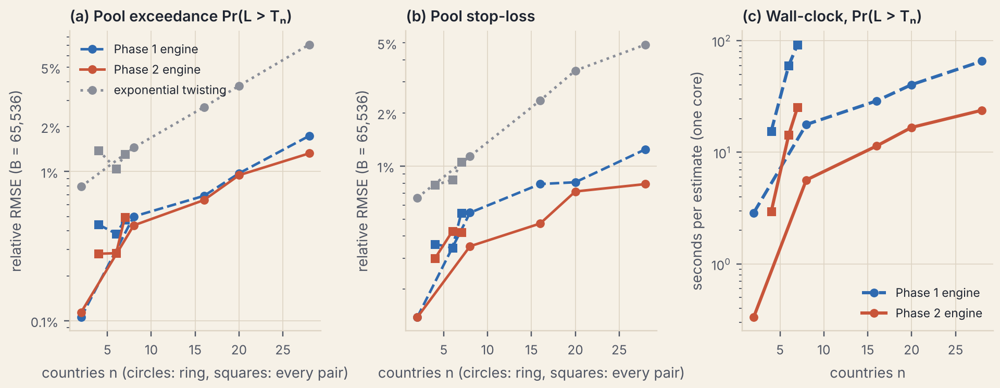

<a id="readme-top"></a>

![Python][python-shield] ![NumPy][numpy-shield] ![SciPy][scipy-shield] ![Tests][tests-shield] ![Status][status-shield]

<br />
<div align="center">
  <h2 align="center">Information-Theoretic Reinforcement Learning for Joint Catastrophe Tails</h2>
  <h3 align="center">Quantum Enhanced Rényi-Doob Policy Optimization (RDPO)</h3>
  <p align="center">
    ADB Quantum Challenge: Joint-Loss Modelling for Natural Catastrophe Risk · Phase 1
    <br /><br />
    <a href="docs/RDPO_Proposal.pdf"><strong>Technical proposal (PDF) »</strong></a>
    &middot;
    <a href="#reproduce">Reproduce</a>
    &middot;
    <a href="#key-results">Key results</a>
    &middot;
    <a href="REPORT.md">Research log</a>
  </p>
</div>

<details>
  <summary>Table of Contents</summary>
  <ol>
    <li><a href="#about-the-project">About the project</a></li>
    <li><a href="#key-results">Key results</a></li>
    <li><a href="#what-we-do-not-claim">What we do not claim</a></li>
    <li><a href="#reproduce">Reproduce</a></li>
    <li><a href="#project-layout">Project layout</a></li>
    <li><a href="#roadmap">Roadmap</a></li>
    <li><a href="#license">License</a> · <a href="#contact">Contact</a> · <a href="#acknowledgments">Acknowledgments</a></li>
  </ol>
</details>

## About the project



Pooled catastrophe bonds are priced and stress-tested on **joint tails**: how often several countries
attach, exceed a pooled threshold or exhaust their cover together. For the ADB benchmark (Kyrgyz
Republic + Tajikistan, earthquake + precipitation, 3-year term) the joint-exhaustion probability is
≈ 3×10⁻⁵, and plain Monte Carlo returns zero in most runs at practical budgets.

**RDPO** treats the zero-variance importance-sampling measure as what it is mathematically: the Doob
h-transform of the loss process, i.e. the optimal policy of a KL-regularised (soft) control problem.

1. **Source-level formulation.** The term law is an exact product of independent Poisson sources with
   finite, capped increment laws, so a scenario is a sequence of K = 2n + 2|E| small draws.
2. **Learned soft-value policy.** O(n + |E|) features: per country, per dependence edge, and target
   progress. Sources that cannot affect the payoff are frozen at their true law, as the exact Doob
   policy prescribes.
3. **Information-theoretic training.** An exponential-twist warm start, then multilevel cross-entropy
   (KL), then a Rényi-2 (χ²) policy gradient, which targets the divergence that actually controls variance.
4. **Fixed total budget.** Training is charged to the path budget; eligible training batches are recycled
   into an exactly unbiased estimator; the final stage uses randomised quasi-Monte Carlo.
5. **Quantum-ready estimation stage (future feature).** The same change of measure loads *exactly* into
   a structured amplitude-estimation circuit with O(n + |E|) qubits and gates and bounded weights.

<p align="right">(<a href="#readme-top">back to top</a>)</p>

## Key results

All numbers come from `results/*.json` (fixed seeds), with **training included in every budget**.

### Phase 1 engine (RDPO v1)

| Result | Number |
|---|---|
| Benchmark, 5 scenarios × 5 targets, 16,384 paths | more accurate than the best reference method in **20/25** cells |
| Joint exhaustion (≈ 3×10⁻⁵) | **×6.3 to ×171** lower error than the best reference method (median ×19) |
| Scaling, ring of 2 → 28 countries, Pr(L > Tₙ) down to **1.3×10⁻¹³** | relative error 0.1% → 4.2% (plain Monte Carlo would need ~10¹⁵ paths) |
| Ablation | indispensable: cross-entropy (×81), twist warm start (×37 at scale), target-relevance freezing (×2.6) |

### Phase 2 engine (RDPO v2: roadmap WP1 + WP3)

| Result | Number |
|---|---|
| Engine | table-driven, identical policy (tested): **6.5–9.9×** rollout throughput; exact compressed training |
| Scaling study (8 portfolio sizes up to 28 countries, 24 replications, same seeds) | more accurate than Phase 1 in **13/16** portfolio-wide settings (up to ×1.7); beats exponential twisting in **16/16**; 2.3–11.9× less wall-clock |
| Coverage of 95% intervals (portfolio-wide targets) | 88–100%, mean 95% |
| Pair targets (joint attachment / exhaustion) | **exact** for any portfolio size in ≤ 3 ms (pair reduction) |
| Overnight transfer (sleep phase) | small-budget error cut by ×1.8–×84 |
| Benchmark | keeps 20/25; expected loss closer to Sobol (×0.6–0.8 instead of ×0.5) |

### Real-world tests

| Test | Finding |
|---|---|
| USGS catalogue, M ≥ 5.5, 1965–2016 | Poisson arrivals supported; 25%-payout trigger ≈ M7; 29–75% of large quakes reach both countries (brief: 7.5%) |
| Loss records (NOAA 1900–2020, EM-DAT 1990–2020) | 120-year record rejects independence (p = 0.005); shared share **48% (12–79%)**; short records uninformative |
| Implied bond risk | joint exhaustion **≈ 3× the brief's base case** (4.0×10⁻⁵–1.5×10⁻⁴) |
| Data-calibrated five-country Central Asian pool | RDPO ×1.7–×15 more accurate than the best of Monte Carlo / twisting on rare questions, against exact answers; weak spot: pair exhaustion (9.5%, answered exactly instead) |

### Quantum stage (projected, future feature)

| Result | Number |
|---|---|
| Loading | exact twisted loader + bitwise weight oracle; amplitude-estimation calls at 28 countries cut from 2.8×10⁹ to 3.4×10⁴ |
| Falsifiable wall-clock criterion | needs **8.2×10⁴ – 4.4×10⁶×** faster hardware to beat classical RDPO |
| Error-mitigation trust boundary | mitigation worse than none in 21–38% of instances; pilot-disagreement guard caps p99 error at ≤ 0.17 |

<p align="center">
  
</p>

## What we do not claim

* **No quantum advantage in Phase 1.** No quantum processor is available; quantum results are exact
  simulations and resource projections, presented as a future feature.
* **Sobol wins on smooth targets.** For expected loss, scrambled Sobol is more accurate than RDPO.
* **Error bars under heavy tails.** Coverage drops below nominal in a few rare-target settings (as low
  as 78% in one benchmark cell).
* **Budget competition at scale.** At 28 countries the one-parameter twist beats RDPO on the stop-loss
  (3.5% vs 5.9%).
* **Real-data scope.** Earthquake assumptions are checked against public catalogues and loss records, and a data-calibrated five-country pool is tested; rainfall is not calibrated from data, and no bond payout history exists to backtest against.
* **Classical exact methods suffice for sparse dependence.** Exact tilted tensor networks solve chain,
  star and ring portfolios exactly.

<p align="right">(<a href="#readme-top">back to top</a>)</p>

## Reproduce

Python ≥ 3.11, CPU only.

```sh
pip install -r requirements.txt
```

```sh
python -m pytest -q tests/
```

Final experiments (≈ 7 CPU-hours in total; set `OMP_NUM_THREADS=1` when running them in parallel):

```sh
PYTHONPATH=. python -m src.rdpo.experiments e1   # benchmark: 5 scenarios x 5 targets x 3 budgets
PYTHONPATH=. python -m src.rdpo.experiments e2   # scaling to 28 countries vs exact tensor networks
PYTHONPATH=. python -m src.rdpo.experiments e3   # ablation
PYTHONPATH=. python -m src.rdpo.experiments_v2 throughput|scale|bench|transfer   # Phase 2 engine (resumable)
PYTHONPATH=. python -m src.realdata.eq_check            # real catalogue check
PYTHONPATH=. python -m src.realdata.loss_backtest       # loss-data backtest
PYTHONPATH=. python -m src.realdata.central_asia_pool   # data-calibrated 5-country pool
```

Build the proposal PDF. This needs Node.js with Playwright/Chromium for printing and MathJax for
equations; every number is filled in from `results/`.

```sh
cd docs/paper && npm install && cd ../..
```

```sh
PYTHONPATH=. python -m src.viz.build_paper
```

Earlier phases (baselines, tensor networks, quantum simulations) have their own drivers. See
[REPORT.md](REPORT.md) and the `run_*` modules in `src/`.

## Project layout

```
src/rdpo/            final estimator: problem (source form), policy, budgeted training, experiments
src/model/           exact ADB model (compound Poisson fit, CTMC, rain, term, targets)
src/baselines/       MC, scrambled Sobol, stratified, brief IS, zero-variance backward induction
src/tensor/          n-country model, tilted-gauge MPS (exact references), bond-dimension scaling
src/quantum/         structured & twisted loading, IQAE/MLAE emulation, QCBM, NISQ analysis, resources
src/learned/ src/scale/ src/hybrid/ src/causal/   earlier prototypes (documented in REPORT.md)
src/realdata/        real-world checks: USGS catalogue, NOAA / EM-DAT losses, calibrated Central Asian pool
api/estimate.py      estimation API (Vercel Python function) for a future web front end
data/real/           cached public data (sources in file headers)
src/viz/             figure style, concept art, data figures, paper build
docs/paper/          manuscript source (proposal.md, references.bib, paper.css)
docs/RDPO_Proposal.pdf   the technical proposal
results/  figures/   all numbers and plots; tests/  50 tests
```

## Roadmap

- [x] Exact reproduction of the brief (all checkpoints and 25 reference values)
- [x] Final RDPO: source-level soft-RL policy, KL → χ² training, fixed-budget unbiased estimation
- [x] Benchmark, scaling (to 28 countries) and ablation at fixed total budget
- [x] Quantum-ready stage: exact structured / twisted loading, resource estimates, NISQ analysis
- [x] RDPO v2: table-driven engine, exact compressed training, stage-dependent and spline soft values, exact pair reduction, transfer warm start
- [ ] WP1 GPU batching · WP2 realistic multi-peril portfolios · WP3 heavy-tail diagnostics, larger dense references
- [x] Quantum evidence standard: wall-clock break-even map, noise/miscalibration study with trust guard
- [ ] WP4 compiled quantum stage + AI-for-Quantum · WP5 web app with AI analyst agent and MCP tools · WP6 validation and delivery

## License

No license has been chosen yet; all rights reserved until one is added.

## Contact

Tan Chun Loong · [https://github.com/CL0908/adb-quantum-challenge](https://github.com/CL0908/adb-quantum-challenge)

## Acknowledgments

ADB Quantum Challenge brief and reference values. README layout:
[Best-README-Template](https://github.com/othneildrew/Best-README-Template). **AI use:** developed with
Claude Code (Anthropic) as an AI pair-programmer and writing assistant, following the author's research
plan; all numbers come from the scripts in this repository.

<p align="right">(<a href="#readme-top">back to top</a>)</p>

[python-shield]: https://img.shields.io/badge/Python-3.13-3776AB?style=for-the-badge&logo=python&logoColor=white
[numpy-shield]: https://img.shields.io/badge/NumPy-013243?style=for-the-badge&logo=numpy&logoColor=white
[scipy-shield]: https://img.shields.io/badge/SciPy-8CAAE6?style=for-the-badge&logo=scipy&logoColor=white
[tests-shield]: https://img.shields.io/badge/tests-50%20passing-2ea44f?style=for-the-badge
[status-shield]: https://img.shields.io/badge/status-Phase%201%20proposal-C8553A?style=for-the-badge
