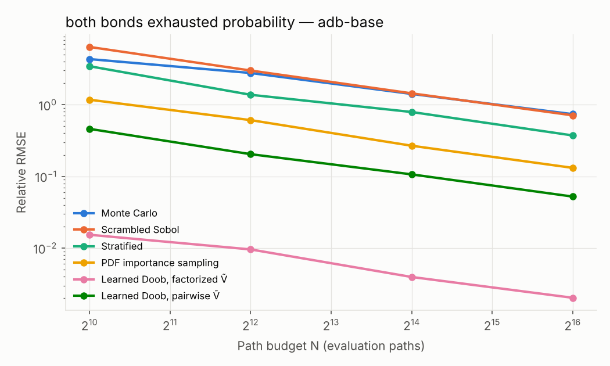
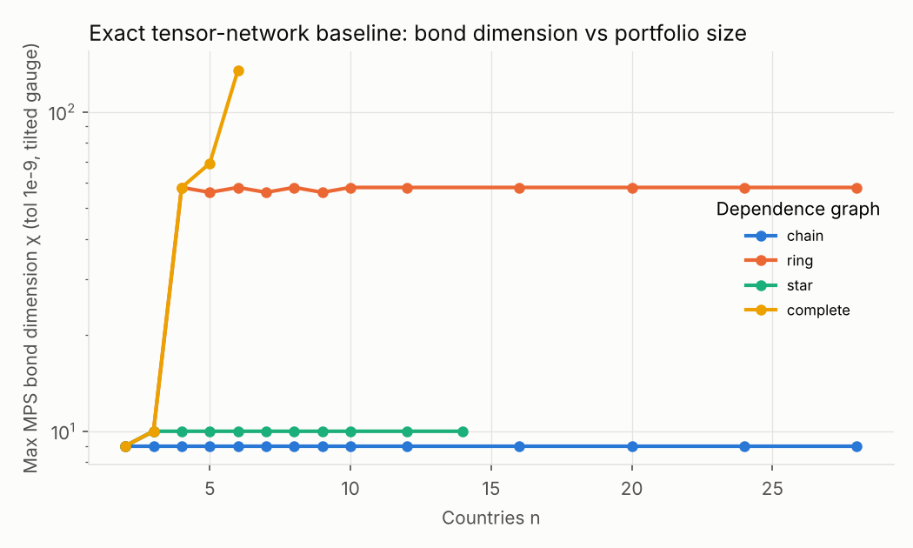
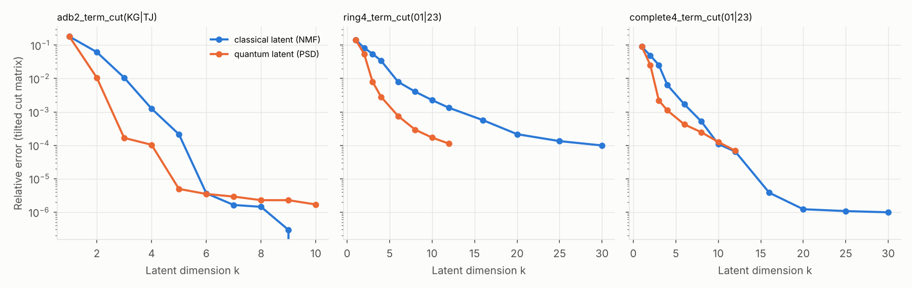

# ADB Quantum Challenge — Technical Report (Phase 1 prototype)

**Joint-loss modelling for natural catastrophe risk: learned Doob h-transforms, quantum proposals,
amplitude estimation and tensor networks.**

All numbers below come from the scripts in this repository (`results/*.json`, fixed seeds).
"Query" means one sampled three-year path for classical methods and one application of the
state-preparation operator *A* for amplitude estimation.

---

## 0. Executive summary

| # | Finding | Evidence |
|---|---|---|
| 1 | The ADB model is reproduced **exactly**: all 3 checkpoints and all 25 Table-5 values, to published precision (stop-loss to the dollar). | §1, `tests/test_exact.py` |
| 2 | **Structural fact:** capped addition is a commutative monoid action, so the 3-year convolution equals the 3-year CTMC, `P_term = expm(3G)`, to 1e-16. The n-country term distribution is therefore a product of commuting 1- and 2-site "gates" applied to `|0…0⟩`. | §1.3, `test_term_equals_three_year_ctmc` |
| 3 | Our **learned Doob h-transform** (30-parameter log-linear Ṽ, cross-entropy) estimates "both bonds exhausted" with **43–105× lower relative RMSE** than the best of the brief's four baselines at the same budget, in all five scenarios. Even counting its 10–12k training paths against its budget, it is **21–72× better**. Gains on the other targets are modest (≈4× on stop-loss) or absent (E[L]). It is unbiased by construction. | §3, Fig. 1 |
| 4 | **IS→QAE cascade:** what matters for QAE is the *maximum* weighted payoff (amplitude a = μ/M), not the variance. iid proposals (PDF IS, log-linear, QCBM) barely raise *a* (3e-5 → ≤2e-4). Only the **state-dependent** learned Doob proposal raises it to 0.05, cutting IQAE calls 54× (1.6M → 29k). | §4.3 |
| 5 | **QCBM proposal:** an 8-qubit, 40-parameter Born machine (leak ≈ 2%) beats the brief's IS (4–11× lower per-path std on exhaustion) and the 10-parameter factorized classical family in 4 of 5 scenarios on exhaustion, but **never beats** a 15-parameter classical log-linear family, which is already KL-optimal among iid proposals. | §4.2 |
| 6 | **Resource estimate:** a fault-tolerant IQAE run at 1% relative error needs ~100 logical qubits and **1e11–5e11 T gates**, i.e. 10⁷–5×10⁷ s (months to over a year) on the stated surface-code assumptions. Exact enumeration takes 0.2 ms. **No quantum advantage exists on the 2-country benchmark, and we do not claim one.** | §4.4 |
| 7 | **Dequantization (risk 1 in the plan) is real for sparse dependence:** in a tilted ("Doob") gauge, an exact MPS computes all five targets to ≤1e-12 relative error, with **bond dimension constant in n** for chain (χ=9), star (χ=10) and ring (χ=58) topologies, up to **28 countries in ≤70 s**. This includes P(all exhausted) ≈ 1e-64. | §5, Fig. 2 |
| 8 | Bond dimension **grows with cut-width**: complete-graph dependence gives χ = 58 → 69 → 135 for n = 4 → 6, and χ grows with common-shock strength. This is the regime where the classical exact method breaks and a quantum method *might* matter. | §5.3 |
| 9 | A plain (untilted) SVD truncation **silently destroys tail targets** (2% error on the rarest target at tol 1e-12). Compressing in the Doob gauge fixes this. | §5.2 |
| 10 | **Quantum latent dimension (route C):** across country cuts, a k-dimensional quantum common cause (PSD factorization) fits the joint tail far better than a k-state classical one (e.g. 64× lower error at k=3 on the ADB cut). At **equal parameter count**, the classical model is as good or better. This is a *dimension* separation, not a parameter separation, and there is no feasibility separation. | §6 |

**Positioning.** The value of this submission is an honest map. (i) The best per-query accuracy on
the benchmark today is a *classical* learned Doob transform. (ii) For sparse dependence graphs,
exact tensor networks scale to large portfolios, which leaves no room for quantum advantage there.
(iii) The open regime is dense or cyclic dependence (high cut-width) and distributions learned from
data. That is where Phase 2 should test quantum proposals and quantum latent models, against the
classical baselines built here.

---

## 1. Problem and exact reproduction (Phase 0)

### 1.1 Model
Implemented exactly as specified in the brief (§3b): compound-Poisson fit of the tail
probabilities (`src/model/poisson_fit.py`), the 25-state EQ CTMC with shared events
(`annual.py`), rain with shared triggers, the 100-state annual distribution, the capped 3-year
convolution (`term.py`), the five targets (`targets.py`) and the five scenarios (`scenarios.py`).

### 1.2 Verification

| Checkpoint | Brief | Ours |
|---|---|---|
| shared EQ rate c | 0.0029667 | 0.0029667 |
| P(no EQ payout, 1 yr) | 92.62% | 92.619% |
| rain neither / one only / both | 96.526 / 1.474 / 0.526% | 96.526 / 1.474 / 0.526% |
| P(no payout of any kind, 1 yr) | 89.40% | 89.401% |

| Scenario | E[L] | Both pay | Pr(L>80m) | E[(L−80m)⁺] | Both exhausted |
|---|---|---|---|---|---|
| adb-base | 10.0635m | 4.4138% | 1.2047% | 282,355 | 0.003163% |
| adb-independent | 10.0635m | 2.7156% | 0.7186% | 171,266 | 0.000392% |
| adb-common-shock | 10.0635m | 5.0526% | 1.6066% | 385,043 | 0.004400% |
| adb-rain-stress | 11.1705m | 7.0464% | 1.3215% | 306,286 | 0.006925% |
| adb-rain-cover | 9.9701m | 4.4138% | 0.6997% | 170,927 | 0.003163% |

All values round to the brief's Table 5. The brief only publishes rounded values, so agreement is
checked to the printed precision (the plan's "1e-6 relative" criterion cannot be checked against
rounded references). We cross-checked independently in two ways: (a) explicit enumeration of all
10⁶ paths, which agrees to 1e-12; (b) a 2×10⁶-year simulation of the raw Poisson event process,
with no generator and no `expm`, which agrees within 5σ on all 25 EQ states.

### 1.3 A structural observation that drives the scaling analysis
Because `min(min(x,4)+min(y,4),4) = min(x+y,4)` and the rain flag is an OR, the
year-by-year capped convolution equals running the CTMC for three years:
`P_term = expm(3G) ⊗ Rain(3μ)`. This is verified to ≤3.3e-16 in all scenarios. Generators of
independent Poisson sources then commute, so for n countries

  P_term = Π_sources exp(3·G_source) |0…0⟩,

with single-country and pairwise (shared-event) factors. This is exactly a circuit of 1- and 2-site
gates on a product state, so its tensor-network complexity is set by how many shared-event
edges cross each cut (§5).

---

## 2. Classical bottleneck analysis (Phase 1)

Five estimators, path budgets N = 2^10 … 2^16, 200 replications (`src/baselines/`):
plain MC; scrambled Sobol (8 independent scrambles, t-interval with 7 dof); stratification by
first payout year with weights p₀^(k−1)(1−p₀); the brief's importance sampling (½ true + ½
loss-tilted); and **zero-variance backward induction**.

Relative RMSE at N = 65,536 (adb-base; all scenarios are in `results/baselines_summary.md`):

| method | E[L] | joint attach | Pr(L>T) | stop-loss | both exhausted |
|---|---|---|---|---|---|
| MC | 0.0077 | 0.017 | 0.035 | 0.044 | 0.74 |
| Sobol | **0.0006** | **0.0058** | 0.015 | 0.015 | 0.71 |
| stratified | 0.0032 | 0.0092 | 0.019 | 0.025 | 0.37 |
| PDF IS | 0.0043 | 0.013 | **0.013** | 0.015 | **0.13** |
| zero-variance Doob | 4e-16 | 2e-16 | 1e-16 | 2e-16 | 2e-15 |

* **The bottleneck is the joint tail.** At N = 1,024, 95–100% of plain-MC runs return exactly
  zero for "both exhausted". Even the best brief baseline (IS) has 13% relative error at 65k paths.
* **Zero-variance backward induction** (Doob h-transform with the exact value function
  V_t(s) = E[f | S_t = s]) gives every path weight × payoff = μ. On the 2-country model it is
  simply an exact method in disguise: building V *is* enumeration. It is our strongest classical
  baseline, not a result. The real question is how to approximate V compactly when 10ⁿ states
  cannot be stored.

---

## 3. Learned Doob h-transform (Phase 2)

### 3.1 Method (`src/learned/`)
* Log-linear value function `Ṽ_{θ,t}(s) = exp(θ_t · φ(s))`, one θ per year.
  * *factorized* φ: per-country threshold indicators 1[a≥k], 1[b≥k], r₁, r₂, giving 10 params/year
    and **O(n)** scaling. Ṽ = Π_i v_i(s_i).
  * *pairwise* φ: factorized plus cross-country terms (a·b, a·r₂, b·r₁, r₁r₂, 1[a=b=4]), giving
    15 params/year.
* Proposal `q_t(y|s) ∝ p(y) Ṽ_{θ,t}(s ⊕ y)`, defensively mixed with p (α = 5%). The likelihood
  ratio corrects any error in Ṽ, so **a bad Ṽ costs variance, never bias** (tested).
* Fitted by **multilevel cross-entropy**. Elite levels are defined on a score (min(L₁,L₂) or L)
  until the target event is reached. Each update is a *convex* weighted log-likelihood problem
  per year, solved with L-BFGS using analytic gradients. Discrete scores create quantile ties, so
  the level advances to the next attained value when the elite set exceeds 2ρN. Without this
  standard fix, CE stalls at USD 70m.
* No enumeration of V is used. The method only touches sampled paths and the annual distribution.

### 3.2 Results (100 replications per point; Fig. 1)

"Both bonds exhausted", relative RMSE. **"incl. training"** compares against the best baseline
given N + training paths (1/√N-scaled from its N = 65,536 value).

| Scenario | best brief baseline @N=4096 | learned (factorized) @4096 | ratio | ratio incl. training | ratio @65,536 |
|---|---|---|---|---|---|
| adb-base | 0.61 (IS) | 0.0096 | 64× | 28× | 65× |
| adb-independent | 1.21 (IS) | 0.0115 | 105× | 46× | 79× |
| adb-common-shock | 0.48 (IS) | 0.0102 | 47× | 26× | 50× |
| adb-rain-stress | 0.40 (IS) | 0.0090 | 44× | 21× | 43× |
| adb-rain-cover | 0.49 (IS) | 0.0089 | 55× | 31× | 63× |

(Training: 10–12k paths, 30 parameters. The "ratio" column for the headline uses the factorized
family only; it is not a hindsight best-of over families.)

Other targets (factorized family vs best baseline, N = 4096, across the five scenarios):
stop-loss **3–4×** better; joint attachment 1–2×; Pr(L>T) 1–3× better in four scenarios but
**worse in adb-base** (0.096 vs 0.052, a poor CE fit); **E[L]: worse** (Sobol is 2× better at
N = 4096 and 5× at 65,536 on this smooth, non-rare target, as Owen's theory predicts).

**Robustness caveat (honest).** CE fits are not uniformly reliable. On "both exhausted" the
45-parameter pairwise family produced heavy-tailed weights in 2 of 5 scenarios (relative RMSE
0.20–0.28, 20× worse than factorized). In the others it matched or beat factorized (e.g. 0.0040
vs 0.0089 on rain-cover), and it was the better family on Pr(L>T) in adb-base where factorized
failed. More features does not mean a better proposal under CE. Phase 2 must select the
proposal by pilot-run variance and effective sample size, not by family size.

**Acceptance (§3.4 of the plan):** "≥1 order of magnitude below the best PDF baseline at equal
query count on both-exhausted": **met in all five scenarios**, including when training cost is
charged.

---

## 4. Quantum proposals and amplitude estimation (Phase 3)

### 4.1 Setup (`src/quantum/`)
* **QCBM:** 8 qubits `|a₂a₁a₀ b₂b₁b₀ r₁ r₂⟩`, RY layer + L×(CZ ring + RY layer), L = 4
  (40 parameters). The simulator is an exact real statevector, and gradients use the exact
  parameter-shift rule (tested against finite differences). Invalid codes (a or b ≥ 5) are
  post-selected. Fitting only the post-selected distribution drove **99.9% of the mass into
  invalid codes**, so we optimise the *unnormalised* cross-entropy, which gives leak ≈ 1–3.5%.
* **Task:** fit the KL-optimal **iid** annual proposal q*(y) (computed exactly as the average
  annual marginal of the f-tilted path law), then use it for IS. Comparators: a factorized
  classical family (10 params) and a log-linear classical family (15 params).
* **IQAE:** the Grinko et al. (2021) algorithm with Clopper–Pearson intervals, emulated exactly
  from the ideal measurement law sin²((2k+1)θ). Noise is not modelled.

### 4.2 QCBM vs classical proposals
Exact per-path relative standard deviation of the IS estimator (lower is better; computed in
closed form, with no sampling noise):

| case | MC | PDF IS | factorized (10p) | log-linear (15p) | **QCBM (40p)** | KL-opt iid (100p) |
|---|---|---|---|---|---|---|
| base · exhausted | 178 | 34.7 | 9.40 | **4.53** | 5.96 | 4.53 |
| independent · exhausted | 505 | 68.3 | 5.54 | **5.53** | 6.38 | 5.54 |
| common-shock · exhausted | 151 | 31.6 | 10.6 | **4.39** | 5.97 | 4.39 |
| rain-stress · exhausted | 120 | 24.5 | 8.38 | **4.42** | 6.48 | 4.42 |
| rain-cover · exhausted | 178 | 32.8 | 9.40 | **4.53** | 5.58 | 4.53 |
| base · E[L] | 2.14 | 1.05 | 1.06 | **0.837** | 0.844 | 0.829 |
| base · joint attach | 4.65 | 3.26 | 3.07 | **1.70** | 1.87 | 1.57 |
| base · Pr(L>T) | 9.06 | 3.35 | 3.35 | **2.04** | 2.26 | 1.95 |
| base · stop-loss | 12.0 | 3.77 | 2.44 | **1.69** | 1.94 | 1.68 |

* The QCBM is never worse than the brief's IS: it is 4–11× better on exhaustion. It beats the
  factorized classical family on exhaustion in 4/5 scenarios and on all 4 other targets. **Plan
  acceptance ("QCBM not inferior to a classical parameterized proposal in ≥1 scenario") is met
  against the factorized family. It is not met against the log-linear family, which is
  essentially KL-optimal and which the QCBM never beats.** We state this plainly: on this model,
  quantum expressivity does not help an iid proposal.
* The learned **state-dependent** Doob proposal (§3) reaches per-path relative std ≈ 0.36–0.8
  on exhaustion, 5–12× below the best *iid* proposal. Conditioning on the running state matters
  far more than the expressivity of the iid family.

### 4.3 IS → QAE cascade: amplitude is set by max weight, not variance
For QAE, A loads the proposal and rotates an objective qubit by g = w·f/M ∈ [0,1], so
a = μ/M with M = max_paths w·f. Exact values from enumerating all 10⁶ paths, plus IQAE emulation
(50 runs, target half-width 1% of μ at 95% confidence; achieved RMSE ≈ 0.1–0.2% of μ):

| proposal loaded into A | a = μ/M | IQAE A-calls | max Grover power k | classical IS paths for the same RMSE |
|---|---|---|---|---|
| none (load p) | 3.2e-5 | 1.59M | 8,732 | 2.1e10 |
| PDF IS | 1.9e-4 | 1.03M | 5,335 | 1.2e9 |
| log-linear iid | 1.5e-4 | 1.14M | 5,947 | 1.9e7 |
| QCBM iid | 2.8e-6 | 7.36M | 40,862 | 3.9e7 |
| **learned Doob (state-dependent)** | **0.051** | **29k** | **204** | 1.7e5 |

* The plan's premise that "IS lifts the amplitude to O(0.1)" holds **only for the
  state-dependent proposal**. iid proposals lower the variance but leave rare paths with huge
  weights, which keeps M/μ at 10³–10⁵. The QCBM *lowers* a, because a few paths have tiny q.
  For QAE the relevant norm is L∞, not L2. This motivates variance-based QAE (Montanaro 2015),
  which costs Õ(σ/ε) instead of O(M/ε), as a Phase 2 item.
* The quadratic speedup in **query count** is real: at matched RMSE, IQAE uses 13,000× fewer
  queries than MC without IS, and ≈6× fewer than classical sampling with the learned Doob
  proposal.

### 4.4 Resource estimation (`src/quantum/resources.py`)
Component formulas (all assumptions are parameters in the code): 3×8-qubit path register;
Möttönen exact state preparation (255 rotations/year) or the QCBM circuit; saturating adders for
capped accumulation; QROM log-weight lookups (Babbush et al. 2018); a 16-bit fixed-point
weight/angle; a piecewise-cubic arcsin√· evaluation; Ross–Selinger rotation synthesis; Toffoli = 4T.
Surface code with p_phys = 1e-3, 1 µs cycles, and 4 magic-state factories.

"Both exhausted" at 1% target half-width:

| A-operator | logical qubits | Toffoli / A | A-calls | total T-count | code distance | physical qubits | runtime |
|---|---|---|---|---|---|---|---|
| exact load p (no IS) | 97 | 3.8k | 1.59M | 1.7e11 | 33 | 2.4e5 | ~180 days |
| exact load PDF-IS | 97 | 3.8k | 1.03M | 1.1e11 | 31 | 2.1e5 | ~110 days |
| QCBM proposal | 97 | 3.8k | 7.36M | 2.4e11 | 33 | 2.4e5 | ~250 days |
| learned Doob (state-dep.) | 105 | 395k | 29k | 5.2e11 | 33 | 2.5e5 | ~550 days |

* The T-count is dominated by rotation synthesis in state preparation. A state-dependent proposal
  needs rotations multiplexed on the 8-qubit running state (2¹⁶ angles per year), so each call
  costs ~100× more and wipes out the 54× reduction in calls. **There is no net win from the
  IS→QAE cascade in this construction.**
* For comparison, exact enumeration takes 0.2 ms, and the classical learned Doob IS reaches 1%
  with ≈1–6k paths plus ≈12k training paths, i.e. milliseconds. As in Chakrabarti et al. (2021)
  for derivative pricing, any advantage requires problem sizes where classical exact methods
  fail (§5) *and* cheaper loading (e.g. QROM-based state preparation, or loading the structured
  Poisson-source circuit of §1.3 directly instead of an arbitrary distribution).
* **NISQ route** (QCBM as a proposal *sampler* only, no QAE): 8 qubits, depth 9, 32 two-qubit gates
  per shot, and ≈12.6k shots for 4,096 paths (≈2% leak). This is feasible on current hardware,
  but by §4.2 it gives no accuracy gain over a classical log-linear proposal.

---

## 5. Tensor networks: the strongest classical baseline at scale (Phase 4)

### 5.1 Method (`src/tensor/`)
A synthetic n-country model on a dependence graph. Each country has a 10-dim site (a ∈ 0..4,
r ∈ {0,1}); countries alternate the KG/TJ parameters. Each graph edge carries a shared-EQ source
(the ADB rule for c_ij) and a shared-rain source (25% of rate ÷ max degree). Each country keeps
its total rates. For n = 2 this is exactly the ADB model: the MPS reproduces Table 5 to 1e-10
(test). By §1.3 the term law is a product of local kernels. We apply them as MPOs to a product
MPS (long-range edges via operator-Schmidt decomposition), recompress with SVD, then contract
the five targets **exactly** with a left-to-right transfer that carries the running loss (in
USD 2.5m units) and the number of paying countries. Threshold for n countries: T_n = 40m·n.

### 5.2 Tail-aware compression: the Doob gauge
Frobenius-norm SVD truncation discards exactly the small tail entries that the targets need.
We compress the **tilted** tensor p̃(x) = p(x)·Π_i g_i(x_i) with g_i = 1/(independent-model
marginal). The tilt is a diagonal change of gauge on each site, the tensor-network analogue of
the h-transform, and it is undone exactly during contraction. Validation against dense 10ⁿ
enumeration (worst relative error over the five targets, n ≤ 6):

| topology | plain SVD tol 1e-12 | **tilted** tol 1e-12 | tilted tol 1e-9 | tilted tol 1e-6 |
|---|---|---|---|---|
| chain | 7e-10 | **2e-14** (χ=10) | 3e-10 (χ=9) | 1e-6 (χ=7) |
| ring | 4e-6 | **3e-13** (χ=82) | 5e-10 (χ=58) | 2.5e-6 (χ=35) |
| complete | **6.7e-4** (n=5) | **8e-13** (χ=92) | 1.4e-9 (χ=69) | 2e-6 (χ=43) |

### 5.3 Scaling (Fig. 2)

* **Chain, star, ring:** χ is constant in n (9 / 10 / 58 at tol 1e-9). All targets for **28
  countries** take 7 s (chain) to 68 s (ring). For example, ring with n = 28: P(L>T) = 1.3e-13 and
  P(all exhausted) = 7.8e-64, values no sampling method could estimate. **For sparse dependence
  the problem is classically easy at any portfolio size.** This is the dequantization risk of
  the plan, now quantified.
* **Complete graph:** χ = 58, 69, 135 for n = 4, 5, 6, and runtime 3 s → 67 s. The bond
  dimension tracks the number of shared-event edges crossing the middle cut (cut-width ~ n²/4).
* **Dependence strength** (n = 8 ring, tol 1e-9): χ = 4, 52, 58, 70, 83, 88 for m = 0, 0.5, 1,
  2, 4, 6. For the n = 6 complete graph: χ = 6, 108, 135, 169 for m = 0, 0.5, 1, 2 (m ≥ 4 is
  infeasible: shared rates would exceed total rates).
* **Structural condition for the classical method to blow up:** large cut-width / pathwidth of
  the dependence graph combined with non-negligible shared-event rates. Because shared shocks are
  rare, the numerical rank across a cut grows only polynomially with the number of crossing edges
  at fixed tolerance (each extra simultaneous cross-cut event costs a factor of ~c·T ≈ 0.01).
  This is milder than the worst case, and it is a further reason for caution about quantum claims.

---

## 6. Quantum vs classical latent dimension (Phase 5, scoped)

### 6.1 What can and cannot be separated
For a bipartite joint P(x,y) across a cut (e.g. KG | TJ), a classical common cause needs
|Λ| ≥ rank₊(P) (nonnegative rank). A quantum common cause with local measurements,
P(x,y) = Tr[ρ(E_x⊗F_y)], needs local dimension ≥ rank_psd(P) (PSD rank; Fiorini et al. 2012;
Fawzi et al. 2015). With no inputs and a single measurement **there is no Bell-type feasibility
separation**: any P has a classical model of size min(|X|,|Y|). Only *dimension* can separate.
We dropped indefinite causal order as planned (no natural mapping to this task).

### 6.2 Experiment (`src/causal/latent_dimension.py`)
We fit the tilted cut matrix (diagonal scaling preserves both ranks) with the best k-state NMF
(HALS, NNDSVD + random restarts) and the best real k×k PSD factorization (Gram-parametrised
L-BFGS). Both give heuristic **upper bounds** on approximation error at dimension k, not
certificates. An earlier version used multiplicative-update NMF, which under-converged by up to
170× and exaggerated the gap. We replaced it with HALS, so the classical side gets the
stronger optimiser.

**adb2_term_cut(KG|TJ)** (matrix 10x10; numerical rank 7 at 1e-6, 10 at 1e-12)

| k | NMF (classical) | PSD (quantum) | ratio | params/outcome NMF / PSD |
|---|---|---|---|---|
| 1 | 1.81e-01 | 1.81e-01 | 1× | 1 / 1 |
| 2 | 6.20e-02 | 1.06e-02 | 6× | 2 / 3 |
| 3 | 1.06e-02 | 1.67e-04 | 64× | 3 / 6 |
| 4 | 1.26e-03 | 1.04e-04 | 12× | 4 / 10 |
| 5 | 2.14e-04 | 4.94e-06 | 43× | 5 / 15 |
| 6 | 3.65e-06 | 3.49e-06 | 1× | 6 / 21 |
| 7 | 1.63e-06 | 2.91e-06 | 1× | 7 / 28 |
| 8 | 1.44e-06 | 2.27e-06 | 1× | 8 / 36 |
| 9 | 2.93e-07 | 2.27e-06 | 0× | 9 / 45 |
| 10 | 0 (exact) | 1.69e-06 | — | 10 / 55 |

**ring4_term_cut(01|23)** (matrix 100x100; numerical rank 35 at 1e-6, 80 at 1e-12)

| k | NMF (classical) | PSD (quantum) | ratio | params/outcome NMF / PSD |
|---|---|---|---|---|
| 1 | 1.45e-01 | 1.45e-01 | 1× | 1 / 1 |
| 2 | 8.28e-02 | 5.49e-02 | 2× | 2 / 3 |
| 3 | 5.49e-02 | 7.97e-03 | 7× | 3 / 6 |
| 4 | 3.42e-02 | 2.83e-03 | 12× | 4 / 10 |
| 6 | 7.96e-03 | 7.55e-04 | 11× | 6 / 21 |
| 8 | 4.05e-03 | 2.95e-04 | 14× | 8 / 36 |
| 10 | 2.26e-03 | 1.70e-04 | 13× | 10 / 55 |
| 12 | 1.33e-03 | 1.12e-04 | 12× | 12 / 78 |
| 16 | 5.65e-04 | — | — | 16 / 136 |
| 20 | 2.15e-04 | — | — | 20 / 210 |
| 25 | 1.34e-04 | — | — | 25 / 325 |
| 30 | 9.89e-05 | — | — | 30 / 465 |

**complete4_term_cut(01|23)** (matrix 100x100; numerical rank 14 at 1e-6, 33 at 1e-12)

| k | NMF (classical) | PSD (quantum) | ratio | params/outcome NMF / PSD |
|---|---|---|---|---|
| 1 | 8.96e-02 | 8.96e-02 | 1× | 1 / 1 |
| 2 | 4.89e-02 | 2.54e-02 | 2× | 2 / 3 |
| 3 | 2.54e-02 | 2.22e-03 | 11× | 3 / 6 |
| 4 | 6.42e-03 | 1.11e-03 | 6× | 4 / 10 |
| 6 | 1.70e-03 | 4.23e-04 | 4× | 6 / 21 |
| 8 | 5.21e-04 | 2.47e-04 | 2× | 8 / 36 |
| 10 | 1.09e-04 | 1.26e-04 | 1× | 10 / 55 |
| 12 | 6.50e-05 | 6.88e-05 | 1× | 12 / 78 |
| 16 | 3.79e-06 | — | — | 16 / 136 |
| 20 | 1.22e-06 | — | — | 20 / 210 |
| 25 | 1.07e-06 | — | — | 25 / 325 |
| 30 | 9.86e-07 | — | — | 30 / 465 |

*Note:* the PSD optimiser floors at ≈1e-6 (L-BFGS tolerance; an exact factorization exists at
k = 10 on the 10×10 cut), so differences below ≈1e-5 are not meaningful. PSD fits for k > 12 on
the 100×100 cuts were not run (cost).

**Reading.** At equal latent *dimension*, the quantum common cause fits the joint markedly better
at small k (6–64× on the ADB cut for k = 2–5, ≈12× across the ring cut for k = 4–12). That is a
genuine (numerical) dimension separation of the kind the brief hints at. It is **not** larger
for denser dependence: on the complete-graph cut the gap shrinks with k and vanishes by k ≈ 10.
Parameter-matched comparisons favour the classical model: on the ADB cut, PSD k=3 (6 numbers per
outcome) gives 1.7e-4 vs NMF k=6 at 3.7e-6; on the ring cut, PSD k=6 (21) gives 7.6e-4 vs NMF
k=20 at 2.2e-4; on the complete cut, PSD k=3 gives 2.2e-3 vs NMF k=6 at 1.7e-3. At equal *parameter count* (a real PSD factor carries k(k+1)/2 numbers per outcome vs k for
NMF), the classical model is as good or better. The quantum advantage here is in **memory /
latent dimension**, not in parameters or accuracy per query. This matches risk 2 of the plan, and
we would present it as a theory result, not a performance claim.

---

## 7. Where a quantum method could matter, and the Phase 2 plan

**Classical regime (no quantum case):** sparse dependence graphs (chain/tree/ring/star) at any n,
via the exact tilted MPS; the 2-country benchmark via enumeration or the learned Doob IS.

**Open regime:** (i) dense or cyclic dependence with high cut-width (complete-graph χ grows
quickly with n); (ii) distributions *learned from data* (QCBM/QBM), where no explicit low-rank
structure is available; (iii) latent-dimension-limited representations (§6).

**Phase 2 work plan (GPU credits):**
1. Scale the learned Doob IS to n = 10–50 with the factorized Ṽ (O(n) parameters). Compute the
   normaliser Z_t(s) without enumerating 10ⁿ states by conditioning on the shared-event sources.
   Benchmark against the tilted MPS where it is exact (sparse graphs) and against MC where it is not.
2. Dense-dependence benchmarks (complete / random graphs with n = 8–20) where the MPS χ blows
   up. Compare MPS (truncated, tilted), learned Doob IS, and QCBM / Born-machine proposals.
3. **Born-machine / locally-purified tensor networks** (Glasser et al. 2019) as the quantum-inspired
   counterpart of §6. Test whether PSD-rank savings across cuts show up as lower χ for the same
   tail error in the high-cut-width regime.
4. Variance-based QAE (Montanaro 2015) and QROM-based or structure-aware state preparation
   (load the Poisson-source circuit of §1.3 directly). Redo the resource estimate in the regime
   of item 2.
5. Proposal selection by pilot ESS / variance (fixes the pairwise-family failures of §3.2).

**Risks:** (1) dequantization, already shown for sparse graphs; we present it ourselves. (2) Memory
savings (§6) do not imply accuracy gains. (3) Fault-tolerant cost ≫ classical for any
benchmark-scale instance (§4.4). (4) CE instability (§3.2).

---

## 8. Reproducibility
See README.md. 28 tests (`pytest tests/`). Seeds are stored in every `results/*.json`. CPU only
(4 cores); no quantum SDK or hardware: the circuits are simulated by our own exact simulator.

## 9. References
Glasserman (2003); Owen (1997); Egger, García Gutiérrez, Cahué Mestre & Woerner (2021, IEEE TC
70(12)), whose correlated-default latent-factor structure mirrors our shared-event sources;
Grinko, Gacon, Zoufal & Woerner (2021, npj QI 7:52); Suzuki et al. (2020); Woerner & Egger (2019);
Chakrabarti et al. (2021, Quantum 5:463); Montanaro (2015); Brassard, Høyer, Mosca & Tapp (2002);
Grover & Rudolph (2002); Benedetti et al. (2019); Zoufal, Lucchi & Woerner (2019); Amin et al.
(2018); Zhu et al. (2022); Han et al. (2018); Orús (2014); Joe (2014); Embrechts, Klüppelberg &
Mikosch (1997); Herman et al. (2023). Additional: Möttönen et al. (2004), "Transformation of
quantum states using uniformly controlled rotations"; Babbush et al. (2018), "Encoding electronic
spectra in quantum circuits with linear T complexity" (QROM); Ross & Selinger (2016), "Optimal
ancilla-free Clifford+T approximation of z-rotations"; Fiorini, Massar, Pokutta, Tiwary & de Wolf
(2012), "Linear vs. semidefinite extended formulations" (STOC); Fawzi, Gouveia, Parrilo, Robinson
& Thomas (2015), "Positive semidefinite rank" (Math. Prog.); Glasser, Sweke, Pancotti, Eisert &
Cirac (2019), "Expressive power of tensor-network factorizations for probabilistic modeling"
(NeurIPS); Cichocki & Phan (2009), HALS NMF; Boutsidis & Gallopoulos (2008), NNDSVD. Citations in
the "additional" list should be checked against the published versions before submission.
