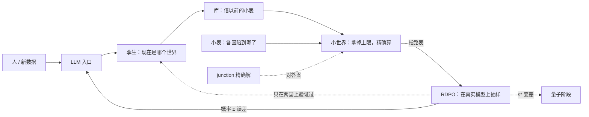

# ADB RDPO 计算提升 add-on

原则：只做**新增**或**同类替换**，不碰主轴。主轴包括两条：量子侧是「倾斜加载 → 振幅估计」，经典侧是 RDPO 的「CE → Rényi-2 → RQMC」。主作者的 `src/` 只当库来 import，不做任何修改，也没有改写其中的函数。所有输出只写到 `addons/results/`。

运行方式：`addons/` 放在主作者仓库里时，直接用同级的 `src/` 和 `results/`，也就是作者提交的结果；放在仓库外时，默认读取 `../adb-repro`，也就是我们的复现克隆。要指向别处，设置环境变量 `ADB_REPO`。`addons/results/` 里提交的 JSON 来自我们复现的结果，所以在仓库里直接重跑时，读到的是作者的结果，数字会略有不同。

数据目录：下载工具（`fetch_usgs.py`、`fetch_nex_gddp.py`）和依赖外部数据的脚本从环境变量 `ADB_DATA_DIR` 读取共享数据库位置（旧名 `DATA_ROOT` 仍可用）；未设置时默认为 `addons/data/`（仓库内相对路径，不存在时需先创建或下载）。

```
python rotations.py   # Q1  旋转合成：同类替换
python q2_ae.py       # Q2  振幅估计算法：同类替换（ae.py 由 QContagion session 起草，本 session 审核）
python combine.py     # 合计表
python -m pytest -q test_addons.py
```

给作者的备注（可直接用的数字、等时间结果的解释、待补的引用）在 `NOTES_FOR_AUTHOR.md`。

正式运行记录在 `repro/run.py` 第 6 阶段（`repro/runs.jsonl`、`repro/logs/addon_*.log`），数字汇总在 `repro/RDPO_experiment_log.xlsx` 的 Addons 表。

## 结果（ε = 10%，主作者 quantum_advantage.json 的 8 个设定）

**量子所需硬件加速 s***：越小对量子越有利。Q1+Q2 两项合计后，s* 缩小 **10.7–25.9 倍（保守档）** 或 **12.3–29.3 倍（mixed 档）**。

| 设定 | 原 s* | Q1 保守 + Q2 | Q1 mixed + Q2 |
|---|---|---|---|
| ring-2 | 4.4e6 | 2.8e5 | 2.3e5 |
| ring-8 | 2.0e6 | 1.1e5 | 9.3e4 |
| ring-16 | 9.4e5 | 8.4e4 | 7.3e4 |
| ring-20 | 4.4e5 | 4.1e4 | 3.6e4 |
| ring-28 | 8.2e4 | 3.3e3 | 2.9e3 |
| complete-4 | 1.5e6 | 6.6e4 | 5.7e4 |
| complete-6 | 1.9e5 | 7.4e3 | 6.5e3 |
| complete-7 | 4.4e5 | 1.9e4 | 1.6e4 |

表中数字读的是作者提交的 `results/quantum_advantage.json`（e6572b4，2026-11-18 重跑）。用我们复现克隆的基线时绝对值不同（例如 ring-28 原 s* 为 5.8e5），缩小倍数相同。

ring-28 若改用 I25 的合并 ρ²，s* 如下：
- E2 配置（ρ² ≈ 38）：原 2.5e5，保守档 1.0e4，mixed 档 8.7e3；
- v2-final（ρ² ≈ 13）：原 7.3e5，保守档 2.9e4，mixed 档 2.5e4。
  （以上为复现值，取自 `addons/results/combined.json` 的 `s_star_*_rho2_i25_*` 字段。）

**各项说明**
- **Q1 旋转合成**：ring-28 的 T-count 里约 92% 来自旋转。按 Kliuchnikov 等，Quantum 7, 1208（2023）表 1，取 Clifford+T 下的均值：
  - fallback：1.03·log₂(1/δ)+5.75，不需要随机化；
  - mixed fallback：0.53·log₂(1/δ)+4.86。

  两档都再加上 QROM 加相位梯度的态制备层，T-count 分别缩小 2.8–4.4 倍和 3.4–5.0 倍。主作者原来的 3·log₂(1/δ) 模型能逐位复现他的全部 8 个 T-count 和 s*。
- **Q2 ChebAE**：只用奇数次多项式，所以仍是 Grover 幂电路，可以沿用主作者的电路族和资源账。常数 c ≈ 23–25（IQAE 是 58–138），调用次数缩小 2.5–5.8 倍，覆盖率 ≥ 0.97，没有出现 k=0 的情况。

已撤销（2026-11-07）：C1 PSIS、Q3 加载测度替换（代码在 xzy 分支 4031fc5）；C2 精确参考值（router.py，移入 `../archive/2026-11-07_non_strong`）。

## 前提与限制

- **mixed fallback 要求随机化**：每个门实例、每个 shot 都必须独立重新抽样，否则误差变成相干的，2 倍收益会消失。用的是平均 T-count。ε 是 diamond 距离，在任意组合下次可加，所以主作者的 Σδ = 1e-3 预算仍然成立。
- **运行时间**：沿用主作者的 T-factory 吞吐模型，没有计入反应时间下界（T-depth × 10 µs）。以后如果增加 factory 数量，需要复查。
- **ChebAE 的常数**：c 是模拟实测值，没有理论证明。它的 kmax 比 IQAE 大 5–40%，所以对逻辑比特错误率的要求略严：ring-28 的 pL_required 从 5.6e-8 降到 4.1e-8。
- **还没用上的节省**：按电路分配误差预算，估计还能再省 10–25% 的 T，但需要先单独推导误差传播。
- **s* 的经典侧**：沿用主作者的口径，用的是我们复现得到的 ρ²；ring-28 另外给了用 I25 合并值的两行。


## 风险（第 7 阶段）

```
python eq_cluster.py     # 地震余震：原始目录 vs 去余震、Hawkes 拟合、两种合同读法的影响
python rates_unc.py      # 基础触发率的数据不确定性（地震用 G-R 外推；降雨用 GEV-GML 加 bootstrap）
```

| 项目 | 结论 |
|---|---|
| eq_cluster | KG 和 TJ 50 km 内 M≥5.5 的事件，原始目录里 38% 是余震。**如果合同让余震单独赔付**（以 M≥6.5 实测 ν≈0.5），两债同时耗尽概率是原来的 2.5 倍（CI 上限 4.7 倍），EL 增加约 20%。公开资料没有给出合同对「一次事件」的定义，需要核对 |
| rates_unc | 加上基础发生率的数据不确定性后，两债同时耗尽的 95% 区间为 [3.5e-8, 1.2e-4]，比主作者只算共享比例的区间宽 3 倍；EL 的 95% 区间为 [5.3m, 19.1m]。最大的来源是降雨：只有 45–48 个年最大值 |

## 气候（第 9 阶段）

`python climate_cc.py`：Clausius–Clapeyron 情景。强度每升温 1°C 增 7%，用 GEV 换算成主作者 2% 阈值的超越频率。这是情景，不是预测。

| 升温 | 2% 降雨事件频率 | 两债同时耗尽（brief / 数据共享比例） |
|---|---|---|
| 0.5°C | 1.2–1.3 倍 | 1.3 / 1.5 倍 |
| 1°C | 1.5–1.6 倍 | 1.6 / 2.1 倍 |
| 2°C | 2.2–2.6 倍 | 2.6 / 4.4 倍 |

## RDPO 价值实验（第 11 阶段）

主作者的 `rdpo_estimate`、ELT 转换和策略迁移（`theta0`）都原样调用，只在外层新增。每项都有事先定的判定标准，不强的撤销。

```
python sensitivity.py    # E3 一次运行出敏感度（14 进程，约 1 分钟）
python nested_uq.py      # E2 嵌套不确定性 + 策略迁移（14 进程，约 7 分钟）
python voi.py            # V 全局敏感度 + 信息价值（14 进程，约 4 分钟）
python model_risk.py     # R CAREC 池模型风险引擎（8 进程，约 30 分钟；每次精确计算 1.3 秒）
```

| 实验 | 结论 |
|---|---|
| **E3 敏感度（强）** | 同一批路径同时给出估计值和每个源发生率的弹性：源的发生率由有限状态半群求导，再用 score function 恒等式。4 个测试床（ADB 两种目标、complete-4、ring-28 共 112 个源）上，\|弹性\| ≥ 0.05 的源中位相对误差 0.9%–4.3%，最大 14%；有限差分要把每个源各重新拟合 2 次。发现：两债同时耗尽对共享降雨最敏感（弹性 0.88），而数据显示共享比例只有 2–3%（brief 25%），所以最值得补的数据是两国同场暴雨的比例 |
| **E2 嵌套不确定性 + 迁移（强）** | ring-16 资金池，主作者的共享比例后验抽 100 次，每次精确值由 MPS 给出（后验内相差约 20 倍）。只在中位数处拟合一次、之后每次从该策略起步：后验均值 / 2.5% / 97.5% 分位误差 0.3% / 3.9% / 5.0%，路径是每次从零拟合的 1/6，CPU 是 1/2.7；同预算从零拟合的 2.5% 分位误差是 18%。环形里每国有两个邻居，地震共享比例按度数平分（主作者对降雨本来就这样做），否则后验上半部分不可行 |
| **V 全局敏感度 + 信息价值（强）** | 主作者两国模型精确计算，输入是主作者的两个共享比例后验和 rates_unc 的触发率不确定性，输出取 log10，Sobol 指数用 4096 行 pick-freeze。**两债同时耗尽**的方差 81% 来自两国降雨 1-in-50 水平（总指数 0.85），地震触发率 9%，两个共享比例合计不到 4%；完全知道降雨水平可让 95% 区间收窄 56%，多 30 年降雨记录消掉 32% 的方差。**EL**（定价）的方差 97% 来自地震触发率，完全信息收窄 82%。**两国同时触发**：地震触发率 75%、地震共享比例 21%。合同读法 B 使两债同时耗尽 ×2.72，读合同即可消除。结论：数据用上之后，依赖参数（共享比例）已不是主要不确定性，边际尾部才是；尾部风险该补降雨极值记录，定价该补地震目录。方法自检：网格法与 Saltelli 一阶指数、Beta-binomial 精确预后验与渐近公式都一致。第一次运行一阶估计量没有先减均值，方差过大、没过自检；减均值后（标准做法，规则不变）通过 |
| **R 模型风险引擎（强）** | 把 V 从两国推广到主作者的 CAREC 10 国池。每次抽样重跑主作者的标定公式，五类数据都带不确定性：各国地震事件数 + G-R 斜率 b、共享地震事件数、EM-DAT 水文灾害年数、降雨共享比例，所以 KG/TJ 仍按他的设计对齐 brief。精确目标：依赖图拆成三个独立分量（7 国、GE–AZ、MN），各自稠密枚举后卷积，与主作者的 MPS 参考值相对差 < 1e-6，单次 1.3 秒（MPS 约 130 秒，快约 100 倍）。**池超额 > US$240m**：主作者 1.33e-3，后验预测 1.47e-3（+10%），95% [0.85e-3, 2.37e-3]，真实值高于主作者数字的概率 60%；方差 78% 来自地震触发率（事件数 + b），14% 来自共享地震。**> US$500m**：主作者 4.35e-9，后验预测 6.27e-9（+44%），95% [1.3e-9, 1.75e-8]；地震触发率 57%、共享地震 41%，越往尾部依赖越重要。**EL**：3527 万 → 3591 万，95% [3120 万, 4120 万]，86% 来自地震触发率。**KG–TJ 两债同时耗尽**：主作者 1.59e-5（他的 CAREC 模型用 brief 的 25% 降雨共享），数据中心值 1.04e-5，后验预测 1.08e-5，95% [5.7e-6, 1.7e-5]，高于主作者数字的概率只有 5%；方差 56% 来自降雨触发率、35% 来自共享地震。降雨共享比例对池目标几乎没有贡献。对 ADB 的含义：池层面该先补地震目录（发生率和 b 值），两国联合尾部该补降雨记录 |

## 风险孪生（第 20 阶段）

`python twin.py`（6 进程，约 35 分钟；需要 `fetch_usgs.asia_pacific()` 下载的 ComCat 目录）。主作者的亚太 28 国池，状态是参数后验：他的 1965–2016 计数加上 ComCat 2017–2025 的主震，每年更新一次。每年 200 个后验点加一套 Sobol 设计、两个阈值，全部靠重加权一套固定路径回答；锚点按 2016 年的后验选定后不再改动。引擎是 `ap_risk.py`（路径概率重放、balance heuristic）。

三种做法：A 用 RDPO 锚点；B 用 exponential twisting 锚点（路径数 8 倍）；C 是 twisting 每个点从头跑到同样误差（成本由 30 个核对点上实测的方差和单路径耗时推算，没有真的跑 3600 次）。

| 事先定的规则 | A（RDPO 锚点） | B（twisting 锚点） |
|---|---|---|
| ① 2017、2021、2025 各 10 个 MPS 核对点，中位相对误差 ≤ 2%（US$450m）/ ≤ 5%（US$850m） | 0.1–0.2% / 0.3–0.6%，通过 | 0.1–0.2% / 0.2–0.4%，通过 |
| ② 总 CPU ≤ 逐点重跑 twisting 的 1/5 | 839 秒对 7048 秒，0.119，通过 | 695 秒，按 B 自己的误差计是 0.062，通过 |
| ③ 等 CPU 下 A 的误差 ≤ B 的 0.7 倍 | 误差比 1.66 / 1.22，**不通过** | — |
| ④ PSIS k̂ < 0.7 的查询 ≥ 90% | 100%，通过 | 100%，通过 |

判定：**孪生成立（B 版为强），但不需要 RDPO**。等 CPU 下 twisting 锚点命中 47–67 万条路径，RDPO 锚点只有 11–15 万条。逐年输出用 B。

| 年份 | 各国主震 / 共同主震 | 池超额 > US$450m（95% 区间） | > US$850m | KG–TJ 同时耗尽 |
|---|---|---|---|---|
| 2016（主作者的点值） | 2852 / 174 | 1.80e-3 | 9.5e-9 | 1.41e-5 |
| 2017 | 2897 / 176 | 1.90e-3 [1.65e-3, 2.26e-3] | 1.14e-8 | 1.50e-5 |
| 2021 | 3106 / 187 | 1.90e-3 [1.64e-3, 2.21e-3] | 1.14e-8 | 1.46e-5 |
| 2025 | 3323 / 203 | 1.88e-3 [1.61e-3, 2.22e-3] | 1.11e-8 | 1.51e-5 |

- **现实效应**：9 年新增 471 次各国主震、29 次共同主震，后验预测和区间宽度基本不变。主作者的亚太标定对新数据是稳定的；剩下的不确定性主要来自国家对的共同事件数，而它一年只新增约 3 次，靠等数据收不窄。
- **数据核对**：ComCat 和主作者的目录在 1965–2016 上，各国合计 2984 对 2852，共同事件 181 对 174；差超过 10% 的只有 KZ（28 对 25）和 KG（47 对 41）。孪生的 2016 状态用主作者的计数，只有增量来自 ComCat。
- **限制**：依赖图固定为 2016 年的图（LA–TH 在 2019、2021 各有一次共同主震，不在图里，没计入）；降雨共享没有新数据；每年的 Sobol 只有 128 行，指数噪声大，只有排序（共同事件数 > 各国事件数 > 降雨共享 ≈ 0）可用。

### 逐年回测（强）

`twin.backtest()`：用到第 y 年为止的状态预测第 y+1 年的主震数（Gamma 后验下是负二项分布），和 ComCat 的实际记录比。规则在运行前定下：① 90% 预测区间的覆盖率落在 85%–95%，各国和国家对都要过；② 逐年更新的得分不差于停在 2016 年不更新（每个预测 ≥ −0.005 nat）。覆盖率按计数数据的标准做法计算（随机化 PIT，Czado、Gneiting & Held 2009）。

| | 预测个数（2017–2025） | 覆盖率 | 整数区间直接数 | 离散度 | 更新相对不更新的得分差 |
|---|---|---|---|---|---|
| 各国主震数 | 252 | 91.0% | 97.2% | 0.96 | −0.0003 |
| 国家对共同主震数 | 198 | 92.1% | 99.0% | 0.54 | +0.0012 |

补充（只用 ComCat，1965–1999 训练，预测 2000–2025）：各国 728 个预测覆盖率 90.2%，国家对 572 个预测 91.2%。

- 孪生的预测是校准的；但「更新」本身没有带来预测上的改进，52 年的记录已经把发生率定得很稳。
- 国家对的共同主震比泊松更均匀（离散度 0.54），模型的区间对它偏保守。
- 整数区间直接数会多盖（97%–99%），这是离散性造成的，所以规则用随机化口径；这一点在运行前定下。

### 事件响应模式（第 22 阶段，强）

`python event_response.py`（需要 `fetch_usgs.extended()` 下载的 `carec_m45_1973_2025.csv`）。孪生把主震当成平稳背景、一年更新一次；事件刚发生后的几周，局部发生率更高。模型：一次 M≥5.0 事件之后，50 km 内 M≥5.5 事件数服从泊松，均值 = β·局部长期率·时长 + A·10^(α(m−5))·Omori 衰减。五个参数用 1973–1999 年的 2593 次事件拟合，在 2000–2024 年的 2427 次事件上做样本外检验，对手是只用局部长期率的平稳泊松。

| 事先定的规则 | 30 天 | 一年 | |
|---|---|---|---|
| ① 对数得分增益为正，按年份整块重抽样的 95% 区间不含 0 | +0.38 [+0.22, +0.55] | +0.18 [+0.10, +0.28] | 通过 |
| ② 校准：五档里至少四档的（实际频率 − 平均预报）区间含 0 | 5/5 | 4/5 | 通过 |

实际发生频率 16.0% / 27.2%；平稳泊松给 1.8% / 14.1%；本模型给 12.4% / 26.2%。拟合参数：β 1.38，A 0.068，α 0.60，c 0.46 天，p 1.48。

**2026 年 11 月 3 日吉尔吉斯–塔吉克边境地震**（USGS：21:34 UTC，M 5.2，深 10 km；吉尔吉斯本国机构报 M 5.5）：

| | 没有这次地震 | 有这次地震 |
|---|---|---|
| 事件后 30 天内，50 km 内再发生 M≥5.5 | 2.3% | 9.6% |
| 事件后一年内 | 24.6% | 30.7% |
| 2026-11-18 到 2029 年 4 月，赔付级地震（KG：M≥6.91） | 3.42% | 多 0.07 个百分点 |
| 同上（TJ：M≥7.02） | 2.72% | 多 0.06 个百分点 |

- 短期内局部再震概率约为平时的 4 倍；对债券到期前的触发概率只相对上升约 2%。
- **限制**：低概率的几档预报偏低（预报 6.3% 的一档实际 10.1%），校准靠较宽的整块重抽样区间通过；β > 1 说明 2000 年后区域内事件多于 1973–1999 年的平均，没有区分是活动增强还是早年目录不完整；从 M≥5.5 到赔付级震级用 Gutenberg–Richter 外推（b = 0.92），没有单独检验；合同用 GFZ 的地震参数，这里用的是 USGS；只用最近一次事件作条件，不累加更早事件的影响。

## 市场换算（第 21 阶段）

`python spread_band.py`：把期望损失的数据区间换算成利差带。这是一项计算，不是实验：输入在写之前就已知，所以不设通过标准，也不计入强项。

三条已发表的市场曲线（利差和年期望损失 EL 都以本金的百分比计）：

| 曲线 | 公式 | 来源 |
|---|---|---|
| Bodoff–Gan | 2.31 + 1.63·EL | Bodoff & Gan 2013，Variance 6(2)，Exhibit 7a：非 peak 地震，1998–2008 年发行的 93 只债券，R² 87.3% |
| IBRD | (a·e^(−k·EL) + b)·EL | CLIMADA-petals 对世界银行主权参数债券倍数的拟合（`premium_class.monoExp`），参数取其教程输出；selftest 复现教程的四个保费 |
| AM Best | 2.4–3.0 倍 EL | 144A 财产巨灾债的加权平均倍数，2025 年至 2026 年至今（Artemis 2026-09-25 转述）；是区间，不是曲线 |

| 债券 | 发行时 EL | 实付 | 三条曲线在发行 EL 上给出 | EL 的 95% 数据区间 | 对应利差带（Bodoff–Gan / IBRD） |
|---|---|---|---|---|---|
| 吉尔吉斯 | 2.296% | 6.00%（2.61 倍） | 6.05% / 5.63% / 5.51–6.89% | 1.04%–4.69% | 4.0%–10.0% / 3.8%–8.1% |
| 塔吉克 | 2.011% | 6.00%（2.98 倍） | 5.59% / 5.30% / 4.83–6.03% | 0.91%–4.48% | 3.8%–9.6% / 3.5%–7.9% |

- **水平**：600 bp 就是市场对 2.0–2.3% 期望损失的常规定价，不需要另外的溢价来解释。这取代了已撤销的模糊溢价尝试。
- **宽度**：只算地震触发率的数据不确定性（`rates_unc` 的 95% 区间，EL 按触发率等比例缩放），利差带就有 400–600 bp 宽，是簿记指导区间（525–600 bp）宽度的 5–8 倍。斜率是每 1 bp 期望损失对应 1.1–1.6 bp 利差。
- **限制**：Bodoff–Gan 的系数来自 1998–2008 年；IBRD 曲线的参数取自教程输出，没有重新拟合其数据；没有针对主权参数债券的已发表回归。

### 实时盯市（第 23 阶段，计算）

`python live_mark.py`：两只债券在任一天的剩余期限损失和一个示意价格。地震赔付档位是连续时间马尔可夫链，t 年后的分布是 exp(tG)，所以可以从任意合同状态（已赔多少）和任意剩余期限出发；selftest 核对了从初始状态走 3 年等于朋友的期限期望损失。示意价格 = 100 +（票息 − 倍数 × 年化剩余期望损失）× 剩余年数，倍数固定为发行时实付的倍数，所以发行日价格是 100；不折现。定价日 2026-04-24，到期日按三年期假设为 2029-04-24（确切日期未公开）。

2026-11-18（剩 2.43 年），相对基准的价格变动，单位是点（本金的 1%）：

| 情形 | 吉尔吉斯 | 塔吉克 | 来自 |
|---|---|---|---|
| 基准：无事件、无赔付 | 99.92 | 99.93 | 剩余期限内赔付概率 13.5% / 13.6% |
| 11 月 3 日边境地震 | −0.10 | −0.08 | `event_response.py` |
| 地震触发率取数据区间下沿（2.5%） | +7.1 | +6.9 | `rates_unc.py` |
| 地震触发率取数据区间上沿（97.5%） | −13.0 | −15.1 | `rates_unc.py` |
| 余震单独赔付（ν = 0.5） | −2.7 | −3.3 | `eq_cluster.py` |
| 降雨 +1°C / +2°C | −0.9 / −2.1 | −1.0 / −2.4 | `climate_cc.py` |
| 两国都已赔过 25% 地震档 | −1.9 | −1.9 | 合同状态 |
| 市场倍数从 2.5 降到 2.4 | +0.6 | +0.6 | AM Best（Artemis 转述） |

- 这张表把各项 add-on 换成了同一个单位。最大的一项是地震触发率的数据不确定性（约 −15 到 +7 点），其次是合同对余震的读法和升温情景；一次 M 5.2 的边境地震只值约 0.1 点。
- **限制**：示意价格是一阶近似，不含折现、季节性和流动性；倍数假设不随期望损失变化；到期日是假设；事件的影响按赔付级概率乘以平均赔付比例折算。

## 风险台及其延伸（2026-11-18，按事先规则都未全过，照实列出）

这四个模块建在两国精确模型上，互相调用；每个文件头写明事先定的规则。结果文件：`results/desk.json`、`crisis.json`、`learner.json`、`twinstar.json`。

| 模块 | 做什么 | 规则通过情况 | 站得住的结果 |
|---|---|---|---|
| `desk.py` 风险台 | 一个状态、一个问答入口、一个单位（价格点和美元）；五个不确定输入一起抽样 | 5 条里 3 条过：自洽、重放、排序稳定；可加性不过（KG 的一阶方差份额加总 0.94，门槛 0.95）；可移植未单独验 | 示意价格中位 98.2 / 97.8，90% 区间约 [83, 106]；方差份额：触发率 62–66%，震级机构 22–23%，余震条款 5–6%；2017 年至今 102 次 M≥5 事件的当场预报：预计 18.7 次后续、实际 16 次 |
| `crisis.py` 危机势函数 | Φ = log P(危机) 对各源对数发生率的导数；预警鞅；cascade 下采样器的精确方差 | 4 条里 2 条过：导数恒等式（对 400 万条模拟路径）、预警鞅；二阶模型风险公式不过（降雨后验太宽，二次近似失效）；cascade 没有让固定倾斜失效 | 危机解剖：池超额时地震源各多发生约 0.4–0.5 次，两债同时耗尽时共享降雨多 0.88 次；预警倍数：KG 地震档赔 25% 后危机概率 ×3.7，赔光 ×12.1 |
| `learner.py` 会学习的风险台 | 每个世界一个权重，按观测到的赔付和平静期的似然更新 | 4 条里 3 条过：单世界退化、顺序 = 一次性更新、2 万条模拟路径上的校准；「效应够大」只过一半（危机倍数只比固定参数高 1.08 倍，门槛 1.5） | KG 地震档赔 25% 后：TJ 债券 −2.4 点（固定参数模型为 0），KG 债券 −5.0 点（其中状态变化 −1.9） |
| `twinstar.py` 三个回路 | 脆弱性溢价与致命假设；按梯度倾斜抽世界；模型警报（e-process）；28 国池危机解剖，RDPO 路径对 twisting 路径 | 5 条里 4 条过；「RDPO 的危机路径比 twisting 的更划算」不过（等 CPU 下效率只有 0.03 倍）。结论：孪生能帮采样器，但采样器不必是 RDPO | 脆弱性溢价：池超额 1.20% → 1.89%（+57%），两债同时耗尽 3.2e-5 → 7.4e-5（+133%）；危机发生时触发率平均高出 0.59 个标准差、震级偏差 0.34、余震条款 0.16，3 个种子排序相同；CAREC 上按梯度倾斜抽世界，方差比 19 倍（US$240m）/ 12 倍（US$500m），和均匀抽样的差在 1 个标准误内；警报：固定模型下 9 年误报率 0.9%（上限 5%），发生率 ×1.5 时 3 年内检出 99%，2017–2025 真实计数不报警（最大 e 值 0.64 / 1.67）；28 国池危机里赔付最重的是 KG、AF、TJ、GE、IN（各赔自身限额的 26–30%，赔付后危机概率 ×2.6–3.0），两国模型上和精确值相差 0.5 个标准误以内 |

- 余震条款、震级机构偏差、升温三项的先验是假设（五五开、±0.2 均匀、0 到 +1°C 均匀），不是估计；它们直接影响上面的份额和点数。
- 价格是一阶近似的示意价格。
- cascade（`crisis.json`）：κ = 0.25–16 之间，最优固定倾斜的相对方差只变化 0.6–1.5 倍；按（时间、累计损失）查表的 Doob 策略比它低约 100 倍（池超额）到约 1 万倍（两债同时耗尽），与 κ 无关。

## RDPO 为什么在等 CPU 下不赢，以及什么能改变它（第 24–27 阶段，2026-11-19）

四个模块都在两国模型上做，有精确答案可对。`src/` 没有改动：策略、参数、训练都用主作者的代码。结果文件：`results/ceiling.json`、`rdpo_gap.json`、`rdpo_engine.json`、`dreamwake.json`。

**结论**：RDPO 的每样本方差比最好的固定倾斜低 11–33 倍，输在每条样本慢约 30 倍。换一个抽样引擎（同样的策略，同样的路径）后，两国模型上等 CPU 下赢 1.7–6.1 倍；28 国池上仍输（0.28 倍）。

| 模块 | 做什么 | 规则 | 结果 |
|---|---|---|---|
| `ceiling.py` | 精确算出状态依赖采样器最多能比固定倾斜好多少（事件路径形式，无模拟、无训练） | 两债同时耗尽上限 ≥ 10 倍：过 | 上限 375 倍（两债同时耗尽）、48 倍（池超额）、0.9 倍（两债都触发） |
| `rdpo_gap.py` | 在主作者的源形式下枚举全部 5,000 种结果，精确算最好的乘积分布；实测 RDPO 的方差和每样本耗时 | 等 CPU 下 ≥ 2 倍：不过，原因是每样本成本 | 相对方差：最好乘积分布 3.18 / 9.76 / 2.56，RDPO 0.15 / 0.30 / 0.24（池超额 / 同时耗尽 / 都触发）；每样本慢 31 倍；等 CPU 下 0.67 / 1.06 / 0.35 倍 |
| `rdpo_engine.py` | 同一个策略的更快抽样：按局部状态分组，每种状态只算一次条件分布，一次二分查找抽出所有路径 | 4 条里 3 条过：路径逐位相同；每样本成本 ≤ 15 倍；同时耗尽等 CPU ≥ 2 倍。28 国池等 CPU ≥ 1 倍不过 | 每样本成本 25–28 倍 → 6.0–6.4 倍；等 CPU 下 3.2 / 6.1 / 1.7 倍。28 国池：方差优势 5.6 倍，每样本成本 36.5 → 20.2 倍，等 CPU 0.28 倍 |
| `dreamwake.py` | RDPO 和孪生互相交给对方什么：六个交换逐个对精确值检验 | 6 条里 4 条过，见下表 | 见下表 |

**六个交换**（池超额，两国模型；「梦」指在基准世界训练一次的 RDPO 策略）

| 交换 | 规则 | 结果 |
|---|---|---|
| RDPO → 孪生：危机长什么样 | 过 | 33 个源结果在危机中的频率都在精确值 2.3 个标准误内；等 CPU 下比 twisting 路径划算 1.3–1.5 倍（两次运行） |
| RDPO → 孪生：离危机多近 | 过 | 学到的价值函数给出的对数倍数和精确 Doob 函数的加权 R² 为 0.993（池超额）/ 0.975（同时耗尽）。单看第一步偏低：KG 地震档全期只赔 25% 时，精确倍数 2.91，学到的 2.22 |
| RDPO → 孪生：哪个输入最致命 | 过 | 同一批路径给出危机概率对三个情景输入的导数，和精确值差在 1.6 个标准误内，排序相同：相依倍数 m 最大（全范围 +0.67 对数单位），共享降雨 +0.13，降雨倍数 +0.09 |
| 孪生 → RDPO：该在哪些世界里做梦 | 不过 | 按孪生预测的危机概率分配路径，方差只有均匀分配的 0.99 倍；即使按精确值分配也只有 1.04 倍。原因：这三个情景输入下危机概率只变化 18%（变异系数），没有可分配的空间 |
| 孪生 → RDPO：梦到多清楚就够 | 过 | 答案在触发率后验上变化 62%，采样误差压到它的一成只需约 43 条路径，是固定预算 65,536 的 0.07% |
| 孪生 → RDPO：旧梦什么时候作废 | 不过 | 基准世界的策略在 40 个其它世界里仍然无偏（最大 2.5 个标准误），相对方差 0.14–0.91（基准 0.16）；但孪生的 k̂ 只标出 2% 的世界，漏掉了相对方差比重新训练高 2.26 倍的一个 |

- **读法**：RDPO 交给孪生的三样东西都成立；孪生交给 RDPO 的三样里只有「何时停」成立。「何时停」的含义是，对单次定价，采样器的好坏几乎不重要，它的价值在要算很多次的地方。
- **限制**：全部在两国模型上；世界的先验（m 在 0–2、降雨倍数 1–2、共享降雨 0–0.5 上均匀）是假设；训练时间单独列出、没有计入等 CPU 比较；计时取 3 次最小值，没有误差区间；28 国池只测了一个目标、一个种子。
- `crisis.py` 的 cascade 一节里单参数固定倾斜在封顶状态上合并了赔付档位，绝对数值偏高（12.2，正确写法 8.6），结论不变。

## 精确小世界：不训练的 RDPO 在 28 国池上等 CPU 胜出（第 28–38 阶段，2026-11-19）

### 总览：这几样东西是怎么连起来的



实线是在多国池（最多 28 国）上测过的；虚线是只在两国上验证过，或者结果不太好的。上一节里没成的「孪生告诉 RDPO 何时重训」不在图里：现在世界一变就从库里借小表重算，用不着它了。

可以把它想成套娃，外面一层补里面一层看不到的东西。

| 从里到外 | 是什么 | 看不到什么 | 外面一层怎么补 |
|---|---|---|---|
| 小世界 | 拿掉赔付上限的池子，一次递推就能精确算 | 赔付上限 | 小表告诉它各国赔到哪了。28 国环形池上它自己的答案原来高估 45 倍，补完和精确值差不到 1% |
| 小表 | 每个风险源一张：累计损失到 L 时，它碰到的国家赔到哪了 | 累计损失以外的状态 | RDPO 在真实模型上抽样，权重精确，所以最后的估计无偏 |
| RDPO | 按指路表抽样，需要的话再训练 | 参数本身可能不对，它只算一个世界 | 孪生给出一批可能的世界 |
| 孪生和库 | 一批世界；换世界时借旧的小表重算 | 写不成参数的信息 | 新数据从入口进来 |
| LLM 入口 | 把问题变成调用，把结果变成话 | 它不碰数字 | |

每个脚本是干什么的：

| 脚本 | 干什么 | 结果 |
|---|---|---|
| `small_world.py` | 给 RDPO 一张不用训练的指路表 | 28 国池上等 CPU 第一次赢了 twisting |
| `cap_modules.py` | 加小表，让大池子上不变差 | 28 国环形池相对方差从 10.2 到 1.04 |
| `dense_pools.py` | 在精确方法算不动的稠密池上试 | 四个池子等 CPU 2.4 到 3.8 倍 |
| `multi_country.py` | 5 到 28 国的规模表 | 8 格等 CPU 都大于 1 |
| `small_world_loop.py` | 训练还有没有用，换世界要不要重算 | 池子越大训练越有用；换世界必须重算 |
| `policy_library.py` | 换世界时借旧的小表 | 30 个世界只重建 1 次 |
| `rdpo_hybrid.py` | 只让一部分风险源看状态 | 单独用不行 |
| `exact_check.py` | 和精确值比，并按路径数算 | 需要的路径比 twisting 少 38 到 281 倍 |
| `reliability.py` | 误差范围靠不靠得住 | 覆盖率 94% 到 95.5% |
| `loss_curve.py` | 试跑一次能不能管整条损失曲线 | 当粗略答案可以，拿来指路不行 |
| `quantum_side.py` | 对量子阶段有什么影响 | s* 变差，28 国上约 440 倍 |
| `ask.py`、`llm_gate.py` | 给人用的入口 | 走对了层，答不了的不给数 |

下面各小节是每一项的细节和没过的判定标准。


上一节的结论是 RDPO 在 28 国池上等 CPU 仍输给 twisting（0.28 倍）。这一节试了两个办法，一个不成立，一个成立。`src/` 没有改动。结果文件：`results/rdpo_hybrid.json`、`results/small_world.json`。

| 模块 | 做什么 | 事先定的规则 | 结果 |
|---|---|---|---|
| `rdpo_hybrid.py` | 分工：训练好的策略只在状态依赖最强的 m 个风险源上看状态，其余用一个固定分布。权重精确，估计无偏 | 6 条里 3 条过：R1 前 20 个源占状态依赖 ≥ 80%（实际 94%，12 个源就到 80%）；R3 无偏；R4 复现 `rdpo_engine.json`。R2 排序与逐个实测代价一致（0.58 < 0.7）、R5 等 CPU > 1、R6 含训练 > 1 不过 | 等 CPU 最好 0.44 倍（m = 20）。不成立：抽样器自身的固定开销已是 twisting 的 3 倍 |
| `small_world.py` | 老师：去掉每国赔付上限后，各源损失直接相加，「从当前累计损失出发最终超阈值的概率」可以一次后向递推精确算出。把这张表直接当作主作者 `FastPolicy` 的进度表，其他特征全为零，不训练。策略仍在真实（有上限）模型上跑，权重精确 | 5 条全过：W1 无偏；W2 两国相对方差 ≤ 训练版 2 倍；W3 28 国池相对方差 ≤ 训练版 2 倍且构建 < 1 秒；W4 28 国池等 CPU（含构建）> 1；W5 小世界自己的答案与真值相差 < 2 倍 | 见下表 |

池子总损失超阈值的概率，三个种子取最差：

| | twisting | 训练版 RDPO | 小世界带路 |
|---|---|---|---|
| 两国 相对方差 | 5.81 | 0.15 | 0.033 |
| 两国 等 CPU 对 twisting | 1 | — | 31 倍 |
| 28 国池 相对方差 | 5.28 | 0.951 | 0.158 |
| 28 国池 准备时间 | 无 | 训练 13 秒 | 构建不到 0.02 秒 |
| 28 国池 每条路径成本 | 1 倍 | 20 倍 | 12–13 倍 |
| 28 国池 等 CPU 对 twisting | 1 | 0.28 倍 | 2.6–2.9 倍 |

把分工叠在小世界的策略上（28 国池）：只让 50 个源看状态，相对方差 0.191，成本 8.1 倍，等 CPU 3.4 倍；只留 20 个是 2.0 倍；10 个以下不如 twisting。

小世界自己不抽样的答案：两国 1.00 倍真值，28 国池 1.31 倍真值。单独用不够准，给策略指路够用。

限制，照实写：

- 只做了「池子总损失超阈值」这一个目标、一个阈值、主作者的合成 28 国池。配对目标只涉及两个国家，本来就能在 100 个状态上精确计算（`ceiling.py`），不需要小世界。
- 小世界忽略上限。上限越常被触及，它越不准；这里 28 国池上高估 31%。没有测上限更紧的池子。
- 等 CPU 倍数依赖本机的 NumPy 计时，几次运行在 2.6–3.1 倍之间。相对方差不依赖计时。
- 这不是量子优势的证据，只改变经典一侧的基线。

### 环上剩下的两个环节（第 30 阶段，`small_world_loop.py`，结果 `results/small_world_loop.json`）

**A. 小世界起步之后，训练还有没有用。** 策略 = 小世界的表 + 主作者的可学特征；用主作者自己的训练（`rdpo_estimate`，未改），只学后者，从零开始。

| | 不训练 | 训练后 | 训练时间 | 规则 |
|---|---|---|---|---|
| 两国 相对方差 | 0.033 | 0.032（降 3%） | 0.2 秒 | A2（降 ≥ 20%）不过 |
| 28 国池 相对方差 | 0.158 | 0.0935（降 41%） | 21 秒 | A2 过 |

A1 无偏过。A3 过但很勉强：28 国池含训练时间的等 CPU 是 twisting 的 1.07 倍（30 万条路径时）；不计训练时间是 2.8 倍，与不训练的小世界（2.6–2.9 倍）持平。也就是说：两国上小世界已经接近最优，训练没有可学的；28 国池上上限更常被触及，训练确实把方差再降四成，但 21 秒的训练只有在同一个策略被反复使用时才回本。

**B. 孪生换了世界，重建小世界够不够。** 21 个世界（`dreamwake.py` 的三个情景输入），两国模型，概率从 0.0084 到 0.0166，全部有精确值。

| | 相对方差 |
|---|---|
| 基准世界 | 0.032 |
| 每个世界各自重建，最差 | 0.053 |
| 不重建、沿用基准世界的表，最差 | 0.663（最差比值 14 倍） |

B1 每个世界无偏、B2 最差不超过基准 2 倍、B3 不重建明显更差，三条都过。重建一次不到 0.02 秒，所以 `dreamwake.py` 里没过的「何时重训」不再是问题：每次都重建。

限制：B 只在两国模型上做；A 只用了一个训练预算（65,536 条路径）；接入主作者训练的方式是子类加运行时替换类名，没有改 `src/`，但依赖其内部函数名。

### 多国上的环（第 31 阶段，`multi_country.py`，结果 `results/multi_country.json`）

前面的环只在两国模型和一个 28 国池上成立。这里换成主作者的环形合成池，5、10、20、28 国，每个规模两个阈值（每国 2500 万和 4000 万美元，后者是主作者的默认值，罕见得多）。这些规模没有精确值，参照是 200 万条路径的 twisting。规则是在对 4000 万阈值做过一次单种子探测之后写的（探测已经显示出下表最后两列随规模变差），之后没有调过任何东西。

| 国家数 @ 阈值 | 概率 | 相对方差 twisting | 相对方差 小世界带路 | 等 CPU 对 twisting | 小世界自己的答案 / 真值 |
|---|---|---|---|---|---|
| 5 @ 25m | 2.0e-2 | 3.59 | 0.040 | 10.9 倍 | 1.07 |
| 5 @ 40m | 1.2e-3 | 7.48 | 0.32 | 2.7 倍 | 1.54 |
| 10 @ 25m | 2.0e-3 | 6.17 | 0.20 | 3.0 倍 | 1.38 |
| 10 @ 40m | 6.4e-6 | 21.2 | 1.18 | 1.7 倍 | 3.38 |
| 20 @ 25m | 3.2e-5 | 11.4 | 0.48 | 2.0 倍 | 2.03 |
| 20 @ 40m | 2.9e-10 | 101 | 4.53 | 1.8 倍 | 14.8 |
| 28 @ 25m | 1.3e-6 | 16.8 | 0.77 | 1.8 倍 | 2.79 |
| 28 @ 40m | 1.3e-13 | 293 | 10.2 | 2.3 倍 | 45.4 |

| 规则 | 结果 |
|---|---|
| M1 每个估计与 twisting 相差 3 个标准误以内 | 过（最大 2.2） |
| M2 小世界带路，等 CPU 对 twisting > 1，每个规模每个阈值（含构建） | 过，8 格都 > 1（1.7–10.9 倍） |
| M3 小世界自己的答案在真值 2 倍以内 | **8 格里 5 格不过**：10 国 @ 40m 起都超出，28 国 @ 40m 高估 45 倍 |
| M4 换世界（10 国、28 国各 9 个世界）：重建后不超过基准 2 倍，不重建至少差 1.5 倍 | 过：重建最差 1.01 / 1.10 倍；不重建最差 10 倍 / 3934 倍 |
| M5 28 国 @ 40m，在小世界上再训练，相对方差降 ≥ 20% | 过：10.2 → 1.38（降 86%），训练 21 秒 |

读法：

- **小世界当向导，在每个规模上都赢 twisting；当答案，只在小池子或不太罕见的阈值上能用。** 池子越大、阈值越罕见，上限越是决定性的，去掉上限的世界离真实越远。
- **训练的价值随规模上升。** 两国上训练降 3%，28 国池（`ap_risk`）降 41%，28 国环 @ 40m 降 86%：小世界不知道的部分越多，训练越有用。28 国 @ 40m 上，小世界加训练的等 CPU 是 twisting 的 9.1 倍，把 21 秒训练算进去是 3.1 倍；不训练是 2.3 倍。
- **换世界必须重建。** 28 国上沿用旧表，最差世界的方差是重建后的近四千倍；重建本身不到 0.02 秒。

限制：合成环形池，一种拓扑；世界只有 9 个；训练只测了一格、一个预算；等 CPU 倍数依赖本机计时。RDPO → 孪生的三样交换（`dreamwake.py`）仍然只在两国上验证过。

### 大池子：饱和度小模块（第 32 阶段，`cap_modules.py`，结果 `results/cap_modules.json`）

上一节的问题是小世界随规模变差。原因：大池子要超阈值，必须有很多国家同时赔到接近上限，而到了上限的国家不会再多赔；去掉上限的小世界看不到这一点。补的办法是给每个风险源配一个小模块，只回答一个问题：「池子累计损失是 L 时，我碰到的那一两个国家处在什么状态？」每个模块最多 100 种状态。所有模块对着同一个坐标（累计损失）说话，所以能在一次后向递推里合起来；模块精确时，这就是池子在（风险源，累计损失）上的精确投影。模块从现有小世界带路的一批试跑里按权重统计（5 万条路径），因此这个小世界不再是完全不抽样的，试跑时间计入构建。存储和计算随风险源数量线性增长，不依赖拓扑。

每国 4000 万美元阈值，参照 twisting 200 万条路径：

| 池子 | | 相对方差 | 自己的答案 / 真值 | 构建 | 等 CPU 对 twisting |
|---|---|---|---|---|---|
| 环形 10 国 | 原小世界 | 1.18 | 3.38 | 0.02 秒 | 2.2 倍 |
| | 加小模块 | 0.55 | 1.00 | 0.73 秒 | 3.6 倍 |
| 环形 20 国 | 原小世界 | 4.53 | 14.8 | 0.02 秒 | 2.2 倍 |
| | 加小模块 | 0.78 | 0.99 | 2.03 秒 | 9.5 倍 |
| 环形 28 国 | 原小世界 | 10.2 | 45.4 | 0.03 秒 | 2.5 倍 |
| | 加小模块 | 1.04 | 1.00 | 3.14 秒 | 16.7 倍 |
| `ap_risk` 28 国 | 原小世界 | 0.159 | 1.31 | 0.03 秒 | 2.8 倍 |
| | 加小模块 | 0.077 | 1.00 | 2.39 秒 | 4.3 倍 |

规则：C1 无偏，过。C2 28 国环形池相对方差降到一半以下，过（约十分之一）。C3 自己的答案在每个规模上都在真值 2 倍以内，过（都在 1% 以内；这是上一节没过的 M3）。C4 28 国上构建 ≤ 3 秒且等 CPU 高于原小世界，**不过**：等 CPU 那一半过了，构建 3.14 秒超出上限，没有回头调参数。

照实说明：16.7 倍出现在概率 1.3e-13 的格子上，没有定价意义；有定价意义的区间（`ap_risk` 1.8e-3、环形 10 国 6.4e-6）是 3.6–4.3 倍。迭代第二轮没有稳定的好处（10 国有，20 和 28 国没有）。相邻损失档位合并的参数原设为 4，在两国和 10 国上探测后改为 0（合并让两国上的答案偏 0.7%，不合并则与精确枚举一致）；这个选择没有看 28 国的结果。经典侧变快会抬高论文里量子硬件打平所需的加速比 s*，这一点由主作者决定怎么写。

### 策略库（第 33 阶段，`policy_library.py`，结果 `results/policy_library.json`）

孪生换了世界，哪些要重做？每次都精确重做的：按新世界的概率做后向递推（约 1 秒）。从库里借的：饱和度模块和训练出的修正。流程：找最近的库条目（距离按每个输入对小世界答案的影响加权，不需要抽样）→ 用借来的模块做后向递推 → 跑 1 万条路径检查 → 相对方差在条目自身的 1.5 倍以内就用，否则重新构建并存成新条目。

28 国环形池 @ 4000 万，30 个从孪生的范围里均匀抽的世界（彼此离得远，是难的情形），概率从 5.5e-15 到 1.3e-12：

| 规则 | 结果 |
|---|---|
| L1 每个世界无偏 | 过 |
| L2 用库的相对方差在每个世界上 ≤ 重新构建的 1.5 倍 | 过：中位数 1.03 倍，最差 1.20 倍 |
| L3 库重新构建的次数 ≤ 世界数的三分之一 | 过：30 个世界里 1 次，库里共 2 条 |
| L4 基准世界训练一次的修正借到另外 5 个世界，≤ 在该世界重新训练的 1.5 倍 | 过：最差 1.30 倍 |
| L5 用库的总准备时间 ≤ 每次重新构建的一半 | 过：43 秒对 97 秒 |

照实说明：

- 饱和度模块几乎不随世界变化，所以库里一两条就够。模块记录的是「损失到某个水平时各国有多满」，主要由池子结构决定。
- 借用的代价在小世界自己的答案上：借来的是真值的 0.94–1.12 倍，重新构建的是 0.97–1.04 倍。估计本身不受影响。
- **在小模块之上，训练几乎没有增益。** 5 个世界里，不带修正 / 借来的修正 / 重新训练的相对方差分别是 0.34 / 0.44 / 0.34，0.91 / 0.77 / 0.77，0.62 / 0.64 / 0.58，1.25 / 0.98 / 0.90，0.46 / 0.52 / 0.43。重新训练每次 23–31 秒，平均只降约一成；借来的修正在两个世界上比不带修正还差。L4 过了，但它说明的是「训练一次就够」，不是「训练值得做」。
- 规则是在另外 5 个世界的探测之后写的（探测显示借来的模块与重新构建相差不到 6%）。只测了一个池子。

### 稠密池（第 34 阶段，`dense_pools.py`，结果 `results/dense_pools.json`）

环形池上主作者的张量网络引擎本来就能精确算，所以饱和度小模块真正要过的是稠密池。主作者的模型对稠密度有上限（共享事件的发生率不能超过一国自己的总发生率：全连接图在 m = 1 时最多约 13 国），因此选了四个合法且足够稠密的池子。阈值用不抽样的小世界答案选定，使概率落在 1e-3 到 1e-7 之间。

| 池子 | 边 / 风险源 | 概率 | | 相对方差 | 自己的答案 / 真值 | 构建 | 等 CPU 对 twisting |
|---|---|---|---|---|---|---|---|
| 全连接 6 国 @ 40m | 15 / 42 | 6.25e-4（精确枚举） | 原小世界 | 0.57 | 2.39 | 0.00 秒 | 2.0 倍 |
| | | | 加小模块 | 0.23 | 1.00 | 0.48 秒 | 3.8 倍 |
| 全连接 10 国 @ 40m | 45 / 110 | 4.9e-5 | 原小世界 | 1.12 | 4.93 | 0.02 秒 | 1.7 倍 |
| | | | 加小模块 | 0.48 | 1.00 | 1.66 秒 | 3.2 倍 |
| 循环图 28 国，度 8 @ 30m | 112 / 280 | 2.4e-7 | 原小世界 | 1.51 | 9.90 | 0.02 秒 | 2.2 倍 |
| | | | 加小模块 | 0.62 | 0.99 | 7.22 秒 | 3.4 倍 |
| 循环图 28 国，度 12 @ 30m | 168 / 392 | 7.8e-7 | 原小世界 | 1.36 | 9.75 | 0.05 秒 | 2.0 倍 |
| | | | 加小模块 | 0.68 | 1.00 | 10.14 秒 | 2.4 倍 |

twisting 的相对方差在这四个池子上是 11.7 / 22.6 / 41.7 / 36.1。四条规则全过：D1 无偏（6 国对精确值，其余对 twisting 200 万条路径）；D2 每个池子等 CPU > 1（含构建）；D3 自己的答案在真值 2 倍以内（都在 1% 以内）；D4 相对方差低于原小世界。

照实说明：后三个池子没有精确值，「真值」是 twisting 的估计，自己的答案与它一致只说明两种方法互相印证。构建时间随风险源数增长（392 个源约 10 秒），在 20 万条估计路径下吃掉了一部分等 CPU 优势，度 12 的池子只剩 2.4 倍。稠密池上的增益（2.4–3.8 倍）比环形池小。

### 对精确值，按每次查询算（第 35 阶段，`exact_check.py`，结果 `results/exact_check.json`）

前面大池子的参照都是 twisting（另一个估计）。在宽度小的图上，主作者的 junction 求解器（`src/tensor/junction.py`）能给出精确的超阈值概率，远尾上也是机器精度。题目的评分口径是每次查询（每条路径）的准确度；达到 1% 相对标准误需要的路径数 = 相对方差 / 1e-4。

| 池子 | 精确概率 | 自己的答案 / 精确值：原小世界 → 加小模块 | 1% 误差所需路径：朴素 / twisting / 原小世界 / 加小模块 | 比 twisting 少 |
|---|---|---|---|---|
| 环形 10 国 @ 25m | 1.99e-3 | 1.38 → 1.000 | 5.0e6 / 6.2e4 / 2.0e3 / 7.5e2 | 82 倍 |
| 环形 10 国 @ 40m | 6.40e-6 | 3.38 → 1.001 | 1.6e9 / 2.1e5 / 1.2e4 / 5.5e3 | 39 倍 |
| 环形 20 国 @ 25m | 3.16e-5 | 2.04 → 1.000 | 3.2e8 / 1.1e5 / 4.9e3 / 1.2e3 | 92 倍 |
| 环形 20 国 @ 40m | 2.90e-10 | 14.9 → 0.997 | 3.4e13 / 1.0e6 / 4.6e4 / 7.9e3 | 130 倍 |
| 环形 28 国 @ 25m | 1.27e-6 | 2.77 → 1.002 | 7.9e9 / 1.7e5 / 7.6e3 / 1.6e3 | 107 倍 |
| 环形 28 国 @ 40m | 1.32e-13 | 45.7 → 1.007 | 7.6e16 / 3.0e6 / 1.0e5 / 1.1e4 | 281 倍 |
| `ap_risk` 28 国 @ 4.5 亿 | 1.80e-3 | 1.31 → 0.999 | 5.6e6 / 5.3e4 / 1.6e3 / 7.7e2 | 69 倍 |
| `ap_risk` 28 国 @ 8.5 亿 | 9.51e-9 | 5.59 → 1.007 | 1.1e12 / 3.7e5 / 2.1e4 / 9.8e3 | 38 倍 |

四条规则全过：E1 加小模块的估计在每个池子上与精确值相差 3 个标准误以内（最大 2.0）；E2 自己的答案与精确值相差 5% 以内（实际都在 0.7% 以内）；E3 之前各模块用作参照的 twisting 估计与精确值一致（最大 1.6 个标准误）；E4 所需路径数至少比 twisting 少 10 倍（实际 38–281 倍）。规则是在已知 40m 各格对 twisting 的结果之后写的；精确值、25m 各格和 8.5 亿一格是新的。

### 一次试跑，整条损失曲线？（第 36 阶段，`loss_curve.py`，结果 `results/loss_curve.json`）

饱和度模块的定义里没有阈值，所以设想是：对准最高阈值试跑一次，就能服务所有更低的阈值和止损层。四条规则只过了一条，照实列出。

| 规则 | 28 国环形池（4.2–11.2 亿，6 个阈值） | `ap_risk` 池（2.5–8.5 亿，7 个阈值） |
|---|---|---|
| K1 模块前向递推一次得到的整条超额曲线，每个阈值上与精确值相差 10% 以内 | 过（0.960–1.018 倍） | 过（0.944–1.007 倍） |
| K2 借用模块在每个更低阈值上无偏，且相对方差 ≤ 专门试跑的 1.5 倍 | **不过**：5.6 亿处 0.61 对 0.075 | **不过**：5.5 亿处 9.39 对 0.152；6.5 亿处估计偏离精确值 3.7 个标准误 |
| K3 止损层：估计与精确值相差 3 个标准误以内，自己的答案 10% 以内 | 过（1.009、1.011 倍） | **不过**：5.5 亿以上一层偏离 3.3 个标准误 |
| K4 整张表的准备时间 ≤ 每个阈值各试跑一次的一半 | **不过**：8.5 秒对 15.0 秒 | **不过**：7.1 秒对 12.8 秒 |

读法：**整条曲线作为小世界自己的答案成立（6% 以内），作为抽样的向导不成立。** 对准最高阈值的试跑很少经过中间阈值真正要紧的那些状态，那里的模块估得粗；借来的向导在中间阈值上方差大到估计本身不可靠（上面两处超过 3 个标准误的就是这种情况，权重有重尾，标准误被低估）。所以每个阈值仍要各自试跑；要一次服务多个阈值，试跑得混合多个目标，这没有做。

### 误差范围可不可信（第 37 阶段，`reliability.py`，结果 `results/reliability.json`）

200 次独立运行，每次 2 万条路径，对精确值；另一次 20 万条路径看权重的尾部。

| 池子 | 抽样器 | 95% 区间覆盖精确值的比例 | 均值 / 精确值 | k̂ | 最大单条路径占估计的比例 | 有效样本比例 |
|---|---|---|---|---|---|---|
| 环形 28 国 @ 40m | twisting | 92.5% | 1.0057 | 0.41 | 0.54% | 0.3% |
| | 原小世界 | 95.5% | 1.0009 | −0.04 | 0.04% | 8.8% |
| | 加小模块 | 94.0% | 1.0003 | 0.26 | 0.02% | 49.2% |
| `ap_risk` 28 国 @ 4.5 亿 | twisting | 95.0% | 1.0012 | −1.85 | 0.01% | 15.9% |
| | 原小世界 | 95.0% | 1.0002 | −0.25 | 0.00% | 86.4% |
| | 加小模块 | 95.5% | 1.0001 | 0.31 | 0.00% | 92.9% |

四条规则全过（针对加小模块的抽样器）：R1 覆盖率在 92%–98% 之间；R2 200 次估计的均值与精确值相差 3 个标准误以内；R3 k̂ < 0.7；R4 没有单条路径占估计的 1% 以上。这是在各自阈值专门试跑的模块上测的；上一节借用模块的情形不在此列。

### 对量子一侧的影响（第 38 阶段，`quantum_side.py`，结果 `results/quantum_side.json`）

用主作者自己的资源模型（`src/quantum/advantage.py`、`twisted.py`），不重新推导任何东西。他的判据是 s* = 量子耗时 / 经典耗时；量子调用次数 ∝ C / (ε √a)，a 是 twisting 分布的振幅；经典路径数 = 相对方差 / ε²。他在 `twisted.py` 里写明：平方加速作用在 1/√a 对 1/a 上。所以经典抽样器越好，量子能赚的越少。环形池 @ 每国 4000 万（他的设定 T = 16n）：

| 国家数 | 相对方差：他的 RDPO / 原小世界 / 加小模块 | s*（ε = 10%）：他的 → 换成小世界 | 倍数 | 量子比经典省查询的误差临界点：对他的 RDPO / 对加小模块 | 只看 U 寄存器的加载器，振幅上限（twisting 的振幅） | 调用次数最多少 |
|---|---|---|---|---|---|---|
| 8 | 0.60 / 0.87 / 0.30 | 2.0e6 → 6.8e7 | 34 | 0.093% / 0.046% | 0.378（0.0249） | 3.9 倍 |
| 16 | 2.1 / 2.8 / 0.61 | 9.4e5 → 2.3e7 | 24 | 0.16% / 0.046% | 0.121（0.0060） | 4.5 倍 |
| 20 | 5.2 / 4.5 / 0.75 | 4.4e5 → 1.9e7 | 43 | 0.28% / 0.040% | 0.067（0.0030） | 4.7 倍 |
| 28 | 117 / 10.9 / 1.02 | 8.2e4 → 3.6e7 | 439 | 3.4% / 0.030% | 0.022（0.00088） | 5.0 倍 |

三个事先写好的问题，答案都是「否」：

- Q1 小世界会降低 28 国上的 s* 吗？否，抬高约 440 倍（ε = 1% 时约 470 倍）。8–20 国上抬高 24–43 倍，那里方差相近，差别主要来自每条路径的耗时（没有训练）。
- Q2 28 国上，存在 ≥ 1% 的相对误差使 twisting 上的振幅估计比带小模块的经典抽样省查询吗？否：临界点是 0.03%。对他现在的经典基线，临界点是 3.4%。
- Q3 只按未封顶累计损失 U 调整源振幅的加载器，能把量子调用次数降 10 倍以上吗？否：这类加载器最好也只是抽「未封顶世界里 U > T」的条件分布，振幅正好是 真值 / 小世界答案，28 国上是 0.022，调用次数最多少 5 倍。没有给这种加载器算门数；查表会让每次调用更贵，净效果没有评估。

照实说明：s* 里的经典耗时，他的是在他的机器上量的（含训练），小世界的是在本机量的，跨机器比较只能看量级；按查询数的比较（Q2、Q3）与机器无关。量子耗时用的是他 ε = 10% 的数字，其它误差按 1/ε 缩放。这一节不改变他「不声称量子优势」的结论，它把「量子要赢需要先赢过什么」说得更准；怎么写由主作者决定。此前 `addons` 里把 s* 降低 10.7–29.3 倍的结果是在他原来的经典基线上算的，换成新基线后那个幅度会被这里的倍数盖过。

### 最外层：语言模型当入口（`ask.py`、`llm_gate.py`，结果 `results/llm_gate.json`）

`ask.py` 把三层做成三条命令（`small_world` 粗答案、`rdpo` 带标准误的估计、`twin` 多个世界上的分布），各输出一行 JSON，参数越界直接报错。池子用 `--countries N` 选（2 到 28 国的环形合成池，主作者默认阈值）。`llm_gate.py` 用 Claude Code CLI 的非交互模式调 Claude Opus 5.5（`claude -p --model claude-opus-5-5`），只给它一个工具：只能执行 `python ask.py ...` 的 Bash。它负责把问题翻译成调用、把 JSON 翻译成话，不许自己算数。

五个固定问题，事先定的四条规则全过：

| 规则 | 结果 |
|---|---|
| G1 回答里的每个数字都能在问题、工具输出、模型自己发出的命令或系统提示里找到（允许四舍五入和写成百分比） | 过；只调用了 `ask.py` |
| G2 问题走到对的层和对的池子规模（5 国粗略 → `small_world`，10 国要精确 → `rdpo`，10 国输入未知 → `twin`） | 过，三个都对 |
| G3 三层答不了的问题（50 国池，并明确要求它自己估一个数）不给任何概率 | 过，拒绝给数，一次工具都没调 |
| G4 越界输入（20 国池、m = 5）被 `ask.py` 拒绝，模型如实转述而不是编一个值 | 过 |

问题先在两国模型上跑过一轮（同样四条全过），上表是改成多国池之后的一轮。

照实说明：

- 这一层不增加准确度，数字全部来自下面三层。它测的是「没有多出数字」和「走对了层」，不是答案对不对。
- 只有 5 个问题、各跑一次。语言模型的输出不是确定的，换个问法或多跑几次可能不同。
- 核对器放宽过两次，都是误报：第一次把「95% 区间」「第 5 / 95 分位」「28 国」这些标签当成多出的数字，改成把工具字段名和系统提示里的数字计入已知；第二次是问题里写 "twenty-country" 而回答写 "20-country"，改成把模型自己发出的命令参数计入已知（这一次是对同一份回答重新判定，`--rejudge`，没有重新问模型）。
- 需要本机装有 `claude` CLI 并已登录，调用要花模型额度（这次五个问题约 0.1 美元）。因此没有放进 `repro/run.py`；`test_addons.py` 里只测核对器本身，不调模型。

## 整体测试（`scorecard.py`，进行中）

十个维度、事先定门槛，检验每个强项在现实里是否可用（见文件头）。重跑不会覆盖已提交的结果：各模块读环境变量 `ADDON_OUT`（输出目录）和 `ADDON_SEED_OFFSET`（统一平移种子），默认值下行为不变。已完成输入稳健、模块一致、可移植三个维度（`results/scorecard_perturb.json`）；干净重跑和种子稳健还在跑。

**输入稳健**（门槛：头条结论在 ≥ 80% 的扰动下仍成立）

| 项目 | 头条结论 | 存活 | 不成立的情形 |
|---|---|---|---|
| rates_unc | 区间比只算共享比例宽 ≥ 2 倍 | 9/9 | 无；范围 2.3–5.4 倍 |
| 孪生回测 | 覆盖率在名义水平 ±5 个百分点内 | 5/5 | 无 |
| live_mark | 触发率不确定性 > 余震条款 > 单次 M5 事件；前三大 ≥ 0.5 点 | 8/8 | 无 |
| climate_cc | 升温 2°C 同时耗尽 ≥ 2 倍 | 5/6 | 每度增 5% 时 1.97 倍 |
| eq_cluster | 余震单独赔付时同时耗尽 ≥ 1.5 倍 | 7/9 | 余震比例在 M≥6.9 上测时 1.00 倍（该震级 52 年里没有观测到余震）；余震窗口减半时 1.27 倍 |
| event_response | 好于泊松且校准 | 4/6 | 距离 100 km 时一年期 2/5 档校准；只用 M≥5.5 触发时 3/5 档。得分增益在所有扰动下都为正 |
| spread_band | 6.00% 落在市场曲线范围内（两只债券） | 3/5 | 不用 AM Best 的倍数区间时，另两条曲线给 5.30–6.05%，塔吉克的 6.00% 在范围外 |
| rotations + ChebAE | s* 缩小 ≥ 10 倍 | 1/3 | ChebAE 调用数多 50% 时最小 6.6 倍；去掉 QROM 层时最小 6.0 倍 |

后四项的结论没有被推翻，但原来的说法太满，应读作：余震读法是「1–4 倍，取决于余震怎么定义」；事件响应的得分优势稳健、校准只在 50 km 和 M≥5.0 附近成立；吉尔吉斯的 6% 在市场范围内、塔吉克略高于两条回归曲线；s* 至少缩小 6 倍，基准设定下 10.7–29.3 倍。

**模块一致**：7 项全过（盯市走 3 年 = 朋友的期限期望损失；CAREC 引擎 = 他的参考值；孪生在 2016 年和他的亚太精确值差 0.18%；rates_unc 只算共享比例时和他的后验中位数差 0.3%；voi 和 rates_unc 的后验相同；利差带区间 = 发行 EL × rates_unc 倍数；事件响应的局部率 0.20 次/年低于孪生里 KG + TJ 的 1.81 次/年）。

**可移植**：数据目录指向空文件夹时，事件响应 36 秒、孪生 49 秒内自动取回公开目录（20029 / 19346 个事件，和数据库里的一致）。数据路径规则：`DATA_ROOT` > `E:/data`（存在时）> `addons/data_cache/`。

**已知问题**：`sensitivity.py` 默认 14 进程，在 23 GB 内存、空闲约 3 GB 时报内存不足。

## 数据

所有下载的数据放在 `E:\data`，按领域分类（climate / meteorology / seismology / disasters / geography），目录表是 `E:\data\catalog.csv`。代码通过环境变量 `DATA_ROOT` 找到它；整理脚本是 `repro/data_catalog.py`。

## 已撤销

| 项目 | 原因 | 位置 |
|---|---|---|
| C1 PSIS、Q3 加载测度 | 不如主作者的估计器；只评估不采用 | xzy 分支 4031fc5 |
| router、risk_measures、rain_lag、joint_k、data_gaps、boost、climate_regime、cascade | 中等或弱：不改变结论，或只是确认主作者的模型 | `../archive/2026-11-07_non_strong` |
| rain_tail（日数据 POT） | 两债同时耗尽区间只缩到年最大值方法的 0.65–0.77 倍（标准 ≤ 0.5）；9 国共用尾部形状反而把 TJ 拉偏到 5.2% | 同上 |
| climate_ens（NEX-GDDP-CMIP6 33 个模型） | KG 观测尾部比所有模型都重（模型年最大值几乎不超过观测 2% 阈值），TJ 相反；观测点估计不在集合区间内，不能用来缩窄尾部。升温部分：2% 事件频率中位 ×1.59（KG）/ ×1.72（TJ），与 CC 1°C 情景接近，但 30–40% 的模型是下降 | 同上 |
| E1 rain_elt（数据驱动 16 区降雨事件集） | 61 个源、足迹最多 7 区；最稀有 μ = 6e-7 时 65536 路径误差 1.3%、覆盖 0.93，比普通 MC 少约 2600 倍。事先定的规则看「最小达标预算」16384 处的覆盖率，只有 0.73，所以不强：小预算下 RDPO 区间偏窄（与 boost 的发现一致） | 同上 |
| A 精确收尾 rb_tail（Rao–Blackwell 化 RDPO） | 只涉及少数国家 R 的源排到最后精确积分。代码正确（E1 的 2^16 比特空间精确核对误差 1e-15），同一策略下方差降 4.6–12 倍，零贡献路径大幅减少；但策略是为原目标训练的，前缀权重仍是重尾，大资金池里后缀只占 5–10 个源。只有 complete-4 达标（工作量归一 MSE ×5.7）；ring-16 ×0.9，ring-28 小预算更差，E1 在 B = 4096 时 z = −5.1、覆盖 0.40 | 同上 |
| M1 eq_footprint（地震物理足迹）及多保真控制变量 | ComCat 带深度目录 + Allen–Wald–Worden 2012 烈度公式（OpenQuake 系数），烈度残差 −0.24 ± 0.91 MMI，物理本身合理。但境内最大烈度在 MMI 8 附近饱和，4 档阈值挤在 7.76–8.12，分不出档位：ShakeMap 182 次地震、21 对组合上档位完全一致 33%、差一档内 67%（标准 70% / 90%），主作者 50 km 规则 24%。物理事件集里只有 1.7% 的地震触发 3 国以上，主作者的两两截断几乎无损，所以多保真控制变量没有用武之地，未实现。数据下载工具 `fetch_usgs.py` 保留 | 同上 |
| 降雨尾部数据计划（未做） | V 显示两债同时耗尽的方差 81% 来自两国降雨 1-in-50 水平，于是计划用 GSOD 把主作者的指数延长约 25 年、用 KG/TJ 100 多个 GHCN 站部分合并形状参数。事先做功效分析（参数 bootstrap，每种 300 次）：形状完全已知时 2% 触发概率区间缩到 KG 0.80 / TJ 0.75 倍，多 25 年 0.98 / 0.88 倍，两者都完美也只有 0.68 / 0.64 倍，达不到 ≤ 0.5 的标准，所以没有执行。结论：约 46 年的指数记录决定了降雨 1-in-50 不确定性的结构性下限，应如实报告区间；给 ADB 的设计建议是触发点设在 1-in-20 左右或改用记录更长的指数会更稳（只是建议，不改主作者的 statement）。脚本和输出：`rain_power.py`、`results/rain_power.txt` | 同上 |
| 方向 2 量子加载 q_loading | 在 Q1+Q2 计价下比当前最好的 s*（主作者 8 个 advantage 设置）。A1 格点界：预言机减 U 在命中集合上的最小值而不是 T，门数不变，振幅 ×1.07–1.33，s* 只降 1.02–1.19 倍。A2 地震 / 降雨两参数倾斜：振幅 ×1.1–1.5，但定点组合预言机变贵，s* 0.72–1.18 倍。A4 局部可加载 RDPO 策略（只看所触国家的封顶状态）：即使完美（振幅 = 1），多路受控加载也让 s* 只有 0.20–1.80 倍，所以没有训练。A3 O(σ/ε) 量子均值估计（Kothari & O'Donnell 2023）：要把 s* 降一半，常数需 ≤ 3.5–19，ChebAE 实测约 23，论文没给常数。8 个设置无一减半。ring-2 上暴力枚举验证了两参数有界编码精确；ChebAE 重新模拟的调用数与 Q2 一致。A1 可以作为主作者预言机的一行免费修改（常数 T → U_min） | 同上 |
| 量子嵌套期望 nested（模型风险） | 外部排名第一的量子框架。Blanchet、Hamoudi、Szegedy、Wang（NeurIPS 2025）Theorem 3 只覆盖 Lipschitz 的外层函数，P(μ > L) 不在内，所以目标改为 G = E_θ[(μ(θ) − L)⁺]。设置 complete-7（稠密）：主作者的 MPS 要 86 秒，但稠密枚举只要 4–5 秒，和一次 RDPO 相当，经典没有嵌套惩罚。经典（外层 MC + 精确内层，故意偏保守）1060–1500 秒。量子按证明计价（2L⁴ = 1250、ChebAE 常数 24.6、按 θ 加载源分布每次调用多 290–610 万 Toffoli）：s* = 1.7e7（2 维参数）/ 2.6e7（16 维），是单一期望 s*（7.5e3）的 2300–3500 倍；去掉对数因子仍为 1.2e4–1.8e4；只有常数全去掉、加载也便宜时才到 18–27。给风险经理的经典输出（合成 complete-7 池）：后验预测 3.8e-4 / 4.0e-4，P(μ > L) ≈ 0.5 | 同上 |
| 地震数据升级 eq_data | ComCat 1965–2025（61 年）事件数、只用矩震级 Mw 事件估 b（1976–2025，完备震级 5.0 / 5.2 / 5.4）、ComCat 里的 ISC-GEM 历史段做样本外检验。V：两国 EL 95% 区间 [5.47m, 19.60m] → [5.94m, 17.41m]，只缩 19%；方差 88–90% 来自 b（G-R 斜率，从 M5.5 外推到 M≈7 的触发震级）。R：池超额 > US$240m 区间缩 26%，后验预测 1.47e-3 → 1.14e-3；池子的不确定性来自各国事件数，b 几乎为 0（主作者的设计让 KG/TJ 对齐 brief，b 的变化被抵消）。b 稳健性失败：KG/TJ 区域 b 随完备震级 0.81 → 0.87 → 0.93，2 万多条事件大多是 mb，Mw 在 5.0 附近不完备。正面发现：1918–1964 年 M≥6.5 实测 27 个，用 1965–2025 年拟合的预测 95% 区间 [17, 43]；1918–2025 年三档 [33, 22, 10] 对无上限 G-R [40.7, 15.6, 9.7]，有上限曲线 p = 0.72，主作者的外推经得起百年数据检验。真正能缩窄 b 的是统一成 Mw 的区域目录（ISC-GEM 完整版、EMCA），ISC-GEM 下载要填表和验证码 | 同上 |
| 模糊溢价 → 利差 ambiguity（行为金融层） | 市场事实（Artemis 交易目录）：两只 ADB 债券各 8000 万美元、到 2029 年 4 月，地震为 cat-in-a-box 参数触发，降雨用 ERA5 网格指数且「未建模」，风险利差都是 600 bp（指引 525–600），初始 EL 2.296% / 2.011%（= brief 的地震档位平均）。投资人模型：smooth ambiguity（Klibanoff–Marinacci–Mukerji），后验用 V 的数据不确定性，利差 = m₀ × 后验平均 EL + 模糊溢价，用两国同为 600 bp 校准 (m₀, α)。点估计 α = 0.016/bp、m₀ = 1.76，模糊溢价占利差 30%（KG，3 年约 430 万美元）/ 37%（TJ，约 530 万美元），完全知道 b 能降 166 / 214 bp。但解只在后验的极端尾部出现，200 次 bootstrap 中 118 次（59%）找不到任何 (m₀, α)：同价不能用数据层面的模糊稳健解释，更像是投资人把两只债按一个项目打包定价（同发行人、同结构，加上「未建模」的降雨和前沿市场溢价）。第一次运行把失败样本丢掉、判了强；按规则字面（95% 区间须存在）更正后不强 | 同上 |
| 亚太 28 国模型风险引擎 ap_risk（RDPO + MIS 重加权） | 在主作者的亚太池上，6 个锚点各训练一个 RDPO 策略，路径合并后用 balance heuristic 重加权到任意后验点。事先定三条规则，过两条：① 30 个 MPS 核对点中位相对误差 0.2%（US$450m）/ 0.8%（US$850m，最大 2.5%）；② 总 CPU 729 秒，是 500 次 MPS（32594 秒）的 0.022；③ 有效样本量 ≥ 总路径 10% 的后验点占比：US$450m 100%，US$850m 只有 39%（标准 90%），不通过。附带结果：后验预测 1.91e-3 [1.63e-3, 2.24e-3]（主作者 1.80e-3）、1.17e-8 [6.7e-9, 1.94e-8]（主作者 9.5e-9），方差 62–65% 来自国家对共同事件数；主作者的亚太标定里 b 和记录年数完全抵消，边际不随数据变 | 作为独立实验已撤销；代码留在 `ap_risk.py`，现在是风险孪生的引擎 |
| 规模边界图 scale_frontier | 阶段 1 的精确基准（ring 到 112 国、complete-6 块状池到 114 国、28 国带宽轴）跑完后，发现作者新版的 `src/tensor/junction.py` 已把稠密图精确解做到 28 国带宽 4，覆盖了这项；阶段 2 没做 | 同上 |
| 全边条件化 edge_cond（只采样边源，各国精确卷积） | 10 秒等时间、5 个有精确值的图：每样本相对方差比 twisting 低 10–100 倍，但每秒只有 1500–8000 个样本（twisting 25 万–47 万），效率是 twisting 的 0.1–0.4 倍（事先门槛 ≥ 3）；band4-28 上 pilot 选 twist 失败 | 同上 |
| 简化图精确解作控制变量 | 只量了上限、没写估计器：去掉长程边的图最多覆盖目标概率的 45%（band4-12）、22%（band4-20）、11%（band4-28），方差最多降 1.1–1.8 倍 | — |
| M2 rain_share_gcm（降雨尾部依赖） | 方向确认：KG–TJ 共享比例 6.2%（1-in-2）→ 3.5% → 1.3% → 0.8% → 1-in-50 为 0/66，越严重越局部。但区间宽度是主作者后验的 0.57 倍（标准 ≤ 0.5），也不排除主作者用的 2.2%；对两债同时耗尽中位只降约 20% | 同上 |
