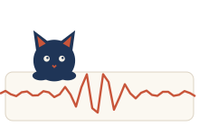
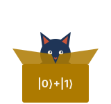

::: {.frontmatter}

::: {.headline}
## Headline findings

*Exact where possible, learned where not, quantum where it can be shown to pay.*

1. **Exact answers at regional scale (quantum-inspired).** The capped multi-year payout process is an exact product
   of independent Poisson sources. A tensor network in a tail-preserving tilted gauge, and frontier variable
   elimination for dense but narrow graphs, compute every target with zero sampling error: the brief's Table 5 in
   {{EQT_EXACT_MS}}, data-calibrated pools of 10 and 28 countries in {{CAREC_MPS_MIN}} and {{AP_MPS_SEC}}, and dense
   band-4 graphs up to 28 countries ({{DENSE_BIG_SEC}}).
2. **Higher accuracy per query (learned).** Where exact contraction is not available, Rényi-Doob Policy
   Optimization (RDPO) beats the best of the brief's four methods in {{EQT_A_PATH_BRIEF}} benchmark cells at the
   same path budget, the brief's criterion, by {{E1_EXH_RANGE_SHORT}} on joint exhaustion, and has {{VAR_RING}}
   lower per-path variance than the optimal exponential twist on rings of 8–28 countries. At equal CPU time on our
   NumPy engine cheap methods win most cells (RDPO keeps {{EQT_A_TIME_BRIEF}}; §6.5, Table [tab:eqtA]).
3. **A quantum stage with a measured bar.** Amplitude estimation with exact twisted loading needs resources linear
   in countries and dependence edges. Against our best classical method it breaks even only on hardware
   {{Q_SSTAR_28}} times faster than a projected fault-tolerant baseline (28 countries); a costed near-term run on
   an IBM Heron-class model is off by {{HW_BEST_RANGE}} at today's noise, and the trust guard falls back.

**Model risk is the larger number.** With both countries' laws fixed, any dependence puts Pr(L > 80m) in
[0, {{FIN_EXC_MAX}}] (brief {{PU_EXC_BRIEF}}). Public proxies give a stress range with posterior median
{{PU_EXC_MED}} [{{PU_EXC_LO}}, {{PU_EXC_HI}}]; one shared US$80m limit keeps {{FIN_POOL_BRIEF}} of expected payouts
under the brief's dependence and {{FIN_POOL_MED}} under the data. *Weaknesses:* the earthquake share rests on
{{LOSS_NBOTH}} coincident loss years (NOAA 1900–2020: {{LOSS_NOAA1900}}; EM-DAT 1990–2020: {{LOSS_EMDAT}},
consistent with the brief); rain sharing is measured at the 1-in-5-year level while the trigger is about
1-in-50; the proxies are loss and epicentre records, not the cat-in-a-box trigger (§6.6).
:::

::: {.abstract}
## Abstract

Pooled catastrophe-risk instruments such as ADB's US$160m Disaster Relief Bond for the Kyrgyz Republic and
Tajikistan depend on *joint tails*: the chance that several countries lose together. These probabilities are
rare, poorly constrained by a few decades of data, and must be recomputed under many dependence scenarios. Plain
Monte Carlo returns no hit at practical budgets, and exact enumeration grows as 10ⁿ with the number of countries.

We write the capped multi-year payout process exactly as a product of independent Poisson *sources*. A
**quantum-inspired tensor network** in a tilted gauge, and frontier variable elimination for bounded-treewidth
graphs, compute every target exactly where dependence is sparse or narrow. **Rényi-Doob Policy Optimization
(RDPO)** covers the rest: the zero-variance sampler is the Doob h-transform of the source process, equivalently the
optimal policy of a KL-regularised control problem; RDPO learns it within a fixed path budget (cross-entropy to
reach the tail, a Rényi-2 (χ²) stage to repair heavy-tailed fits) with an exactly unbiased estimator. Per path it
is the most accurate method we tested on every rare target; per CPU second simple methods remain competitive, and
Phase 2 targets that gap. Because dependence, not sampling, dominates the uncertainty, we bound each target over
all couplings, propagate posterior uncertainty from public records as a stress range, and express the result as a
pooling decision. A product-form version of the learned measure loads exactly into amplitude estimation; we give
an end-to-end resource estimate, a falsifiable crossover law against our best classical method, and a costed
near-term run.
:::

:::

# 1 Introduction {.newpage}

## 1.1 Why now

* **Pooled cover is growing, and its price depends on joint tails.** The Asian Development Bank's
  US$160 million Disaster Relief Bond for the Kyrgyz Republic and Tajikistan pools earthquake and
  precipitation risk across a shared fault and glacier system. Whether pooling lowers cost, and whether
  investors are paid fairly, depends on how often both countries lose *together*.
* **The losses are large and recurrent.** Earthquakes in Central Asia are reported to cause on the order
  of half a billion US dollars of damage per year, with the Kyrgyz Republic among the most affected
  (CABAR.asia, cited in the challenge brief).
* **The data cannot pin down the joint tail.** Only a couple of decades of high-quality disaster data
  exist, so the dependence between countries must be stress-tested across scenarios rather than
  estimated. Every scenario multiplies the number of rare-event computations.
* **Current tools fail exactly where it matters.** At the {{BASE_JE_MU}} joint-exhaustion probability of the
  benchmark, plain Monte Carlo with 16,384 paths returns *zero* in {{MC_ZERO}} of runs. Exact enumeration
  is instant for two countries but grows as 10ⁿ, and regional pools cover 5–30 countries.

![**Figure [fig:bvd].** The bond's two dependence assumptions against public proxies (§6.6). Dots: point estimates; bars: 95% intervals. The longest loss record shows more shared earthquakes than the brief assumes, the shortest is consistent with it; station data show less shared extreme rain at the 1-in-5-year level. Propagated through the exact bond model, the posterior median of a large pool payout is {{PU_EXC_X}} times the brief's value. A stress range, not a re-pricing.](../art/brief_vs_data_clean.svg){.wide}

::: {.takeaway}
The bottleneck is accuracy per query in the joint tail, and how it degrades as portfolios grow.
:::

## 1.2 The idea in three cards

![**Figure [fig:cards].** The three ideas behind RDPO. (01) The optimal sampler moves probability
towards the losses and corrects by importance weights. (02) A catastrophe portfolio decomposes into
independent Poisson shocks, so a scenario is a short sequence of small draws. (03) Estimation error is
dominated by a few rare paths, so the sampler must be trained against χ², not only against
KL.](../art/concept_cards.svg){.wide}

## 1.3 System overview

![**Figure [fig:arch].** System architecture. Calibrated hazard parameters, contract terms, a
dependence graph and stress scenarios define an exact source model. The RDPO engine learns a
soft-value sampling policy inside a fixed path budget (top loop) and turns it into an unbiased estimate
with a confidence interval (bottom row). A validation layer checks the method against exact references.
The same learned measure can feed a future quantum estimation stage (dashed).](../art/architecture.svg){.wide}

## 1.4 Contributions

1. **Exact source-level formulation.** The capped multi-year payout process is an exact product of commuting
   Poisson kernels with finite increment laws (Propositions 1–2), so a scenario is a sequence of K = 2n + 2|E|
   independent draws.
2. **A quantum-inspired exact engine.** Tilted-gauge matrix-product states and frontier variable elimination give
   every target with zero sampling error for sparse and bounded-treewidth pools to 28 countries (§6.4), and pair
   questions in milliseconds at any size.
3. **RDPO for what exact contraction cannot reach.** The zero-variance sampler is the optimal policy of a soft
   control problem (Proposition 3); we learn it with KL then χ² objectives (Proposition 4) inside a fixed budget,
   with an exactly unbiased estimator (Proposition 5).
4. **Evaluation at equal paths and at equal time.** All 25 benchmark cells, scaling to 50 countries, dense graphs
   and data-calibrated pools against exact references, three stronger rare-event baselines, and an equal
   wall-clock audit (§6.5).
5. **Model risk made explicit.** Model-free bounds over all couplings, a posterior stress range from public
   records with its weaknesses stated, and the effect on a pooled limit (§6.6).
6. **A quantum stage with an end-to-end resource estimate.** Exact structured loading, a falsifiable crossover
   law against our best classical method, a calibration trust guard and a costed near-term run (§7–8).

# 2 Data and Problem Formulation {.newpage}

::: {.opener}
{.mascot}

This section states what data the prototype uses, then builds the estimation problem step by step,
from the contract terms to an exact source-level representation for any number of countries.
:::

## 2.1 Data and model inputs

The model uses **no historical loss records and no proprietary data**. Its inputs are the calibrated
parameters published in the challenge brief; a public earthquake catalogue is used to *check* them (§6.6):

| Input | Values | Source | Used for |
|---|---|---|---|
| Annual EQ exceedance probabilities (≥25/50/75/100% of sub-limit) | KG: 3.883/2.331/1.790/1.184%; TJ: 3.925/1.743/1.332/1.043% | Brief, Table 1 | compound-Poisson rates (§2.4) |
| Conditional trigger probabilities | Pr(TJ \| KG) = 7.5%, Pr(KG \| TJ) = 7.4% | Brief | shared-event rate (§2.5) |
| Precipitation trigger probability; shared share | 2% per year; 25% of the smaller rate | Brief | rain sources (§2.5) |
| Contract terms | US$80m principal = 70m EQ + 10m rain; 3-year term; T = 80m | Brief | payoffs (§2.3) |
| Stress scenarios | base, independent, common shock (m = 2), rain stress (×2), rain cover (60/20m) | Brief, Table 4 | E1 benchmark |
| Reference values | five targets × five scenarios | Brief, Table 5 | validation (reproduced exactly) |
| n-country extension | KG/TJ parameters alternated on chain, ring, star and complete graphs | constructed (§2.8) | scaling study |
| Earthquake catalogue (real data) | USGS significant earthquakes, M ≥ 5.5, 1965–2016; country boundaries | public mirrors (§6.6) | check of Poisson arrivals, trigger size, shared events |

In Phase 2 the same pipeline will take source laws estimated from public hazard data (for example
earthquake catalogues, regional seismic hazard models and precipitation reanalyses) in place of the
brief's parameters. The method only needs one finite increment law per source.

![**Figure [fig:setup].** The benchmark portfolio. Each country's bond pays in earthquake quarter steps
and a single precipitation trigger; shared events hit both countries at once. All five targets are
expectations of functions of the two term losses.](../art/problem_setup.svg){.wide}

## 2.2 Notation in brief

* Countries $i = 1, \dots, n$; term $\tau = 3$ years; dependence graph $\mathcal G = (V, \mathcal E)$.
* Terminal state of country $i$: EQ quarter steps $a_i \in \{0, \dots, 4\}$ and rain trigger $r_i \in \{0,1\}$.
* Sources $k = 1, \dots, K$ with finite increment laws $p_k$; target functional $f$; target value $\mu = \mathbb E_p[f]$.
* Sampling policy $q_\theta$; importance weight $w = \mathrm dP/\mathrm dQ_\theta$; total path budget $B$.

## 2.3 Contract terms and payout functions

Country $i$ holds a bond with principal $B_i$ split into an earthquake sub-limit $E_i$ and a
precipitation sub-limit $P_i$ (benchmark: $E_i = 70$m, $P_i = 10$m, $B_i = 80$m). Earthquake payouts accrue in
quarter steps and accumulate up to the sub-limit; precipitation pays $P_i$ at most once. The term loss is

$$L_i = E_i \frac{a_i}{4} + P_i\, r_i, \qquad L = \sum_{i=1}^n L_i .$$

## 2.4 Annual earthquake model

From the exceedance probabilities $t_1 > t_2 > t_3 > t_4$, the point probabilities of paying 0–3 quarter
steps are $p_0 = 1 - t_1$, $p_k = t_k - t_{k+1}$ ($k = 1, 2$) and $p_3 = t_3 - t_4$. A compound Poisson model with
total rate $\Lambda$ and size rates $\lambda_k$ matches them when

$$\Lambda = -\ln p_0,\quad \lambda_1 = \frac{p_1}{p_0},\quad \lambda_2 = \frac{p_2}{p_0} - \frac{\lambda_1^2}{2},\quad \lambda_3 = \frac{p_3}{p_0} - \lambda_1\lambda_2 - \frac{\lambda_1^3}{6},\quad \lambda_4 = \Lambda - \lambda_1-\lambda_2-\lambda_3,$$

with per-event size probabilities $w_{i,k} = \lambda_{i,k}/\Lambda_i$.

## 2.5 Dependence through shared events

* **Shared earthquakes.** With conditional trigger probabilities $\rho_{2|1} = 0.075$, $\rho_{1|2} = 0.074$ and
  scenario multiplier $m$,
  $$c = m \cdot \tfrac12\left(\rho_{2|1}\Lambda_1 + \rho_{1|2}\Lambda_2\right).$$
  Solo events arrive at $\Lambda_i - c$, so each country keeps its total rate; shared events draw their
  sizes independently in each country.
* **Generator.** The capped levels $(a_1, a_2)$ form a 25-state Markov chain with generator $G$:
  $$G_{(a,b),(a \oplus k,\, b)} \mathrel{+}= (\Lambda_1 - c)\, w_{1,k}, \qquad G_{(a,b),(a,\, b \oplus j)} \mathrel{+}= (\Lambda_2 - c)\, w_{2,j}, \qquad G_{(a,b),(a\oplus k,\, b \oplus j)} \mathrel{+}= c\, w_{1,k} w_{2,j},$$
  where $x \oplus k = \min(x + k, 4)$ is capped addition.
* **Rain.** Each country triggers with annual probability $q = 2\%$ (rate $\mu = -\ln(1-q)$), of which a
  shared component $c_r = s_r \min(\mu_1, \mu_2)$ with $s_r = 0.25$ triggers both.

## 2.6 Aggregation over the term

::: {.proposition}
**Proposition 1 (term law).** The law of the capped term EQ levels is $e^{\tau G}_{(0,0),\,\cdot}$, and
the term rain law is the annual one with rates multiplied by $\tau$.

*Proof.* For non-negative integers, $\min(\min(x,4) + y, 4) = \min(x + y, 4)$, so capping each year and
then the running total equals capping the total event count over the term. Independent Poisson streams
over three unit intervals superpose to a Poisson stream on $[0,\tau]$, whose capped levels follow $G$.
The rain trigger is the indicator of at least one event. $\square$
:::

Numerically, $e^{3G}$ reproduces the brief's three-fold capped convolution to within $3\times10^{-16}$ in
all five scenarios.

## 2.7 Estimation targets

| Target | Definition | Typical value |
|---|---|---|
| expected principal loss | $\mathbb{E}[L]$ | US$10m (not rare) |
| joint attachment | $\Pr(L_1 > 0,\ L_2 > 0)$ | ≈ 4% |
| portfolio exceedance | $\Pr(L > T)$ | ≈ 1% |
| portfolio stop-loss | $\mathbb{E}[(L - T)^+]$ | tail-driven |
| joint exhaustion | $\Pr(L_1 = B_1,\ L_2 = B_2)$ | **≈ 3×10⁻⁵ (rare)** |

## 2.8 Extension to n countries

* An edge $\{i,j\}$ of the dependence graph means that $i$ and $j$ can be hit by common events (a shared
  fault system, river basin or weather regime).
* Each edge carries a shared EQ source (rate $c_{ij}$, the rule of §2.5) and a shared rain source
  $(c^r_{ij} = s_r\min(\mu_i,\mu_j)/d_{\max})$; solo rates are reduced so that total rates are preserved.
* For $n = 2$ with one edge this *is* the benchmark: all 25 reference values are recovered to
  $4\times10^{-14}$.

![**Figure [fig:topo].** Dependence graphs used in the scaling study. Nodes are countries; edges are
shared-event sources. The number of edges crossing a cut (the cut-width) governs the cost of exact
classical tensor-network methods (§6.4).](../art/topologies.svg){.wide}

## 2.9 Source decomposition

::: {.proposition}
**Proposition 2 (source decomposition).** Let $\mathcal{S}$ be the $K = 2n + 2|\mathcal{E}|$ independent Poisson
sources (solo EQ and solo rain per country; shared EQ and shared rain per edge), with generators $G_k$.
Then the $G_k$ commute and $P^{(\tau)} = \delta_{\mathbf 0} \prod_{k} e^{\tau G_k}$. The terminal state is
$\mathbf{0} \oplus X_1 \oplus \cdots \oplus X_K$ with independent increments $X_k \sim p_k = (e^{\tau G_k})_{\mathbf 0, \cdot}$,
each supported on at most 25 values.

*Proof.* Capped addition is a commutative monoid action, so the kernels of different sources commute,
and independence gives the product. By the identity in Proposition 1, a source's term effect is a capped
increment in $\{0..4\}$, $\{0..4\}^2$ or $\{0,1\}$. $\square$
:::

![**Figure [fig:sources].** Source decomposition of a three-country chain. A scenario is a sequence of
independent draws, one per source; each draw changes only the one or two countries it
touches.](../art/sources.svg){.wide}

## 2.10 Why the problem is hard

* Monte Carlo relative error: $\mathrm{RE}_{\text{MC}} = \sqrt{(1-\mu)/(\mu N)}$, and the probability of no hit
  at all is $(1-\mu)^N$.
* For joint exhaustion ($\mu \approx 3.2\times10^{-5}$) at $N = 16{,}384$: $\mathrm{RE}_{\text{MC}} \approx 1.4$, and about
  60% of runs return exactly zero.
* Exact enumeration takes 0.2 ms for two countries but scales as $10^n$.

::: {.takeaway}
A portfolio scenario is a short sequence of independent, local draws. That is the structure a learned
sampler, and a quantum loader, can exploit.
:::

# 3 Related Work

::: {.opener}
{.mascot}

Where RDPO sits: rare-event simulation, control as inference, and quantum methods for risk, and the evidence standard we hold ourselves to.
:::

* **Catastrophe modelling practice.** Vendor platforms and the open-source Oasis Loss Modelling
  Framework chain hazard, vulnerability and financial modules. They estimate portfolio metrics by
  aggregating simulated event or year loss tables, usually by plain Monte Carlo, and they express
  dependence through shared events or copulas [@joe2014; @embrechts1997].
* **Rare-event simulation.** Stratification, randomised quasi-Monte Carlo and importance sampling are
  classical [@glasserman2003; @owen1997]. The cross-entropy method fits proposals by multilevel KL
  minimisation [@rubinstein2004]. Variance-minimising adaptive importance sampling [@arouna2004] and χ-
  and Rényi-divergence variational inference [@dieng2017; @li2016] motivate our second training stage.
* **Control and RL.** The link between zero-variance measures, Doob transforms and KL control goes back
  to linearly solvable MDPs and path-integral control [@todorov2009; @kappen2005].
* **Quantum methods for risk.** Amplitude estimation offers a quadratic query speed-up over Monte
  Carlo [@brassard2002; @montanaro2015], with risk applications [@woerner2019] and a correlated
  credit-default model [@egger2021] analogous to shared-event catastrophe risk. Practical variants avoid
  phase estimation [@suzuki2020; @grinko2021], and end-to-end studies show that state preparation
  dominates cost [@chakrabarti2021; @herman2023]. Generative models load distributions on near-term
  devices [@benedetti2019; @zoufal2019; @amin2018; @zhu2022]; Grover–Rudolph loading is exact for integrable
  laws [@grover2002] but can erase the speed-up when the integrals are costly [@herbert2021].
* **Other quantum and quantum-inspired routes.** Quantum kernels [@havlicek2019] and annealer-based samplers
  [@benedetti2016] have been proposed for surrogates and proposals. Tensor networks are the standard
  quantum-inspired representation of high-dimensional laws [@orus2014; @han2018] and are used for multi-asset
  pricing [@kastoryano2022]; exact inference on bounded-treewidth graphs goes back to variable elimination
  [@dechter1999] and cutset conditioning [@pearl1988].
* **Evidence standards.** A recent position paper argues that quantum machine learning on classical
  data has not earned priority, because its advantage claims rest on strong input assumptions and
  trainability and noise barriers, and lack wall-clock wins; it calls for falsifiable criteria and for
  AI-for-Quantum work [@guo2026stopqml]. Error mitigation can itself increase error under
  miscalibration [@errmit2026]. Section 7 is written to these standards.

**Positioning.** Exact where possible (tensor networks), learned where not (the change of measure, trained
against the divergence that governs variance), and quantum only where a measured crossover says it pays. Against
the approaches the brief suggests:

| Approach | What it needs on this problem | What we measured or cite | Verdict |
|---|---|---|---|
| Amplitude estimation [@woerner2019; @egger2021] | exact loading, payout oracle, deep circuits | exact source-wise loading, linear resources (§7.5); break-even needs hardware {{Q_SSTAR_28}}× faster at 28 countries; near-term circuits off by {{HW_BEST_RANGE}} (§7.8) | right primitive; needs fault tolerance |
| QCBM, QGAN, QBM, quantum copula as loaders [@benedetti2019; @zoufal2019; @amin2018; @zhu2022] | learn p from data | p is known exactly here; a learned loader errs in the tail it never sees. As a proposal, an 8-qubit Born machine's noise biased weights by {{QCBM_BIAS}}, {{QCBM_CAL}} after calibration (§7.8) | only as a reweighted proposal |
| Quantum kernels [@havlicek2019] | a surrogate or proposal | payouts are exact and cheap; the optimal proposal is a value function | no role found; not tested |
| Annealing, annealer QBM [@amin2018; @benedetti2016] | samples at unknown effective temperature | unbiased weights need known proposal probabilities | not used |
| Tensor networks [@han2018; @orus2014; @kastoryano2022] | low bond dimension or treewidth | exact to 28 countries in seconds to minutes (§6.4) | **our exact engine** |
| Classical rare-event methods | a good proposal | MC, Sobol, stratified, brief IS, SMC, splitting, flow IS, twisting: all benchmarked (§6) | the bar for every claim |

# 4 Method: Rényi-Doob Policy Optimization

::: {.opener}
{.mascot}

One idea: the best possible sampling distribution is a reinforcement-learning policy, and it should be
trained against the quantity that actually determines estimation error.
:::

## 4.1 Importance sampling and the zero-variance measure

For any sampling law $Q$ with $Q \gg P$ on $\{f > 0\}$, the estimator $\hat\mu = \frac1N\sum_{j} w(X_j) f(X_j)$
with $w = \mathrm dP/\mathrm dQ$ is unbiased, and

$$\operatorname{Var}_Q(\hat\mu) = \frac{1}{N}\left(\mathbb{E}_Q[w^2 f^2] - \mu^2\right).$$

For $f \ge 0$ the variance vanishes under $\mathrm dQ^*/\mathrm dP = f/\mu$. In the source representation, with
$s_k$ the state after sources $1..k-1$, define the value function

$$V_k(s) = \mathbb{E}\left[f(S_K) \mid S_k = s\right] = \sum_x p_k(x)\, V_{k+1}(s \oplus_k x), \qquad V_{K+1} = f.$$

::: {.proposition}
**Proposition 3 (Doob transform).** $Q^*$ is the Markov law with transitions
$q^*_k(x \mid s) = p_k(x)\, V_{k+1}(s \oplus_k x) / V_k(s)$, and every path sampled from $Q^*$ has $w \cdot f = \mu$.

*Proof.* The ratios telescope: $\prod_k q^*_k / p_k = V_{K+1}(S_{K+1}) / V_1(\mathbf 0) = f/\mu$. $\square$
:::

For two countries $V$ has only 100 states and can be tabulated exactly. This zero-variance backward
induction is our strongest classical baseline, and it is exact. At scale $V$ has $10^n$ entries and must be
*learned*.

## 4.2 The reinforcement-learning loop

Taking logarithms of the recursion gives the **soft Bellman equation**

$$\log V_k(s) = \log \sum_x p_k(x)\, \exp\!\big(\log V_{k+1}(s \oplus_k x)\big)$$

of a KL-regularised control problem with reference dynamics $p$ and terminal reward $\log f$
[@todorov2009; @kappen2005]. The zero-variance sampler is its Boltzmann policy. Figure [fig:rl] states the
resulting MDP.

![**Figure [fig:rl].** RDPO as one reinforcement-learning loop. The agent chooses the increment of
each Poisson source in turn; the environment applies it with capping. After K steps the payoff and
importance weight are observed. The two learners update the same soft value
function.](../art/rl_loop.svg){.wide}

## 4.3 Policy class

* **Soft value.** $\log \tilde V_\theta(s) = \theta^\top \Phi(s)$; policy
  $$\tilde q_{\theta,k}(x \mid s) \propto p_k(x)\, \exp\!\left(\theta^\top\left[\Phi(s \oplus_k x) - \Phi(s)\right]\right), \qquad q_{\theta,k} = (1-\alpha)\,\tilde q_{\theta,k} + \alpha\, p_k .$$
  The defensive mixture ($\alpha = 0.05$) bounds every per-step likelihood ratio by $1/\alpha$.
* **Features.** Country thresholds $\psi(a_i, r_i) = [\mathbb 1\{a_i \ge 1\}, \dots, \mathbb 1\{a_i \ge 4\}, r_i]$ ($5n$);
  dependence edges $\chi = [\mathbb 1\{L_i>0\}\mathbb 1\{L_j>0\}, \mathbb 1\{a_i = a_j = 4\}, r_i r_j]$ ($3|\mathcal E|$);
  target progress, e.g. $[\min(L,T)/T, \mathbb 1\{L>T\}, (L-T)^+/(L_{\max}-T)]$ (1–3).
* **Locality.** A source touches at most two countries, so $\Phi(s\oplus_k x) - \Phi(s)$ lives on a fixed small
  coordinate set and the normaliser sums over at most 25 values. One path costs $O(n + |\mathcal E|)$ on
  bounded-degree graphs and never touches the $10^n$ joint state space.
* **Target relevance.** If $f$ depends only on a subset $\mathcal R$ of countries, then for every source
  touching no country in $\mathcal R$ the exact Doob policy is $q^*_k = p_k$ (Proposition 3). RDPO freezes such
  sources at $p_k$, with likelihood ratio exactly one. For a pair target inside a 28-country portfolio this
  reduced the error by more than two orders of magnitude in development runs (§6.3).

## 4.4 Training objectives: from KL to Rényi-2

* **Stage 1: cross-entropy policy search (KL).** Minimising $D_{\mathrm{KL}}(Q^*\,\|\,Q_\theta)$ is a weighted
  maximum-likelihood problem, concave in $\theta$ for this log-linear policy. For rare targets, the elite
  level $\gamma = \min(\gamma^*, \text{quantile}_{1-\rho}(\text{score}))$ is raised until the target level is reached
  [@rubinstein2004].
* **Stage 2: Rényi-2 policy gradient (χ²).** Estimation error is governed by a different divergence:

::: {.proposition}
**Proposition 4 (variance is a Rényi-2 divergence).** For $f \ge 0$ and $g = w f$,
$$\frac{N\operatorname{Var}_Q(\hat\mu)}{\mu^2} = \chi^2(Q^*\,\|\,Q) = e^{D_2(Q^*\|Q)} - 1, \qquad D_{\mathrm{KL}}(Q^*\|Q) \le D_2(Q^*\|Q).$$
The bound runs one way only: a policy with small KL can still have very large variance.
:::

  RDPO therefore takes REINFORCE steps on $\log M_2$, $M_2 = \mathbb E_{Q_\theta}[g^2]$, with a constant baseline:
  $$\nabla_\theta \log M_2 = -\,\mathbb{E}_{Q_\theta}\!\left[\left(\frac{g^2}{M_2} - 1\right) \nabla_\theta \log q_\theta(\text{path})\right],$$
  keeping the iterate with the lowest *estimated* χ² and stopping early. No reference value is used in
  training. In a preliminary benchmark study this stage removed every heavy-tailed cross-entropy failure
  (2 of 15 fits) and reduced the exact per-path relative standard deviation of a failed fit from 14.5 to
  0.60. Its role is to repair fits whose KL is small but whose χ² is not.

* **Warm start.** For threshold targets the policy starts at the optimal exponential twist of the total
  loss, $\theta_h \leftarrow \eta^\star T$ with $\eta^\star = \arg\max_\eta\, \eta T - \Lambda(\eta)$ (the large-deviation Doob
  transform).

## 4.5 Algorithm

::: {.algorithm}
**Algorithm 1: RDPO with a fixed total budget B**

1. Initialise $\theta$ (warm start where applicable); batch size $b = \max(500, B/16)$; training cap $B/2$.
2. **Stage 1:** draw $b$ paths; set the elite level $\gamma$; refit $\theta$ by concave weighted log-likelihood. Repeat until the target level is reached, plus one iteration.
3. **Stage 2:** draw $b$ paths; estimate $\hat\chi^2$; take one Adam step on $\log M_2$. Repeat until 3 steps pass without improvement or the cap is reached; keep the best $\theta$.
4. **Stage 3:** spend the rest of the budget with the selected policy, driven by 8 scrambled Sobol sequences.
5. **Estimate:** pool every batch whose policy had reached the target level before it was drawn (weights ∝ batch size); report the 95% interval.
:::

![**Figure [fig:pipeline].** RDPO stages and an illustrative split of the fixed path budget.](../art/pipeline.svg){.wide}

## 4.6 Unbiasedness and uncertainty

::: {.proposition}
**Proposition 5 (recycled estimator is unbiased).** Let batches be drawn with policies $\theta_b$ and sizes
$n_b$ measurable with respect to the history $\mathcal F_{b-1}$, and let $b_0$ be the first batch whose policy had
reached the target level before it was drawn. Then $\hat\mu = \sum_{b \ge b_0} \frac{n_b}{N_e}\,\hat\mu_b$ with
$N_e = B - \sum_{b<b_0} n_b$ satisfies $\mathbb{E}[\hat\mu] = \mu$.

*Proof.* All batches after $b_0$ are pooled, so $N_e$ and every weight $n_b/N_e$ are known before batch $b$ is
drawn. Since $\mathbb{E}[\hat\mu_b \mid \mathcal F_{b-1}] = \mu$, the tower property gives $\mathbb{E}[\hat\mu] = \mu$.
Scrambled Sobol points are marginally uniform, so RQMC blocks are unbiased too. $\square$
:::

The standard error combines within-batch variances (i.i.d. batches) with between-scramble variances
(RQMC blocks). We report the empirical coverage of the resulting 95% intervals.

::: {.takeaway}
RDPO learns the zero-variance sampler as a soft-RL policy: KL to reach the tail, χ² to control the
error, inside one budget, without bias.
:::

# 5 Experimental Protocol

::: {.opener}
{.mascot}

Every method gets the same simulation budget, RDPO's training counts against it, and every answer is checked against an exact reference.
:::

* **Budget.** Every method receives the same total number of sampled term scenarios $B$; RDPO's training
  paths count against $B$.
* **Metrics.** Relative RMSE against the exact value over independent replications (40 for the
  benchmark, 6–20 at scale), relative bias, and the empirical coverage of nominal 95% intervals.
* **References.** Benchmark: exact enumeration, which reproduces the brief's Table 5. Scaling: exact
  tensor networks in a tail-preserving tilted gauge (§6.4), validated against dense enumeration for $n \le 6$.
* **Baselines.** Three groups. (i) The challenge's four reference methods: plain Monte Carlo, scrambled
  Sobol (8 scrambles), stratification by first payout year, and the brief's importance sampling. (ii) At
  scale we add classical exponential twisting [@glasserman2003]. (iii) Three stronger rare-event methods,
  compared on the ADB benchmark and the ring-16 scaling case, at the same budget and seeds as RDPO
  (§6.5): adaptive multilevel splitting / subset simulation [@cerou2007; @aubeck2001],
  SMC on exponential tilts [@delmoral2006], and a diagonal normalising-flow importance sampler trained by
  REINFORCE on $\chi^2$ (product-of-categoricals, warm-started from the optimal twist) [@muller2019].
* **Compute.** One core per run of a 4-core Intel Xeon server CPU (15 GB RAM, no GPU); NumPy/SciPy; fixed seeds
  in every result file. Sections 6.1–6.4 use the Phase 1 engine; §6.5 onwards the Phase 2 engine.

# 6 Results {.newpage}

::: {.opener}
{.mascot}

How accurate, how fast, and where it fails: the benchmark, scaling to 50 countries, the Phase 2 engine, real-world data and catastrophe-model output.
:::

## 6.1 Benchmark: five scenarios × five targets (Phase 1 engine)

![**Figure [fig:e1].** Benchmark at a total budget of 16,384 paths, training included. Left: RDPO's
relative RMSE per cell. Right: improvement over the best of the four reference methods in the same cell
(>1: RDPO is more accurate).](../../figures/paper/e1_heatmap.png){.wide}

{{BRIEF5_TABLE}}

{{TABLE_E1}}

{{E1_TEXT}}

![**Figure [fig:e1budget].** Relative RMSE versus total budget in the base scenario, with RDPO's
training included. Grey dashes show the $N^{-1/2}$ slope.](../../figures/paper/e1_budget.png){.wide}

## 6.2 Scaling to large portfolios (Phase 1 engine)

![**Figure [fig:e2].** Scaling at a total budget of 65,536 paths. (a) Pool exceedance $\Pr(L > T_n)$ on a
ring: the target falls from $10^{-2}$ to $10^{-13}$. (b) Joint exhaustion of one country pair *inside* the
portfolio. Monte Carlo is shown by its theoretical error, since empirical runs return
zero.](../../figures/paper/e2_scaling.png){.wide}

{{TABLE_E2}}

{{E2_TEXT}}

## 6.3 Ablation study

![**Figure [fig:e3].** Ablation at a total budget of 16,384 paths. Each bar removes one component of
RDPO.](../../figures/paper/e3_ablation.png){.wide}

{{E3_TEXT}}

## 6.4 The quantum-inspired exact engine: tilted tensor networks

Tensor networks are the classical simulation method of quantum many-body physics, and the standard
*quantum-inspired* approach to high-dimensional probability. Here they are our first solver: wherever they
are exact, sampling is unnecessary.

* Applying the commuting kernels of Proposition 2 to a matrix-product state gives the full joint law,
  with a bond dimension set by the shared sources crossing each cut.
* Tail accuracy requires compressing in a *tilted gauge*, $\tilde p(x) = p(x)\prod_i g_i(x_i)$ with $g_i$ the inverse
  independent marginal. In the correctness study (2–6 countries) plain truncation gives up to {{TN_PLAIN_ERR9}}
  error on the rarest target at tolerance $10^{-9}$ ({{TN_PLAIN_ERR12}} at $10^{-12}$); the tilted gauge gives
  {{TN_TILT_ERR9}} ({{TN_TILT_ERR12}}).
* For chain, star and ring dependence the bond dimension is constant ({{TN_CHAIN_BOND}}, {{TN_STAR_BOND}},
  {{TN_RING_BOND}}): all targets for 28 countries on a ring take {{TN_RING28_S}}. For complete dependence it grows
  ({{TN_COMPLETE_BOND}} from four to six countries).
* Real pools are sparse: ordered west to east, the data-calibrated 10-country CAREC pool has bond dimension
  {{CAREC_BOND}} and the 28-country Asia–Pacific pool {{AP_BOND}} (§6.7), exact in {{CAREC_MPS_MIN}} and
  {{AP_MPS_SEC}}. These serve as references for
  RDPO and as the production answer whenever they fit in memory.
* **Dense, bounded-treewidth graphs.** A frontier variable-elimination solver (`src/tensor/junction.py`) is
  exact for any graph of small pathwidth, with only non-negative sums (no gauge needed). It agrees with dense
  enumeration to 10⁻¹⁶ and with the tilted MPS to 10⁻¹³, and gives {{DENSE_NEXACT}} exact references for graphs
  where each country is linked to its next 2–4 neighbours or to a ladder with diagonals, down to
  μ = {{DENSE_MINMU}}; the largest, {{DENSE_BIG}}, takes {{DENSE_BIG_SEC}}. Against these references RDPO beats
  exponential twisting in {{DENSE_NWIN}} cells at the same path budget, by {{DENSE_GAIN}} (Table [tab:dense]);
  at equal wall-clock twisting is ahead in {{DENSE_EQ_TWIST_WINS}} (RDPO {{DENSE_RDPO_SEC}} per estimate
  including training, twisting about {{DENSE_TWIST_SEC}}).

{{DENSE_TABLE}}

* **Division of labour.** Pair questions: exact product of kernels (≤ {{V2_EXACT_MS}}). Sparse pools: tilted tensor
  network. Dense dependence or events reaching three or more countries: RDPO, validated against the network
  wherever both run.

![**Figure [fig:tn].** The exact engine. (a) Time to compute the full joint law on one core: tilted MPS for chain,
ring and complete dependence; frontier elimination for band-k graphs and a ladder with diagonals; stars:
data-calibrated pools and a 50-country ring. (b) MPS bond dimension: constant for sparse dependence, far below the
√(10ⁿ) a generic law would need.](../../figures/paper/exact_scaling.png){.wide}

## 6.5 Phase 2 engine: complete results

::: {.opener}
{.mascot}

Phase 2 engine: the same answers several times faster, a little more accuracy at scale, and exact answers for questions about two countries.
:::

Sections 6.1–6.4 report the **Phase 1 engine** (RDPO v1). We then implemented the first work packages of
the Deep Development plan (WP1 engineering, WP3 RL improvements) as the **Phase 2 engine** (RDPO v2), and
re-ran every study at the same total budgets, with more replications and identical seeds for every method.

**Engineering (WP1).**

* **Table-driven engine.** Each country state is one of 10 codes, so every logit is a table lookup. The
  policy is *identical* to Phase 1: actions, weights and gradients match to machine precision (tested).
  Rollouts are {{V2_SPEEDUP}} faster on one core for 4–28 countries (Table [tab:v2tp]).
* **Exact compressed training.** Paths share few distinct local states at each source step, so the
  cross-entropy and Rényi-2 objectives are evaluated on unique states with aggregated weights. The
  objective is unchanged, and each evaluation is 50–500× cheaper.

{{V2_TP_TABLE}}

**Reinforcement-learning improvements (WP3).**

* **Stage-dependent soft values.** The exact value function $V_k$ depends on how many sources remain, but
  Phase 1 shares one progress parameter vector across all steps. Phase 2 gives each of 4 contiguous
  stages of source steps its own progress parameters (+9 parameters) for portfolio-wide targets.
* **Flexible soft values for smooth targets.** For expected loss, a piecewise-linear (hat-function)
  basis, a fixed-knot ReLU network in the loss, replaces the hand-made progress features. The
  cross-entropy fit stays concave.
* **Exact reduction for pair targets.** A target that depends on two countries only needs the joint law
  of their 100 states. That law is the product of the kernels of the sources touching them (Proposition 2).
  It is computed exactly in at most {{V2_EXACT_MS}} for any portfolio size, and agrees with the
  tensor-network references to {{V2_EXACT_ERR}}. The Phase 2 engine answers such targets exactly and
  reserves RDPO for portfolio-wide targets.
* **Projected Doob sampler: a simplified RDPO for pair targets.** For a target that depends only on a few
  countries R, the exact value function depends only on their 10^|R| joint states. RDPO's learned log-linear
  soft value is then replaced by an exact table per step, computed by backward induction over the sources that
  touch R, while all other sources keep their true law. The policy is the zero-variance Doob sampler: every path
  returns the exact value (relative spread {{PROJ_SD}}; 20,000 paths in {{PROJ_MS}} for the 10-country CAREC
  pool). Its paths are also exact draws from the portfolio *conditional* on the event, which turns the
  estimator into a stress-scenario generator. Given that the Kyrgyz and Tajik bonds are both exhausted, the
  CAREC pool's total payout averages {{PROJ_COND_MEAN}} (95th percentile {{PROJ_COND_P95}}), and exceeds US$400m
  with probability {{PROJ_COND_400}}. Three-country questions also work: all of KG, TJ and UZ exhausted has
  probability {{PROJ_TRIPLE}}.
* **Safeguards.** Student-t intervals with Welch–Satterthwaite degrees of freedom. The initial (twist or
  transferred) policy is selected whenever its estimated χ² beats every trained iterate.

**Scaling study.**

![**Figure [fig:v2].** Phase 1 versus Phase 2 engine on the scaling study (B = 65,536; 24 replications;
identical seeds). (a, b) Relative RMSE for the portfolio-wide targets, with exponential twisting as the
classical reference. (c) Wall-clock time per estimate on one core.](../../figures/paper/v2_results.png){.wide}

*Table [tab:app_v2scale] in Appendix A lists every setting: method, coverage, twisting and run time.*

* **Accuracy.** On the portfolio-wide targets, at the same budget and seeds, the Phase 2 engine
  {{V2_GAIN}}. It beats exponential twisting in {{V2_TW_WINS}} settings at the same path budget.
* **Equal wall-clock.** Twisting needs no training, so one estimate costs well under a second against
  RDPO's seconds to tens of seconds; at equal wall-clock twisting is at least as accurate in {{EQT_SCALE}} of
  these settings. The full audit follows at the end of this section.
* **Speed.** One estimate takes {{V2_TIME}} less wall-clock time than in the Phase 1 study.
* **Error bars.** With 24 replications, coverage of the Phase 2 intervals on portfolio-wide targets is
  {{V2_COV}}. Most low-coverage cells of the Phase 1 study (6–10 replications) were sampling noise.

**Benchmark.**

{{V2_BENCH_TABLE}}

* The Phase 2 engine keeps the 20/25 wins over the best reference method. On the non-pair cells it is on
  par with Phase 1 at 4,096 paths, and its advantage grows with the budget. Pair targets are answered
  exactly in the product. On expected loss the spline soft values close part of the gap to scrambled
  Sobol, but Sobol remains better.

**Transfer.** In daily use, today's estimate can start from the policy trained overnight on yesterday's model. We emulate this by training on one model, then
reusing the parameters as the initial policy after a change of scenario or a 20% rate increase.

{{V2_TRANSFER_TABLE}}

* **Small budgets become usable.** Transfer improves accuracy by {{V2_TRANSFER_GAIN}}. At 2,048 paths, a
  cold start spends most of its budget reaching the tail, while the transferred policy is already there.
  The estimator remains unbiased, because the initial policy is fixed before sampling.

**Negative results (kept for the record).**

* A *value-of-training* stopping rule, which stops training when one more batch is not expected to pay
  for itself, slightly *increased* the error at two countries and was dropped.
* Spline soft values *hurt* the threshold targets (in development probes, up to ×19 on the stop-loss),
  so they are used for expected loss only.
* t-intervals and model selection changed no result in these studies: the effective degrees of freedom
  were large, and the trained policy always beat the initial one. They are kept as safeguards.

**Comparison with stronger rare-event methods.**

Reviewers of rare-event methods expect comparisons against adaptive multilevel splitting, SMC on
exponential tilts, and neural importance sampling, not just the brief's four reference methods. We
implemented all three on the identical source-form problem (`src/baselines/stronger.py`) at the same
budget and seeds. The normalising-flow IS is warm-started from the optimal exponential twist; it is a product
proposal in source space, like the twist that SMC uses, so it cannot represent state dependence either.

{{STR_TABLE}}

* **RDPO beats every one of them** on every rare target we tested, by factors of {{STR_RANGE}}.
* **SMC on exponential tilts is the strongest fixed baseline.** It is what good practitioners actually
  deploy; RDPO's advantage against SMC is the gain from a learned *state-dependent* policy over the best
  product proposal.
* **Splitting struggles with the discrete, ties-heavy score** of the capped per-country loss, where the
  default rare-event score (total loss) jumps in large steps. We advance past ties and run Gibbs
  mutations, but acceptance stays low on the joint targets.
* **The flow IS does not beat SMC on joint exhaustion**, because a product proposal in source space cannot
  force both countries to their maxima at once; state-dependent transitions are needed, which is what RDPO adds.

### Equal wall-clock audit

The brief's criterion is accuracy per query. Per CPU second the picture differs, because RDPO trains for each
estimate while simple methods draw paths almost for free. We re-ran the benchmark ({{EQT_A_REPS}} replications) and
the data-calibrated pools ({{EQT_B_REPS}} replications) with every competitor given RDPO's single-core wall-clock
for one estimate (`src/rdpo/experiments_equal_time.py`; competitors' paths at equal time from a two-point timing fit,
verified by timing each at that size).

{{TABLE_EQT_A}}

* **Benchmark.** Per path RDPO wins {{EQT_A_PATH_BRIEF}} cells against the brief's four methods ({{EQT_A_PATH_ALL}}
  with SMC and flow IS added). At equal CPU time it keeps {{EQT_A_TIME_BRIEF}} ({{EQT_A_TIME_JE}} joint-exhaustion
  cells); scrambled Sobol wins the smooth targets. One RDPO estimate takes {{EQT_RDPO_MS}}; exact enumeration takes
  {{EQT_EXACT_MS}}, so on the benchmark itself the exact answer is the right tool.

{{TABLE_EQT_B}}

* **Pools.** At equal CPU time RDPO wins {{EQT_B_TIME}} pool cells: both pair-exhaustion questions, by
  {{EQT_B_JE_GAIN}} over Monte Carlo (which pair reduction answers exactly anyway), and {{EQT_B_THR_TIME}} threshold
  questions; twisting's error ranges from {{EQT_B_THR_RANGE}} of RDPO's on the threshold targets.

{{TABLE_V3}}

* **Negative result.** A learned *product-form* tilt (one tilt per source, no state dependence) costs almost no
  training but only ties twisting (median ratio {{V3_TILT_MED}}); an automatic selector between twisting, tilt and
  RDPO also ties ({{V3_SEL_MED}}). RDPO trained per estimate loses {{V3_COLD_SCALE_LOSS}} scaling cells
  ({{V3_COLD_SCALE_MED}} behind) and {{V3_COLD_DENSE_LOSS}} dense cells ({{V3_COLD_DENSE_MED}} behind). The gain
  RDPO shows per path comes from state dependence, and state dependence is what costs training.
* **Consequence for Phase 2.** A GPU-batched engine (the sandbox provides GPU credits), and value functions taken
  from tensor-network contractions or cutset conditioning instead of learned features, so that state dependence
  comes without per-estimate training (§9).

<!-- CUTSET-RESULTS -->

## 6.6 Real-world checks

::: {.opener}
{.mascot}

Do the bond's assumptions survive contact with data? An earthquake catalogue, 120 years of loss records, 48 weather stations, and calibrated pools.
:::

The benchmark model is calibrated to the brief's parameters, not to observations. We tested its assumptions
against public data. **Read this section as a stress test, with these weaknesses stated first:**

* The earthquake shared share rests on {{LOSS_NBOTH}} coincident loss years. NOAA 1900–2020 gives
  {{LOSS_NOAA1900}}, NOAA 1975–2020 {{LOSS_NOAA1975}}, and EM-DAT 1990–2020 {{LOSS_EMDAT}}, consistent with the
  brief's 7.5%.
* Rain sharing is measured at the 1-in-5-year level ({{RAIN_SHARE}}); the bond's rain trigger is about 1-in-50,
  where the stations record too few events to measure it.
* All proxies are loss years, epicentre distance and station rain, not the bond's cat-in-a-box and gridded-rain
  triggers. Shared payouts may be rarer than shared losses.

We never read the results below as evidence that the brief underestimates risk; they give the range over which
pooling decisions should be stress-tested.

* **Data.** The USGS catalogue of significant earthquakes (M ≥ 5.5, 1965–2016) in the public mirror
  `plotly/datasets`, and country boundaries from `datasets/geo-countries`. Aftershocks are removed with
  Gardner–Knopoff windows, which leaves {{RD_N}} main shocks in the Central Asian window. Both files are cached
  in `data/real/`, and the analysis is `src/realdata/eq_check.py`.
* **Proxy.** An event "reaches" a country if its epicentre lies inside the country or within a given
  distance of its border (25, 50 or 100 km). This is a proxy for damage, not a payout calculation.

![**Figure [fig:rd].** (a) Main shocks of M ≥ 5.5 around the Kyrgyz Republic (blue outline) and Tajikistan
(teal outline), 1965–2016; red events lie within 50 km of both countries. (b) Share of each country's events
that also reach the other country, with 95% intervals, against the brief's 7.5% / 7.4%.](../../figures/paper/realdata_eq.png){.wide}

{{RD_TABLE}}

* **Poisson arrivals: supported.** Yearly main-shock counts have dispersion {{RD_DISP}} at 50 km, with
  every p-value ≥ {{RD_DISP_P}}. This is consistent with the compound-Poisson model.
* **Trigger size: plausible.** The Gutenberg–Richter slope is b = {{RD_B}}. The brief's annual 25%-payout
  probabilities then correspond to events of about {{RD_MSTAR}}: rare, damaging earthquakes, consistent with
  the bond's design.
* **Shared events: more than the brief assumes at these magnitudes.** {{RD_SHARE}} of one country's main shocks
  lie within the given distance of the other country, against the brief's 7.5% (Tajikistan given the Kyrgyz
  Republic; 7.4% the other way). These are M ≥ 5.5 events, smaller than the bond's trigger events. Seismicity concentrates along
  the shared Alay–Pamir border zone. Examples in the catalogue are 1974 M7.3 (Markansu), 1978 M6.8 (Alay),
  2008 M6.7 (Nura) and 2016 M6.6 (Murghob). Event years are also significantly dependent at 25–50 km.
* **Consequence for the bond.** Setting the shared-event intensity from these data changes the exact joint
  targets as follows:

{{RD_IMP_TABLE}}

* **Reading.** With the data-based shared intensity, the joint-exhaustion probability is {{RD_EXH_FACTOR}} the
  brief's base value, and joint attachment rises to {{RD_ATT}}. The brief's "common shock ×2" scenario sits at
  the mild end of this range. The finding supports the brief's position that dependence must be stress-tested,
  and it suggests testing intensities well above ×2.
* **Caveats.** Epicentre distance is not payout: parametric triggers depend on ground motion at the exposure.
  The catalogue covers 52 years and ends in 2016, and the M ≥ 6.5 rows rest on very few events. Rainfall
  could not be checked: the reanalysis services (ERA5 via Open-Meteo) are blocked in this environment, and
  checking them is a first task of WP2.

**Loss-data backtest.** Epicentre distance is a proxy, so we repeated the test on *reported losses*. Public
records give yearly losses per country: NOAA's significant-earthquake database (1900–2020) and EM-DAT (1990–2020),
both via the Our World in Data mirror. In the bond model, each country's events are a Poisson process with a
country-only part and a shared part. For yearly occurrence this is a bivariate Poisson model, so the 2×2 table
of loss years identifies the shared rate by maximum likelihood (`src/realdata/loss_backtest.py`).

{{LOSS_TABLE}}

* **The longest record does not fit the brief's 7.5%.** Over 1900–2020 the shared share is {{LOSS_SHARE}}, and
  independence is rejected (p = {{LOSS_P}}). The estimate rests on {{LOSS_NBOTH}} years in which both countries
  recorded losses.
* **Short records are not informative.** The 31-year EM-DAT windows cannot separate 7.5% from 50%, and the
  flood and landslide record does not constrain the rain assumption. This is the brief's own point about
  short data.
* **Implied bond risk.** With the loss-data share for earthquakes (rain at the brief's value), the
  joint-exhaustion probability is {{LOSS_EXH}}: {{LOSS_EXH_FACTOR}} the brief's base case.

::: {.opener}
{.mascot}

Rain is the other half of the bond. Is extreme rain shared between neighbours as often as the brief assumes?
:::

**Meteorological calibration of the rain cover.** The rain cover is parametric: it pays when an
extreme-precipitation index passes its 1-in-50-year level. Its frequency is a design choice, but the brief's 25%
shared share is an assumption about the weather. We measured it in daily station data (NOAA GHCN-Daily via its
open-data mirror; {{RAIN_NST}} stations; `src/realdata/rain_check.py`):

* **Index.** Each station's daily precipitation is divided by its median annual maximum; the country index is
  the daily maximum over its stations.
* **Events.** Days above the country's (1−q) annual-maximum quantile are merged into events less than 3 days
  apart. An event is shared when the neighbour has one within ±1 day.
* **Data cleaning.** Code values of 99.1–99.8 mm, which occur hundreds of times in former-Soviet records, are
  removed.

{{RAIN_TABLE}}

* **Extreme rain is local.** Pooled over neighbouring pairs, the shared share is {{RAIN_SHARE}} at the
  1-in-5-year level and falls towards zero for rarer events, where the counts are small. The brief's 25% is
  outside the 1-in-5-year interval; the trigger level itself cannot be measured with these stations.
* **Both corrections together.** Earthquakes are more dependent than assumed (loss data) and rain much less
  (station data):

{{RAIN_IMP_TABLE}}

* **Reading.** With both dependence assumptions set to their point estimates, pool exceedance is
  {{RAIN_EXC_FACTOR}} the brief's value, while joint exhaustion is {{RAIN_EXH_FACTOR}} because exhaustion needs
  rain in both countries. (The posterior below averages over the uncertain shares, so its median factor for joint
  exhaustion, {{PU_EXH_X}}, differs from this point value; both say the effect is not distinguishable from one.)
  Checking one assumption alone would have been misleading in either direction.
* **Caveats.** Six stations per country sample the rainfall field sparsely, and Kyrgyz and Tajik records thin out
  after the 1990s. Gridded data (ERA5, GPCP, both reachable via open-data mirrors) are the next step.

**Market record of comparable bonds.** The challenge bond has no payout history, and catastrophe bonds are
private placements without public price series, so exchange data such as Yahoo Finance cannot be used. The
closest public record is the World Bank's parametric sovereign bonds. In that record, triggers do occur and
near-misses decide outcomes, but no two countries have ever paid out together:

| Bond (IBRD) | Peril | Modelled annual attachment probability | Outcome |
|---|---|---|---|
| FONDEN 2017, Mexico, Class A (US$150m) | earthquake | not published in the sources found | 100% paid after the M8.1 Chiapas earthquake, Sept 2017 [^mx17] |
| Pacific Alliance 2018, Peru (US$200m) | earthquake | 7.14% | 30% paid after the M8.0 Loreto earthquake, May 2019 [^pe18] |
| FONDEN 2020, Mexico, Class D | Pacific hurricane | not published in the sources found | about 50% loss after Hurricane Otis, 2023 [^mx20] |
| CAR Jamaica 2024 (US$150m) | hurricane | 2.46% (2.34% at launch) | not triggered by Beryl (2024); 100% paid after Melissa, 2025 [^jm24] |

* **What this shows.** Parametric sovereign bonds do pay, and basis risk is real (Beryl). There are too few
  bonds with published attachment probabilities to test the modelled frequencies statistically. The record is far too small to validate a *joint* tail, which is why the joint risk has to come
  from a model of the kind tested here.

[^mx17]: Artemis, "Mexico confirms $150m cat bond payout for quake", https://www.artemis.bm/news/mexico-confirms-150m-cat-bond-payout-for-quake/
[^pe18]: Artemis, "Peru's World Bank cat bond could be triggered by M8.0 earthquake", https://www.artemis.bm/news/perus-world-bank-cat-bond-could-be-triggered-by-m8-0-earthquake/; attachment probability from Artemis, "$1 billion Pacific Alliance earthquake cat bond launched by World Bank", https://www.artemis.bm/news/1-billion-pacific-alliance-earthquake-cat-bond-launched-by-world-bank/
[^mx20]: Artemis, "Mexico expected to renew Pacific coast hurricane cat bond after Otis resolution", https://www.artemis.bm/news/mexico-expected-to-renew-pacific-coast-hurricane-cat-bond-after-otis-resolution/
[^jm24]: World Bank press release, 7 Nov 2025, https://www.worldbank.org/en/news/press-release/2025/11/07/hurricane-melissa-triggers-100-payout-of-150-million-world-bank-catastrophe-bond-for-jamaica; attachment probability from the World Bank case study, https://thedocs.worldbank.org/en/doc/401877c87631461af8ad227793affc5f-0340012025/original/Case-Study-Jamaica-2024-Cat-Bond.pdf; Beryl: Artemis, https://www.artemis.bm/news/jamaicas-disaster-insurance-funds-sufficient-for-beryl-despite-no-cat-bond-payout-cdps-meenan/

**A real five-country pool.** Finally, we calibrated a Central Asian pool from data alone and tested RDPO on
it (`src/realdata/central_asia_pool.py`):

* **Rates.** Rates come from each country's catalogue main shocks within 50 km, with one Gutenberg–Richter slope
  b = {{POOL_B}}.
* **Payout design.** Each country holds the bond's design. The 25% tier triggers at {{POOL_M1}}, the magnitude at
  which the Kyrgyz and Tajik data reproduce the brief's trigger frequency, and higher tiers follow the brief's
  tier ratios.
* **Dependence graph.** The graph is not assumed: an edge exists wherever main shocks reached two countries.
  The catalogue finds {{POOL_EDGES}}. A shock reaching three countries is assigned to its two nearest
  countries, so no event is counted twice.

{{POOL_CAL_TABLE}}

{{POOL_TABLE}}

* **Result.** On the data-calibrated pool, RDPO beats the better of plain Monte Carlo and exponential
  twisting by {{POOL_GAIN}} on the rare questions, against exact answers. On expected pool
  payout, a smooth target, the factor over Monte Carlo is {{POOL_EL}}.
* **Weak spot.** The joint exhaustion of two countries inside the heterogeneous pool is the hardest question
  at this budget. RDPO's error is {{POOL_PAIR}} with {{POOL_PAIR_COV}} interval coverage: far better than Monte
  Carlo, but the intervals are optimistic. Pair questions are therefore answered exactly (pair reduction, §6.5),
  and RDPO is used for pool-wide questions.

**Parameter uncertainty: posterior credible intervals for the headline findings.**

The data give *ranges*, not points, so we propagate parameter uncertainty end-to-end. On
each shared share we place a Jeffreys-prior Beta posterior from the bivariate-Poisson occurrence table
(earthquake: NOAA 1900–2020; rain: pooled station analysis at the 1-in-5-year level), draw {{PU_N}}
samples, and recompute the exact two-country targets at each sample
(`src/realdata/param_uncertainty.py`).

{{PU_TABLE}}

* **Pool exceedance:** posterior median {{PU_EXC_MED}} (**{{PU_EXC_X}}× the brief**); 95% credible
  interval **[{{PU_EXC_LO}}, {{PU_EXC_HI}}]**; the whole interval sits above the brief's {{PU_EXC_BRIEF}}.
* **Joint attachment:** posterior median {{PU_ATT_MED}} ({{PU_ATT_X}}× the brief); 95% credible interval
  [{{PU_ATT_LO}}, {{PU_ATT_HI}}].
* **Joint exhaustion:** posterior median {{PU_EXH_MED}} ({{PU_EXH_X}}× the brief); 95% credible interval
  [{{PU_EXH_LO}}, {{PU_EXH_HI}}]. The two dependence corrections cancel on this target: more earthquakes
  shared, but less rain shared, and exhaustion needs both.
* **Reading.** A credible interval that lies entirely above the brief's value says the proxies are inconsistent
  with the brief's dependence; one that straddles it does not. By this standard pool exceedance and joint
  attachment move and joint exhaustion does not. Loss years and
  epicentre distance are not payout: the bond's earthquake trigger is a cat-in-a-box on location,
  intensity and depth, with boxes that span the border[^cib]. Shared payouts may therefore be rarer than
  shared losses, so we read the posterior as a stress range for the dependence, not as an estimate of it.

[^cib]: Artemis, "More details on the Kyrgyz Republic & Tajikistan catastrophe bonds from the ADB", https://www.artemis.bm/news/more-details-on-the-kyrgyz-republic-tajikistan-catastrophe-bonds-from-the-adb/

**Model risk and the pooling decision.** ADB's question is what dependence means for the instrument, so
we turn the joint tails into the quantities a disaster-risk-financing team decides on
(`src/finance/analysis.py`, all exact).

* **The brief reproduces the issued bond.** Averaging the brief's four annual tier probabilities gives an
  expected earthquake loss of {{FIN_EL_KG}} (Kyrgyz Republic) and {{FIN_EL_TJ}} (Tajikistan) of the
  sub-limit a year. The notes came to market at initial expected losses of {{FIN_ELC_KG}} and
  {{FIN_ELC_TJ}} and priced at a {{FIN_RM}} risk margin[^pricing], so investors are paid
  {{FIN_RM_X_KG}}× and {{FIN_RM_X_TJ}}× expected loss. The benchmark is the real bond's risk profile.
* **Expected loss does not see dependence.** Each tranche's expected loss is fixed by its own country
  (factor ×1.00 in Table [tab:pu]). Dependence enters only through anything that *shares* capital: a
  pooled limit, a reserve, or a portfolio-level stop-loss.
* **Model-free range.** Fixing both countries' term laws at the brief's values, a linear program over all
  100-state couplings gives the smallest and largest value of each target that *any* dependence can
  produce (Table [tab:bounds]). The brief sits low in every range, and joint exhaustion can be up to
  {{FIN_EXH_X}}× the brief's value without changing either country's own risk. No amount of sampling
  accuracy narrows these ranges; only data or expert judgement about dependence can.

{{FIN_TABLE_BOUNDS}}

* **Pooling.** A regional pool would replace the two US$80m covers by one shared limit. Under the brief's
  dependence a shared US$80m limit still pays {{FIN_POOL_BRIEF}} of the expected {{FIN_EL_TERM}} per term
  ({{FIN_SHORT_BRIEF}} given up for US$80m of capital released). Under the data it pays {{FIN_POOL_MED}}
  [{{FIN_POOL_LO}}, {{FIN_POOL_HI}}] ({{FIN_SHORT_MED}} given up), more than three times the shortfall
    (Table [tab:pooling]). A US$100m shared limit restores {{FIN_POOL100_MED}}.

{{FIN_TABLE_POOL}}

[^pricing]: Artemis, "ADB prices first cat bonds, secures $160m disaster risk finance for Kyrgyz Republic & Tajikistan", 24 April 2026, https://www.artemis.bm/news/adb-prices-first-cat-bonds-secures-160m-disaster-risk-finance-for-kyrgyz-republic-tajikistan/

::: {.takeaway}
For pooled cover, the decision-relevant number is how much shared capital is needed for a given payout
reliability, and it moves by several percentage points with the dependence assumption. RDPO and the tensor
network make each such question cheap to recompute; the coupling bounds say how far it could move.
:::

## 6.7 Calibrated regional pools

::: {.opener}
{.mascot}

From two countries to regional pools built from public data: 5, 10 and 28 real countries, and a 50-country stress test.
:::

An earlier version of our work plan asked for realistic portfolios of 10–50 countries with a relative RMSE of at
most 10% at μ ≤ 10⁻⁸ within 10⁵ paths. That criterion is already met below, so the Phase 2 plan (§9) sets new
ones. We first built the pool of ADB's Central Asia Regional Economic Cooperation programme (CAREC) from public
data alone (`src/realdata/carec_pool.py`):

* **Countries.** Afghanistan, Azerbaijan, Georgia, Kazakhstan, Kyrgyz Republic, Mongolia, Pakistan, Tajikistan,
  Turkmenistan and Uzbekistan. China is excluded because only some of its provinces take part in CAREC.
* **Perils.** Earthquakes come from {{CAREC_EVENTS}} catalogue main shocks, calibrated as in §6.6. Rain is
  heterogeneous: each country's trigger probability scales the brief's 2% by its observed frequency of major
  hydro-meteorological losses.
* **Dependence.** The catalogue finds {{CAREC_NEDGES}} shared-event edges: {{CAREC_EDGES}}.
* **Exact references.** A tilted matrix-product state with countries ordered west to east has maximum bond
  dimension {{CAREC_BOND}} and builds in {{CAREC_MPS_S}}. Results at truncation tolerances 10⁻¹⁰ and 10⁻¹² agree
  to {{CAREC_CHECK}}.

{{CAREC_TABLE}}

{{CAREC_RES_TABLE}}

* **Criterion {{CAREC_CRIT_OK}}.** At μ = {{CAREC_MU_RARE}} (pool payout above {{CAREC_TR}}), RDPO's relative
  RMSE is {{CAREC_CRIT}} with 65,536 paths, against the 10% target within 10⁵ paths. At 16,384 paths it is
  {{CAREC_CRIT16}}.
* **Remaining scope.** Trigger-level dependence (gridded rainfall, a cat-in-a-box proxy): WP2 of §9.

**Scaling to 28 real countries and 50 synthetic ones.** The second WP2 pool covers the ADB developing member
countries of Asia and the Pacific (`src/realdata/asia_pacific_pool.py`):

* **Design.** Every country buys the same *return-period* cover, as parametric sovereign covers are designed in
  practice. Its 25% earthquake tier attaches at its own 1-in-25.6-year event, so trigger magnitudes range from
  about M5.5 to M8.8. Rain uses the 2% design with the station-calibrated shared share.
* **Data.** {{AP_EVENTS}} catalogue main shocks in the region. {{AP_N}} countries had at least one main shock
  within 50 km and form the pool, with {{AP_E}} data-derived shared-event edges.
* **Exact references.** Ordering the countries by reverse Cuthill–McKee gives bandwidth {{AP_BW}}. The exact
  tensor network has maximum bond dimension {{AP_BOND}} and builds in {{AP_MPS_S}}, and a 100× tighter truncation
  agrees to {{AP_CHECK}}. A 50-country ring (bond dimension {{R50_BOND}}) completes the 10–50-country range of WP2.

![**Figure [fig:apmap].** The data-calibrated Asia–Pacific pool. Countries with at least one main shock within 50 km (CAREC members blue, other ADB developing members teal) and the shared-earthquake links found in the catalogue; line width grows with the number of shared main shocks. Cambodia, Sri Lanka and Samoa had no main shock within 50 km in 1965–2016 and are not in the pool.](../../figures/paper/pool_map.png){.wide}

{{AP_TABLE}}

* **Criterion at scale {{AP_CRIT_OK}}.** {{AP_CRIT}}, all with 65,536 paths (target: ≤ 10% within 10⁵
  paths). Pair exhaustion inside the pools is harder to sample ({{POOLPAIR_ERR}}, coverage {{POOLPAIR_COV}}) and
  is answered exactly by pair reduction instead.

## 6.8 Running on catastrophe-model output (ELT/YLT)

::: {.opener}
{.mascot}

Analysts already have event and year loss tables. The converter lets RDPO run on them directly.
:::

Catastrophe models deliver an *event loss table* (ELT: each stochastic event with its annual rate and the loss it
causes in each country) or a *year loss table* (YLT: simulated years and the events in them). The converter in
`src/elt/convert.py` turns either into RDPO's source form, so the engine runs on model output without changing
the analyst's workflow:

1. **Payouts.** Each event's loss per country is mapped to the cover (earthquake quarter steps, rain trigger).
2. **Footprints.** Events paying in the same set of countries form one compound Poisson source. A footprint may
   contain any number of countries, not only pairs.
3. **Term law.** Each source's capped three-year increment is computed exactly on its joint state space
   (Proposition 1 per source).
4. **Year loss tables.** Event rates are estimated as occurrences divided by the number of simulated years.

![**Figure [fig:eltpipe].** From catastrophe-model output to RDPO. Events are grouped by the countries they pay
in; each group becomes one Poisson source with an exactly computed capped three-year law.](../art/elt_pipeline.svg){.wide}

*Demonstration.* No vendor ELT is public, so we built an illustrative stochastic event set from public data
(`src/elt/demo.py`):

* **Event set.** Every catalogue main shock within 300 km of the five Central Asian countries ({{ELT_LOC}}
  locations) generates magnitudes M7.0–8.5 at Gutenberg–Richter rates.
* **Payouts.** An event pays in every country within a magnitude-dependent radius (cat-in-a-circle), with the
  bond's tiers. Rain uses the 2% design and the station-calibrated shared share.
* **Size.** The resulting ELT has {{ELT_EVENTS}} events. Conversion takes {{ELT_CONV}} and yields {{ELT_SOURCES}}
  sources, {{ELT_MULTI}} of which pay in three or more countries at once (up to {{ELT_MAXFP}}).
* **YLT.** A 10,000-year YLT is simulated from the ELT, as a modelling agent would deliver it.

{{ELT_TABLE}}

* **The YLT is the bottleneck on rare questions.** For the rarest pool question, reading the answer off a
  10,000-year YLT gives a relative error of {{ELT_RARE_YLT}}. RDPO on the converted sources gives
  {{ELT_RARE_RDPO}} with 16,384 simulated terms.
* **Exact where possible.** On the converted model, pair questions are exact (projected Doob sampler:
  {{ELT_PAIR_DOOB}} for KG and TJ both exhausted).
* **Next steps.** Next come secondary uncertainty within an event (here the mean loss is used) and Oasis LMF
  file formats.

## 6.9 Limitations

* **Smooth targets.** On expected loss, scrambled Sobol remains more accurate and should be preferred.
* **Level functions.** The cross-entropy stage is indispensable for the rarest targets, so new targets
  need a sensible score function.
* **Error bars under heavy tails.** In the Phase 2 benchmark, coverage is {{V2_BENCH_COV}} per cell (40 replications); the lowest cells are
  rare targets with heavy-tailed weights. Heavy-tail diagnostics remain part of WP3.
* **Dense dependence.** Exact references now reach 28 countries for bounded-treewidth graphs (§6.4); complete
  graphs remain limited to 7, and dense pools with large treewidth need reference-free validation (WP3).
* **Wall-clock.** Headline comparisons are at equal path budget, the brief's criterion. At equal CPU time RDPO
  keeps {{EQT_A_TIME_BRIEF}} benchmark cells and {{EQT_B_TIME}} pool cells, mainly joint and pair targets;
  twisting is at least as accurate on most threshold targets ({{EQT_SCALE}} scaling settings,
  {{DENSE_EQ_TWIST_WINS}} dense settings), and a learned product-form tilt only ties it (§6.5).
* **Real-data scope.** Earthquake dependence was checked against a catalogue and two loss records, rain
  dependence against station data, and RDPO was tested on data-calibrated pools of 5, 10 and 28 countries
  (§6.6–6.7). Remaining gaps: loss records are yearly and smaller than bond triggers; the station network is
  sparse; epicentre distance stands in for ground motion and exposure; and no bond payout history exists to
  backtest against.

::: {.takeaway}
Exact where possible: the tensor network answers the benchmark and sparse or narrow pools to 28 countries with
zero sampling error. Per path, RDPO is the most accurate method on every rare portfolio-wide target we tested; per
second of CPU, simple twisting still wins most threshold targets. The Phase 2 engine is several times faster and up to {{V2_GAIN_MAX}} more accurate at scale, overnight transfer makes small
budgets usable, and pair targets are solved exactly. Scrambled Sobol remains better on expected loss.
:::

# 7 Quantum Extension: an Evidence-First Design {.newpage}

::: {.opener}
{.mascot}

An end-to-end resource analysis in the style of Chakrabarti et al. (2021): exact loading, the classical method
any quantum claim must beat, the hardware at which the quantum stage pays, and a costed near-term run.
:::

## 7.1 Why Q-RDPO is not "QML on classical data"

The position paper of Guo and Pan [@guo2026stopqml] identifies four reasons why quantum machine
learning on classical data has not earned priority. Q-RDPO is designed to avoid three of them by
construction and to measure the fourth:

| Barrier for QML on classical data | Q-RDPO |
|---|---|
| Advantage relies on strong **input-loading assumptions** | Loading is *exact* and cheap: one small register per Poisson source, O(n + \|E\|) gates (Proposition 2, §7.4) |
| **Trainability** (barren plateaus, noisy gradients) | Nothing is trained on the quantum device; the classical RL agent learns the measure (AI-for-Quantum) |
| **Noise** makes deep circuits unreliable | Noise is modelled explicitly, and a calibration trust guard falls back to the classical estimate (§7.7) |
| No convincing **wall-clock** wins | A falsifiable wall-clock criterion against our own best classical method (§7.6) |

## 7.2 The estimation problem and the quantum primitive

* **Task.** Estimate $\mu = \mathbb{E}_p[f]$ for a pool target $f \ge 0$ to relative error $\varepsilon$ with confidence
  $1-\delta$, where $p$ is the source law of Proposition 2 and $f$ is bounded on its support.
* **Classical reference.** RDPO draws paths from a learned measure $q_\theta$ with per-path relative variance $\rho^2$,
  so it needs $N_C = \rho^2 / \varepsilon^2$ paths of cost $\tau_C$ each ($\varepsilon$ measured as relative RMSE).
* **Quantum primitive.** Amplitude estimation on a state-preparation unitary $A$ whose "good" amplitude is
  proportional to $\mu$.

::: {.proposition}
**Proposition 6 (amplitude encoding with bounded weights).** Let $q$ be a law that $A$ loads exactly, with
$w = p/q$, and let $C \ge \sup_x f(x) w(x)$. If $A$ prepares
$$A|0\rangle = \sum_x \sqrt{q(x)}\,|x\rangle\big(\sqrt{1-g(x)}\,|0\rangle + \sqrt{g(x)}\,|1\rangle\big), \qquad g = f w / C \in [0, 1],$$
then the probability of measuring the objective qubit in $|1\rangle$ is $a = \mu / C$. For the exponentially
twisted law $q_\eta \propto p\, e^{\eta U}$ and $f = \mathbb{1}\{L > T\}$, one may take $C = e^{\Lambda(\eta) - \eta T}$, giving
$g = \mathbb{1}\{L>T\}\, e^{-\eta (U - T)}$ and $a = \mu\, e^{\eta T - \Lambda(\eta)}$.

*Proof.* $\Pr(1) = \sum_x q(x) g(x) = \sum_x p(x) f(x) / C = \mu/C$. Under $q_\eta$, $w = e^{-\eta U + \Lambda(\eta)}$, and
$U \ge L > T$ on the target event, so $f w \le e^{\Lambda(\eta) - \eta T}$. $\square$
:::

::: {.proposition}
**Proposition 7 (query complexity).** Iterative amplitude estimation [@grinko2021] returns $\hat a$ with
$|\hat a - a| \le \varepsilon a$ with probability at least $1-\delta$ using
$N_Q = O\big(\varepsilon^{-1} a^{-1/2} \log(1/\delta)\big)$ applications of $A$, against $O(\varepsilon^{-2} a^{-1})$ samples for
classical sampling of the same measure [@brassard2002; @montanaro2015]. We write $N_Q = c_Q/(\varepsilon\sqrt a)$ and
measure $c_Q$ (which absorbs the confidence level, $\delta = 0.05$) by exact emulation of the algorithm.
:::

**Corollary (crossover law).** With $\tau_A$ the fault-tolerant time per application of $A$, the wall-clock
ratio of the quantum and classical estimators is
$$s^*(\varepsilon, \rho^2) = \frac{N_Q \tau_A}{N_C \tau_C} = \kappa\,\frac{\varepsilon}{\rho^2}, \qquad \kappa = \frac{c_Q\,\tau_A}{\tau_C\,\sqrt{a}} .$$
Two consequences follow:

* **What the quantum stage needs.** It wins only where the *best classical* estimator is hard (large $\rho^2$) or
  where very high precision is required (small $\varepsilon$).
* **What a quantum advantage claim must compare against.** Comparing with plain Monte Carlo ($\rho^2 = (1-\mu)/\mu$)
  instead of RDPO overstates the advantage by the factor $\rho^2_{\text{MC}}/\rho^2_{\text{RDPO}}$, which here is up to {{Q_MC_OVER}}.

## 7.3 Algorithm design

::: {.algorithm}
**Algorithm 2: Q-RDPO (guarded quantum estimation stage)**

1. **Classical stage.** Run RDPO (Algorithm 1) on the target. Keep its estimate $\hat\mu_C$, its interval, and its
   per-path variance $\hat\rho^2$.
2. **Choose a loadable measure.** Among product-form (state-independent) laws, choose the twist that
   maximises the encoded amplitude $a$. Each source's law and weight then factorise, so $A$ is a tensor product
   of small exact rotations followed by arithmetic.
3. **Decide whether to go quantum.** Predict $s^*$ from the crossover law with the calibrated hardware
   parameters. If $s^*$ exceeds the hardware's speed-up, stop and report $\hat\mu_C$.
4. **Compile.** Build $A$ (Proposition 6, §7.4) and the iterate $Q = A S_0 A^\dagger S_\chi$. Set the depth cap $k_{\max}$ so
   that the deepest circuit succeeds with probability at least one half at the device's logical error rate.
5. **Estimate.** Run iterative or depth-capped maximum-likelihood amplitude estimation, with Grover powers
   $k \le k_{\max}$ and a noise-aware likelihood.
6. **Guard.** Accept $\hat\mu_Q = C\hat a$ only if the fit passes the goodness-of-fit test across depths *and* $\hat\mu_Q$
   agrees with $\hat\mu_C$ within 3σ. Otherwise report $\hat\mu_C$.
:::

* **Why the learned RDPO policy itself is not loaded.** Its transition probabilities depend on the
  current state (country codes and running loss). Loading it exactly needs multiplexed rotations whose cost
  grows exponentially with the size of each source's context, and its importance weights are bounded only by
  $\alpha^{-K}$. Either cost would destroy the scaling.
* **Product-form laws.** State-independent laws, such as twists and per-source tilts, keep both costs linear and
  the weights bounded (Proposition 6).

| Loadable measure | Gate cost of A | Weight bound C | Status |
|---|---|---|---|
| Untwisted law $p$ | $O(n + \|E\|)$ | 1 ($a = \mu$) | baseline; $N_Q \propto \mu^{-1/2}$ |
| Exponential twist $q_\eta$ | $O(n + \|E\|)$ + one rotation per bit of $D$ | $e^{\Lambda(\eta) - \eta T}$ | **used** |
| Per-source tilts $q_k \propto p_k e^{\eta_k \ell_k}$ (learned) | same | $\sup_{L > T} e^{\sum_k (\Lambda_k(\eta_k) - \eta_k \ell_k)}$ | WP4 |
| Full RDPO policy $q_\theta(\cdot\mid s)$ | exponential in context size | up to $\alpha^{-K}$ | not loadable |

* **The classical agent as the quantum stage's compiler.** The quantum cost $N_Q \propto a^{-1/2}$ depends on the
  loaded measure. Choosing that measure is a reinforcement-learning problem of the same kind as RDPO: maximise
  the encoded amplitude over product-form laws. This is the AI-for-Quantum component of the design.

## 7.4 Construction: exact structured loading with bounded weights

![**Figure [fig:qcirc].** Q-RDPO. Top: the hybrid pipeline of Algorithm 2. Bottom: one Grover iterate. ① Each
source register is loaded exactly in its twisted law. ② Reversible adders form per-country sums. ③ The
uncapped loss minus the threshold is computed. ④ The threshold flag is set. ⑤ The weight $e^{-\eta D}$ is
written onto the objective qubit one bit of $D$ at a time. The oracle $S_\chi$, the inverse $A^\dagger$ and the
reflection $S_0$ complete the iterate.](../art/quantum_v3.svg){.wide}

* **Exact loading.** One register per source (3, 6 or 1 qubits), prepared in $\sum_x \sqrt{q_k(x)}\,|x\rangle$; no
  truncation of Poisson counts. A sparse-statevector simulation reproduces the joint law to $10^{-16}$.
* **Bounded weights.** With twisted registers $q_k \propto p_k e^{\eta \ell_k}$, the weight depends only on the uncapped
  loss $U \ge L$: $w = e^{-\eta U + \Lambda(\eta)}$. On $\{L > T\}$ it is bounded, and the amplitude becomes
  $$a = \mu\, e^{\eta T - \Lambda(\eta)}, \qquad \max_\eta a = \mu\, e^{I(T)},$$
  which decays with the large-deviation gap, not with $\mu$.
* **Bitwise oracle.** Since $e^{-\eta D} = \prod_b (e^{-\eta 2^b})^{d_b}$ for $D = U - T$, the weight needs one controlled
    rotation per bit of $D$ ({{Q_WU_28}} at 28 countries) instead of a lookup table with thousands of entries.
* **Query effect.** At 28 countries (μ = {{Q_MU_28}}) the twisted loader needs {{Q_CALLS_28}} state preparations
  for 10% error, against {{Q_MC_PATHS_28}} Monte Carlo paths (Figure [fig:queries]).

![**Figure [fig:queries].** Projected query counts for 10% relative error on $\Pr(L > T_n)$ (ring dependence).
Quantum curves are projections from an exact emulation of iterative amplitude estimation, not hardware
runs.](../../figures/paper/quantum_queries.png){.wide}

## 7.5 Scalability

* **Resource laws.** Least-squares fits over the eight compiled settings (rings and complete graphs, 2–28
  countries) give the laws below, each within {{QS_FIT_ERR}} of every compiled count:

{{QS_FITS}}

* **Depth.** Source registers load in parallel and their adders commute, so the depth of $A$ grows with the
  number of shared-event edges but not with the number of countries.
* **Connectivity.** A shared source couples two country registers. On a 2D nearest-neighbour lattice, a dense
    dependence graph needs long-range gates: SWAP routing inflates CNOT counts by {{SWAP_RANGE}}, and lattice surgery
  inflates time instead. Sparse geographic graphs (bandwidth 5 for the 28-country pool, §6.7) map onto a
  line of country blocks.
* **Parallelism.** Amplitude-estimation rounds at different Grover powers are independent, so $m$ QPUs cut the
  wall-clock by up to $m$. A single Grover iterate cannot be parallelised.
* **Where the quantum stage could win.** The phase diagram (Figure [fig:qphase]) places every measured
  portfolio. RDPO's measured relative variances are $\rho^2 =$ {{QS_RHO2}}, while break-even at 1% error needs
  $\rho^2 \approx$ {{QS_BREAKEVEN_1}} at the stated fault-tolerant baseline. Against plain Monte Carlo, every
  rare target would sit deep in the quantum region. This is the misleading comparison that Proposition 7's
  corollary rules out.

![**Figure [fig:qphase].** (a) Wall-clock phase diagram. Quantum amplitude estimation beats classical RDPO above
the break-even band (which spans the eight compiled settings), which moves down by two orders of magnitude
for every 100× of hardware speed-up. Filled markers: RDPO's measured variance at ε = 10%. Open markers:
plain Monte Carlo on the same targets. (b) Logical qubits, Toffolis per state preparation and depth of $A$
versus portfolio size.](../../figures/paper/quantum_phase.png){.wide}

## 7.6 A falsifiable wall-clock criterion

Query counts are not wall-clock time. For a target relative error $\varepsilon$ we compare measured
classical time with projected fault-tolerant time:

$$T_{\text{RDPO}}(n) = \frac{\rho^2(n)}{\varepsilon^2}\, t_{\text{path}}(n), \qquad T_{Q}(n) = \text{runtime of IQAE on the surface-code model}, \qquad s^*(n) = \frac{T_Q(n)}{T_{\text{RDPO}}(n)} .$$

Here $\rho^2$ is RDPO's measured per-path relative variance and $t_{\text{path}}$ its measured time per path, both
with training included. **Q-RDPO beats RDPO in wall-clock if and only if the quantum machine is $s^*$ times
faster than the stated baseline** (physical error $10^{-3}$, 1 µs code cycles, 4 magic-state factories).

![**Figure [fig:qadv].** (a) Hardware speed-up $s^*$ required for the quantum stage to match classical RDPO
in wall-clock time at 10% relative error. (b) Logical two-qubit error rate required for the deepest
amplitude-estimation circuit to succeed with probability one half.](../../figures/paper/quantum_advantage.png){.wide}

{{Q_ADV_TABLE}}

{{Q_ADV_TEXT}}

## 7.7 Noise, mitigation and a calibration trust boundary

Error mitigation is not monotone: under miscalibration it can increase error [@errmit2026]. We test this
directly on low-depth maximum-likelihood amplitude estimation.

* **Model.** Grover powers $k = 0, 1, 2, 4, \dots$ (depth capped by circuit fidelity), 100 shots each, with
  depolarising decay $f$ and a coherent control offset $\delta$ per Grover iterate:
  $P_k = \tfrac12 - \tfrac12 f^{2k+1}\cos\big((4k+2)\theta + 2k\delta\big)$.
* **Estimators.** Four, compared:

  (i) no mitigation ($f = 1$, $\delta = 0$);
  (ii) noise-aware mitigation (fit $f$, assume $\delta = 0$);
  (iii) mitigation plus a goodness-of-fit guard (likelihood-ratio test across depths);
  (iv) mitigation plus a pilot-disagreement guard,
  which also rejects the quantum estimate when it disagrees by more than 3σ with a cheap RDPO pilot
  (5% error). Rejected estimates fall back to the full classical RDPO estimate.
* **Instances.** 250 per offset level; amplitude $a \in [10^{-3}, 10^{-1}]$, two-qubit error $p_2 \in [10^{-7}, 10^{-5}]$.

![**Figure [fig:mit].** Tail of the relative error over random instances at three levels of control-offset
miscalibration. Mitigation removes the worst raw errors but is worse than no mitigation in a growing
fraction of instances; the combined guard bounds the tail.](../../figures/paper/mitigation.png){.wide}

{{MIT_TABLE}}

{{MIT_TEXT}}

## 7.8 Verification and near-term component

* **Verification protocol.** (i) On instances small enough for exact classical simulation (up to three
  countries), hardware estimates are compared with the exact value. (ii) Every production run is checked
  against the classical RDPO pilot (Algorithm 2, step 6). (iii) Raw counts per Grover power and the fitted
  noise parameters are published with each estimate.
* **A costed near-term run.** We compiled and emulated the Deep Development hardware milestone
  (`src/quantum/hardware_plan.py`): amplitude estimation on the two-country bond with the exact 100-state
    joint law loaded on {{HW_QUBITS}} qubits, directly or under the exponential twist of Proposition 6, transpiled for an
  IBM Heron-class device model and run with its noise (Table [tab:hw]). Every encoding reproduces μ to a relative error of {{HW_SV_ERR}} in noiseless simulation, and tilting raises the
  encoded amplitude {{HW_GAIN_EXC}} for pool exceedance and {{HW_GAIN_EXH}} for joint exhaustion. On the device
  model one Grover iterate costs {{HW_N2Q_K1}} two-qubit gates (circuit depth {{HW_DEPTH_RANGE}} for Grover powers
  0–2), so the best estimates are off by {{HW_EXC_DIRECT}} (exceedance, direct) and {{HW_EXC_BEST}} (tilted), and
  {{HW_EXH_BEST}} (joint exhaustion, tilted; the direct circuit is {{HW_EXH_DIRECT}} off). The trust guard rejects
  them and returns the classical value, as designed. The tilted circuits reach {{HW_TILT_P4}} at a two-qubit
  error of 10⁻⁴ and {{HW_TILT_P5}} at 10⁻⁵, which is where early fault tolerance must deliver. The run needs about {{HW_SHOTS}} shots, {{HW_QPU_MIN}} QPU minutes (within two months of IBM's
  open allocation); the fallback is the same pipeline on the emulator ({{HW_DM_MIN}} CPU minutes). For two
  countries the loaded law is computed classically, so this run tests the hardware path and the guard,
  not the model; the structured source-wise twisted loader of §7.4, the non-circular version, needs {{Q_LQ_2}} logical qubits for
  two countries (Table [tab:qres]).

{{HW_TABLE}}

* **Near-term sampler.** An 8-qubit circuit Born machine (depth 9, 32 entangling gates) can serve as a
  proposal sampler. Hardware noise biases the importance weights by {{QCBM_BIAS}}. Calibrating the *sampled* law
  with $10^5$ shots reduces the bias to at most {{QCBM_CAL}}; inverting readout errors is the wrong mitigation in
  this setting.
* **Possible extension (not in the Phase 2 plan).** An RL agent that chooses Grover depth schedules under a noise
  budget, using the same machinery as RDPO [@guo2026stopqml].

::: {.takeaway}
The quantum stage is exact, its data loading is cheap, and nothing is trained on the device. It breaks even
with our best classical method on a machine {{Q_SSTAR_28}} times faster than the projected fault-tolerant
baseline, at a logical error rate near {{Q_PL_28}} (28 countries): two testable hardware targets.
:::

# 8 Resource Estimation

::: {.opener}
{.mascot}

What it costs to run: seconds to minutes on one CPU core; a projected fault-tolerant machine for the quantum stage.
:::

## 8.1 Classical (the Phase 1 deliverable and the core of Phase 2)

| Task | Hardware | Wall time | Memory |
|---|---|---|---|
| Exact benchmark model (5 scenarios), dense enumeration | 1 CPU core | {{EQT_EXACT_MS}} / scenario | < 1 MB |
| RDPO estimate, benchmark, B = 16,384, training included: Phase 1 / Phase 2 engine | 1 core | {{E1_SEC_16K}} s / {{EQT_RDPO_MS}} | < 100 MB |
| RDPO estimate, 28-country ring, B = 65,536: Phase 1 / Phase 2 engine (twisting) | 1 core | {{V1_RING28_SEC}} / {{V2_RING28_SEC}} ({{TW_RING28_SEC}}) | < 1 GB |
| RDPO estimate, Asia–Pacific pool, rarest exceedance, B = 65,536 (Phase 2) | 1 core | {{AP_RARE_SEC}} | < 1 GB |
| Exact tilted MPS: 28-country ring / Asia–Pacific pool / CAREC pool | 1 core | {{TN_RING28_S}} / {{AP_MPS_SEC}} / {{CAREC_MPS_MIN}} | < 1 GB |
| Exact frontier elimination, {{DENSE_BIG}} | 1 core | {{DENSE_BIG_SEC}} | < 1 GB |

The three RDPO timings are different runs: the Phase 1 study, the Phase 2 engine on the same ring, and the
data-calibrated Asia–Pacific pool.

## 8.2 Quantum (projected; future feature)

**Near-term (Deep Development).** The costed hardware run of §7.8 needs {{HW_QUBITS}} qubits, {{HW_N2Q_RANGE}}
two-qubit gates and depth {{HW_DEPTH_RANGE}} per circuit, about {{HW_SHOTS}} shots and {{HW_QPU_MIN}} QPU minutes on an IBM Heron-class device,
with a CPU emulator fallback of {{HW_DM_MIN}} minutes (Table [tab:hw]).

**Fault-tolerant (projected).** Logical-level estimates from explicit component formulas, not compiled circuits. Assumptions: Toffoli = 4 T
= 6 CNOT; Ross–Selinger rotation synthesis; surface code at physical error $10^{-3}$, 1 µs cycles, 4
magic-state factories; twisted loading with the bitwise oracle; 10% target relative error.

{{Q_RES_TABLE}}

* **Error mitigation:** noise-aware likelihood plus the two-part trust guard (§7.7); calibrated
  sampled-law weights for the near-term sampler; post-selection of invalid register codes.
* **Hardware modality:** dense dependence graphs need all-to-all coupling between country registers,
  which favours trapped-ion and reconfigurable neutral-atom platforms. SWAP routing on 2D superconducting
  lattices inflates CNOT counts by {{SWAP_RANGE}}.

# 9 Work Plan for the Deep Development Phase

::: {.opener}
{.mascot}

Eight weeks, 30 November 2026 to 22 January 2027, three work packages, one person, each milestone measurable and
not yet met.
:::

**Already done, not repeated.** Exact engine to 28 countries; RDPO with unbiased estimator; benchmarks at equal
paths and equal time; data-calibrated pools; ELT/YLT converter; quantum resource model and costed hardware emulation.

**Planned effort.** 20 h/week for all eight weeks (about 160 hours); over the holiday weeks 4–5 these hours go to long
compute jobs and writing, and GPU sweeps run unattended outside them.

![**Figure [fig:gantt].** Work plan for Deep Development (30 Nov 2026 – 22 Jan 2027; pitch 25 Jan). The
holiday weeks carry long compute jobs and writing rather than new development.](../../figures/paper/gantt.png){.wide}

| Work package | Milestone (week) | Measurable criterion (current value) |
|---|---|---|
| WP1 Wall-clock: port rollouts and training to GPU in the sandbox, batched over replications and scenarios; replace learned features by tensor-network value functions or cutset conditioning on graphs too wide for exact contraction | M1 (W3) | at equal wall-clock RDPO beats the brief's four methods in ≥ 10 of 25 benchmark cells (now {{EQT_A_TIME_BRIEF}}) and is within 2× of twisting on the dense threshold cells (now {{V3_COLD_DENSE_MED}} behind) |
| WP2 Dependence at trigger level: rain sharing from gridded data (ERA5 or GPCP open mirrors) at the 1-in-50-year level; earthquake sharing at trigger magnitudes with a cat-in-a-box proxy; coupling bounds with data constraints | M2 (W5) | both shared shares estimated at trigger level with intervals; a data-constrained range for Pr(L > 80m) narrower than [0, {{FIN_EXC_MAX}}] |
| WP3 Quantum run and decision package: source-wise twisted loader on the emulator, then a guarded run on IBM hardware; pooling calculator; documentation, classical bottleneck analysis, business case, pitch | M3 (W7), M4 (W8, 22 Jan) | M3: measured fidelity against depth on hardware within the emulator's predicted band, and the guard's verdict. M4: three ADB questions (pooled limit, dependence stress, ELT input) answered end to end from one command |

| Risk | Mitigation and fallback |
|---|---|
| GPU port slower than planned | Keep the CPU engine and report the equal-time tables as they are; M1 becomes "gap halved". |
| Tensor-network value functions do not help | Report the negative result; recommend twisting for threshold targets and RDPO for joint and pair targets. |
| Data access (ERA5 needs an account; some hosts are blocked in our sandbox) | GPCP and CHIRPS open mirrors, then the cached station data with the level mismatch stated. |
| Hardware access or noise | The emulator with the device noise model gives the same report; the run is the first item descoped. |
| Public proxies mislead on dependence | Coupling bounds hold for any dependence; posterior results are reported as a stress range, never as a price. |
| Holiday weeks and a one-person team | Weeks 4–5 run long compute jobs only; descoping order: hardware run, cutset conditioning, cat-in-a-box proxy. M4 is protected. |

# 10 Use for Disaster Risk Financing

::: {.opener}
{.mascot}

What a disaster-risk-financing team gets from this, during the challenge and after it.
:::

* **Questions it answers today.** For a pooled or multi-country instrument: the probability and expected
  size of joint payouts; how much shared capital keeps a target share of expected payouts (§6.6); how far
  any answer can move over all dependence structures; stress tests over dependence scenarios in seconds;
  and catastrophe-model event or year loss tables run directly through the converter (§6.8).
* **Users.** ADB's disaster-risk-financing and treasury teams first (trigger design, pooling studies for
  CAREC members, the next issuance); then sovereign pools, reinsurers and catastrophe-model vendors, for
  whom the engine replaces the plain Monte Carlo aggregation step.
* **Other uses.** The same source-level model fits any portfolio of shared shocks: parametric
  micro-insurance, correlated credit defaults, multi-site infrastructure outages, compound climate extremes.
* **After the challenge.** Open-source library plus a validation pack; product and market notes in Appendix B.

# 11 Team

::: {.opener}
{.mascot}

One researcher, with a background that spans quantum information, reinforcement learning and stochastic climate models.
:::

::: {.profile}
**Tan Chun Loong**, sole member: research, implementation, quantum resource estimation and decision tools.

Bachelor of Applied Physics with a Second Major in Quantum Technology, Nanyang Technological University
(2024–2028; CGPA 4.8/5.0, First Class Honours).
:::

* **Incoming Phortify Student Research Fellow, ICFO – The Institute of Photonic Sciences (Barcelona).** One of
  three students selected worldwide for this funded research fellowship. Hosted by the Quantum Information Theory
  group of ICREA Professor Antonio Acín, a leading group in quantum information and device-independent quantum
  cryptography.
* *URECA Research Fellow, "The Thermodynamics of Mitigating Ignorance" (Prof. Mile Gu, NTU, 2026–2027).*
  This project studies the cost of acting on beliefs that differ from reality, measured by the relative
  entropy between belief and truth. It also covers optimal belief revision by dynamic programming for
  model-based reinforcement learning. RDPO rests on the same mathematics: backward induction for value
  functions, and divergences between a policy and the optimal measure.
* *Quantum Security Research Intern, QUASAR-CREATE Thrust 2, Fraunhofer Singapore (2026–).* Security
  evaluation of quantum key distribution under device imperfections.
* *URECA Research Fellow, atmosphere–ocean interaction models (Prof. François Gay-Balmaz, NTU, 2025–2026).*
  Fokker–Planck equations and stochastic thermodynamics for reduced climate models.
* *Selected projects:*
  * Clifford+T compilation and T-count optimisation (MIT iQuHACK 2026, sole Singapore representative).
  * Quantum optimisation for wildfire response (SEA Quantathon 2025 finalist).
  * Quantum reservoir computing for sustainable-finance systemic risk (QAI Ventures GenQ Hackathon 2025).
  * AI risk scoring for maritime fuel verification (winner, SuperAI NEXT Hackathon 2026).
* *Community:* founder of Quantum Wings (quantum outreach to more than 500 students); Country Lead
  (Singapore), Qiskit Fall Fest 2026.
* **Why this profile fits.** Quantum information theory (ICFO, QKD security) underpins the quantum stage.
  Relative entropy and dynamic programming (NTU) underpin RDPO. Stochastic climate models connect to the
  hazard side, and hackathon delivery under deadlines connects to the eight-week Deep Development plan.

* **One-person team, mitigated.** Every result is regenerated by one command from fixed seeds, and {{N_TESTS}}
  tests check each exactness claim, so the work can be audited and handed over. The plan is front-loaded with a
  stated descoping order. A domain contact at ADB or QAI Ventures for the pooling questions would strengthen it.

A short CV is attached as an annex.

# 12 Platform Requirement, Prototype Package and AI Use

::: {.opener}
{.mascot}

Everything runs on one 4-core CPU, with fixed seeds and a test for every exactness claim.
:::

* **Platform.** No platform access is required at this stage; all results were produced on the author's
  own compute (4-core CPU, no GPU, no quantum hardware). In Deep Development the QAI Ventures sandbox
  would serve GPU-batched RDPO sweeps, compilation of the loading circuits, and emulator or hardware runs.
* **Prototype package.** The complete repository (source code, cached public data, result files, tests and the
  build of this document) ships with the submission as an archive. Python {{ENV_PY}}, NumPy {{ENV_NUMPY}}, SciPy
  {{ENV_SCIPY}}, Matplotlib {{ENV_MPL}}, pytest {{ENV_PYTEST}} (`requirements.txt`); Linux x86-64. All
  quantum circuits are simulated by exact simulators written for this project; the near-term hardware plan
  additionally uses Qiskit {{HW_QISKIT}} and Qiskit Aer {{HW_AER}} with the fake IBM backend {{HW_DEVICE}}. No quantum hardware was used. Every experiment uses fixed seeds recorded in its output, and a test suite checks every
  exactness claim.
* **AI use.** The code, experiments and this document were developed with Claude Code (Anthropic) as an AI
  pair-programmer and writing assistant, following the author's research plan. The author directed the
  research questions and design decisions and reviewed all results. All numbers are produced by the
  scripts in the repository.

# Appendix A: Full Phase 2 scaling table

{{V2_SCALE_TABLE}}

# Appendix B: Product and market beyond the challenge {.newpage}

Not part of the Deep Development scope; the Phase 2 business case will build on it.

* **Product.** An open-source joint-tail engine (exact references, RDPO, ELT/YLT converter, validation pack) with
  paid integration, support and enterprise deployment. It sits after a catastrophe model: event or year loss
  tables in, joint-tail answers with intervals out. A thin agent or API layer may expose the same tools, with every
  reported number coming from the engine, never from a language model.
* **Customers.** Business-to-government and business-to-business: development banks and sovereign risk pools
  (ADB, World Bank, CCRIF, ARC, SEADRIF), reinsurers, ILS funds, brokers and model vendors, parametric insurers.
  Consumers benefit indirectly through cheaper pooled and parametric cover.
* **Market.** A bottom-up model (`src/business/market.py`: institutions per segment × annual contract value)
  gives a serviceable market of about US${{MK_SAM}}m a year across {{MK_INST}} institutions, and a year-5 target of
  US${{MK_SOM}}m from {{MK_CUST}} customers ({{MK_SHARE}} of it). These are planning assumptions, not measured
  demand.

| Segment | Pain point today | What we offer | Model |
|---|---|---|---|
| Development banks, sovereign pools | joint tails of pooled cover cannot be estimated from data; slow scenario studies | pooling and stress-test analytics, trigger studies | technical-assistance contracts, enterprise licence |
| Reinsurers, model vendors | Monte Carlo on event loss tables is noisy in the joint tail | engine plug-in for the aggregation step | licence, royalty |
| ILS funds, brokers, parametric insurers | correlation between bonds; multi-site triggers | API, dashboard | subscription, usage-based API |

* **Go-to-market.** Public pilots first (where validation and openness matter most), an Oasis-compatible plug-in
  to stay inside existing workflows, then private risk capital.
* **Risks.** Long institutional sales cycles (start with grant-funded pilots); data licensing (open data first);
  incumbents building the same capability (partner and licence early).
* **Other uses.** Correlated credit defaults, multi-site infrastructure outages, supply-chain and compound climate
  extremes: any portfolio of shared shocks.

# References {.newpage}

::: {#refs}
:::

::: {.closing}
{.mascot-end}
:::
