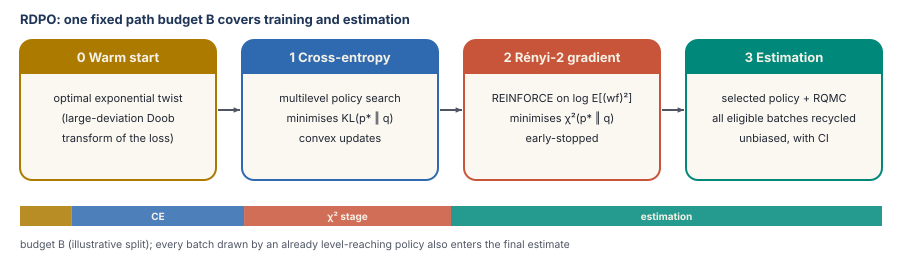
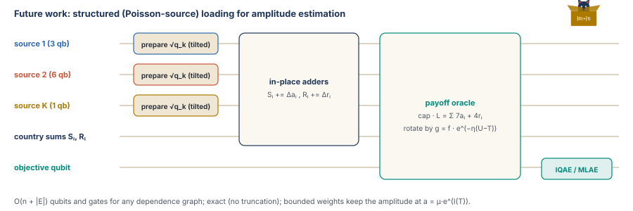
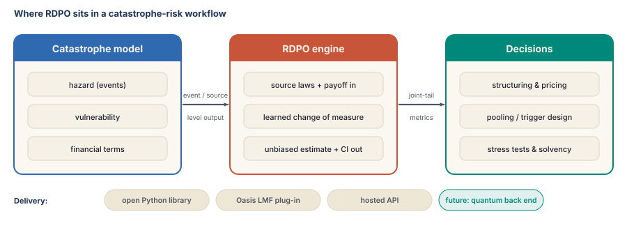

::: {.frontmatter}

::: {.abstract}
## Abstract

Pooled catastrophe-risk instruments are priced, structured and stress-tested on their *joint tails*: the
probability that several countries attach, exceed a pooled threshold or exhaust their cover together.
These quantities are rare (10⁻³ to 10⁻¹³ per term), are driven by a dependence structure that historical
data cannot pin down, and must be re-estimated under many dependence scenarios. Plain Monte Carlo
returns no hit at all at practical budgets, and exact enumeration grows as 10ⁿ with the number of
countries.

We formulate joint-loss estimation as a sequential decision problem over independent Poisson *sources*
of loss. We show that the zero-variance importance-sampling measure is the Doob h-transform of the loss
process, equivalently the optimal policy of a KL-regularised (soft) control problem. On this basis we
propose **Rényi-Doob Policy Optimization (RDPO)**: a compact soft-value policy is learned by
cross-entropy policy search and then refined by a Rényi-2 (χ²) policy gradient, because χ² rather than
KL governs estimator variance. Training and estimation share one fixed path budget. Training samples are
recycled into an estimator that is exactly unbiased, and the final stage uses randomised quasi-Monte
Carlo.

On the ADB benchmark (five scenarios × five targets), with all training charged to the budget, RDPO
attains {{E1_EXH_MED}} median relative RMSE on the joint-exhaustion probability at 16,384 paths, a
{{E1_EXH_RANGE}} improvement over the best of the four reference methods. On an n-country extension it
keeps relative errors of {{E2_RANGE}} while the target probability falls to 10⁻¹³ (28 countries),
where Monte Carlo would require on the order of 10¹⁵ paths. As a forward-looking extension we show that
the same change of measure carries over to quantum amplitude estimation through an *exact*, structured
loading circuit whose size scales linearly with the dependence graph. Since no quantum processor is
available in Phase 1, the quantum stage is presented as a resource-estimated future feature, not as a
claimed advantage.
:::

::: {.glance}
## At a glance

::: {.tiles}
::: {.tile}
[{{E1_EXH_RANGE_SHORT}}]{.big}
lower error than the best reference method on joint exhaustion (training included)
:::
::: {.tile}
[10⁻¹³]{.big}
smallest target probability estimated, at {{E2_RING28_EXC}} relative RMSE (28 countries)
:::
::: {.tile}
[{{E1_COVERAGE}}]{.big}
empirical coverage of nominal 95% intervals across all 75 benchmark settings; the estimator is provably unbiased (Proposition 5)
:::
::: {.tile}
[O(n + |E|)]{.big}
cost per sampled path, for both the classical policy and the future quantum loader
:::
:::
:::

:::

# 1 Introduction {.newpage}

Disaster risk financing instruments transfer the cost of natural catastrophes from governments to
capital markets before an event occurs. In a catastrophe bond, investors receive a coupon in exchange
for exposing part of their principal to a pre-agreed parametric trigger. For a multilateral development
bank structuring a pooled facility, such as the Asian Development Bank's Disaster Relief Bond for the
Kyrgyz Republic and Tajikistan, the decision-relevant quantities are *joint*: whether pooling reduces
cost depends on how often the covered countries suffer losses together, and whether investors are
adequately compensated depends on the probability that the cover of several countries is exhausted in
the same term. Two features make these quantities hard to compute. First, they lie far in the tail of
the joint loss distribution, where sampling error dominates. Second, the dependence that drives them is
poorly constrained by the short historical record, so they must be recomputed across many dependence
scenarios and, for regional pools, across many countries.

This proposal makes four contributions.

1. **A source-level formulation.** We show that the capped multi-year payout process of the benchmark
   is exactly a product of commuting single- and two-country Poisson kernels, and that each source has
   a finite term-increment law (Propositions 1–2). This yields an exact representation in which a
   portfolio scenario is a sequence of K = 2n + 2|E| independent draws.
2. **RDPO, an information-theoretic reinforcement-learning estimator.** We identify the zero-variance
   importance-sampling measure with the optimal policy of a soft control problem (Proposition 3). We
   learn it with a compact policy class and a two-stage objective (KL, then Rényi-2) whose second stage
   targets estimator variance directly (Proposition 4). With sample recycling the estimator is exactly
   unbiased under a fixed total budget (Proposition 5).
3. **A rigorous evaluation at fixed total budget.** RDPO is compared with the challenge's reference
   methods on all 25 benchmark cells, scaled to 28 countries against exact tensor-network references,
   and dissected by an ablation study. All training costs are charged to the budget, and interval
   coverage is reported.
4. **A quantum-ready estimation stage.** The same change of measure can be loaded *exactly* into a
   quantum circuit whose qubit and gate counts scale with the dependence graph, with bounded importance
   weights for amplitude estimation. We provide end-to-end resource estimates and a near-term
   feasibility analysis, and we state clearly that no quantum advantage is claimed in Phase 1.

# 2 Problem Formulation {.newpage}

::: {.opener}
{.mascot}

This section builds the estimation problem step by step, from the contract terms of the benchmark to
an exact source-level representation that holds for any number of countries.
:::

{.wide}

## 2.1 Contract terms and payout functions

Consider countries $i = 1, \dots, n$ (the benchmark has $n = 2$) over a term of $\tau = 3$ years. Country
$i$ holds a bond with principal $B_i$ split into an earthquake sub-limit $E_i$ and a precipitation
sub-limit $P_i$ (benchmark: $E_i = 70$m, $P_i = 10$m, $B_i = 80$m). Earthquake payouts accrue in quarter
steps of $E_i$ and accumulate over the term up to the sub-limit; precipitation pays $P_i$ at most once.
We therefore describe the terminal state of country $i$ by

$$a_i \in \{0,1,2,3,4\} \ \text{(cumulative EQ quarter steps, capped)}, \qquad r_i \in \{0,1\} \ \text{(rain trigger)},$$

and its term loss by

$$L_i = E_i \frac{a_i}{4} + P_i\, r_i, \qquad L = \sum_{i=1}^n L_i .$$

## 2.2 Annual earthquake model

For each country the brief specifies the annual exceedance probabilities $t_1 > t_2 > t_3 > t_4$ that the
year's aggregate EQ payout reaches at least 25%, 50%, 75% and 100% of the sub-limit. The point
probabilities of paying 0, 1, 2 or 3 quarter steps are $p_0 = 1 - t_1$, $p_k = t_k - t_{k+1}$
($k = 1, 2$) and $p_3 = t_3 - t_4$. The annual payout is modelled as compound Poisson: events arrive at
total rate $\Lambda$ and an event pays $k$ quarter steps with rate $\lambda_k$
($\Lambda = \sum_k \lambda_k$). Matching the first four point probabilities gives

$$\Lambda = -\ln p_0,\quad \lambda_1 = \frac{p_1}{p_0},\quad \lambda_2 = \frac{p_2}{p_0} - \frac{\lambda_1^2}{2},\quad \lambda_3 = \frac{p_3}{p_0} - \lambda_1\lambda_2 - \frac{\lambda_1^3}{6},\quad \lambda_4 = \Lambda - \lambda_1-\lambda_2-\lambda_3,$$

and per-event size probabilities $w_{i,k} = \lambda_{i,k}/\Lambda_i$.

## 2.3 Dependence through shared events

Dependence enters through events that hit both countries. With conditional trigger probabilities
$\rho_{2|1} = 0.075$ and $\rho_{1|2} = 0.074$ and a scenario multiplier $m$, the shared-event rate is

$$c = m \cdot \tfrac12\left(\rho_{2|1}\Lambda_1 + \rho_{1|2}\Lambda_2\right).$$

Each country keeps its total rate: solo events arrive at $\Lambda_i - c$ and shared events at $c$, with
event sizes drawn independently in each country from $w_{i,\cdot}$. The pair of capped annual levels
$(a_1, a_2)$ is a continuous-time Markov chain on 25 states with generator $G$, whose off-diagonal
entries are

$$G_{(a,b),(a \oplus k,\, b)} \mathrel{+}= (\Lambda_1 - c)\, w_{1,k}, \qquad G_{(a,b),(a,\, b \oplus j)} \mathrel{+}= (\Lambda_2 - c)\, w_{2,j}, \qquad G_{(a,b),(a\oplus k,\, b \oplus j)} \mathrel{+}= c\, w_{1,k} w_{2,j},$$

where $x \oplus k = \min(x + k, 4)$ denotes capped addition. Precipitation is modelled analogously: each
country triggers with annual probability $q = 2\%$, i.e. at Poisson rate $\mu = -\ln(1-q)$, of which a
shared component $c_r = s_r \min(\mu_1, \mu_2)$ ($s_r = 0.25$) triggers both countries.

## 2.4 Aggregation over the term

The brief aggregates the term by convolving three annual draws and capping the running total. The
following observation removes the year structure altogether and is used throughout.

::: {.proposition}
**Proposition 1 (term law).** Let $P_{\text{EQ}}^{(\tau)}$ denote the law of the capped term EQ levels.
Then $P_{\text{EQ}}^{(\tau)} = e^{\tau G}_{(0,0),\,\cdot}$, and the term rain law is that of the annual
model with rates multiplied by $\tau$.

*Proof.* For non-negative integers $x, y$, $\min(\min(x,4) + y, 4) = \min(x + y, 4)$. Hence capping each
year and then capping the running total equals capping the total uncapped event count over the term.
The superposition of independent Poisson streams over three unit intervals is a Poisson stream on
$[0,\tau]$, whose capped levels form the chain with generator $G$; the claim follows. The rain trigger
is the indicator of at least one event, to which the same argument applies. $\square$
:::

Numerically, $e^{3G}$ reproduces the three-fold capped convolution of the brief to within $3\times10^{-16}$ in all
five scenarios.

## 2.5 Estimation targets

All five focus quantities are expectations $\mu = \mathbb{E}[f(\text{terminal state})]$ with $T = 80$m:

| Target | Definition | Rare? |
|---|---|---|
| expected principal loss | $\mathbb{E}[L]$ | no |
| joint attachment | $\Pr(L_1 > 0,\ L_2 > 0)$ | moderately (≈ 4%) |
| portfolio exceedance | $\Pr(L > T)$ | moderately (≈ 1%) |
| portfolio stop-loss | $\mathbb{E}[(L - T)^+]$ | tail-driven |
| joint exhaustion | $\Pr(L_1 = B_1,\ L_2 = B_2)$ | **rare (≈ 3×10⁻⁵)** |

## 2.6 Extension to n countries on a dependence graph

To study portfolio scale we place countries on an undirected *dependence graph*
$\mathcal{G} = (V, \mathcal{E})$: an edge $\{i,j\}$ means that $i$ and $j$ can be hit by common events
(a shared fault system, river basin or weather regime). Each edge carries a shared EQ source at rate
$c_{ij}$ (the rule of §2.3) and a shared rain source at rate $c^r_{ij} = s_r\min(\mu_i,\mu_j)/d_{\max}$, and every
country's solo rates are reduced so that its total rates are preserved. For $n = 2$ and a single edge
this reproduces the benchmark exactly. All 25 reference values are recovered to $4\times10^{-14}$
relative error. Figure 2 shows the four graph families used in our scaling study.

{.wide}

## 2.7 Source decomposition

::: {.proposition}
**Proposition 2 (source decomposition).** Let $\mathcal{S}$ be the set of $K = 2n + 2|\mathcal{E}|$ independent
Poisson sources (solo EQ and solo rain per country; shared EQ and shared rain per edge), and let $G_k$ be
the generator of source $k$ acting on the levels of the countries it touches. Then the $G_k$ commute and

$$P^{(\tau)} = \delta_{\mathbf 0} \prod_{k \in \mathcal{S}} e^{\tau G_k}.$$

Moreover, the terminal state equals $\mathbf{0} \oplus X_1 \oplus \cdots \oplus X_K$, where the
increments $X_k$ are independent with *finite* laws $p_k = (e^{\tau G_k})_{\mathbf 0, \cdot}$ supported on at most 25
values.

*Proof.* Capped addition is a commutative monoid action, so the transition kernels of different
sources commute. Independence of Poisson sources gives the product. Finiteness follows from the identity
in the proof of Proposition 1: a source can raise each level by at most 4 quarter steps (one rain trigger)
before the cap binds, so its term effect is a capped increment in $\{0..4\}$ or $\{0..4\}^2$ (resp.
$\{0,1\}$). $\square$
:::

{.wide}

Proposition 2 is the structural basis of everything that follows. A scenario becomes a short sequence
of small, independent decisions, and each decision has local consequences. This is the form required by
the sequential policy of §4 and by the quantum loader of §7.

## 2.8 Why the problem is hard

For an unbiased Monte Carlo estimate of a probability $\mu$ from $N$ paths, the relative error is

$$\mathrm{RE}_{\text{MC}} = \sqrt{\frac{1-\mu}{\mu N}},$$

and the probability of observing no hit at all is $(1-\mu)^N$. For joint exhaustion
($\mu \approx 3.2\times10^{-5}$) and $N = 16{,}384$ paths, $\mathrm{RE}_{\text{MC}} \approx 1.4$ and about 60% of runs return
exactly zero. Exact enumeration is cheap for two countries (0.2 ms) but scales as $10^n$. The challenge
is therefore **accuracy per query in the joint tail, and how it degrades with portfolio size**.

# 3 Related Work

**Catastrophe modelling practice.** Vendor platforms and the open-source Oasis Loss Modelling
Framework chain hazard, vulnerability and financial modules and estimate portfolio metrics by
aggregating simulated event or year loss tables, usually by plain Monte Carlo. Cross-region dependence
is expressed through shared events or copulas [@joe2014; @embrechts1997].

**Variance reduction for rare events.** Stratification, randomised quasi-Monte Carlo and importance
sampling are classical [@glasserman2003; @owen1997]. The cross-entropy method fits proposals by
multilevel KL minimisation [@rubinstein2004]. Variance-minimising adaptive importance sampling
[@arouna2004] and χ- and Rényi-divergence variational inference [@dieng2017; @li2016] motivate our
second training stage. The zero-variance measure as a Doob transform, and its link to KL control, go
back to [@todorov2009; @kappen2005].

**Quantum methods for risk.** Amplitude estimation offers a quadratic query-complexity speedup over
Monte Carlo [@brassard2002; @montanaro2015], with risk applications [@woerner2019] and a correlated
credit-default model [@egger2021] closely analogous to shared-event catastrophe risk. Phase-estimation-free
variants [@suzuki2020; @grinko2021] and end-to-end resource studies [@chakrabarti2021; @herman2023]
show that state preparation dominates cost and that advantage requires fault tolerance. Quantum
generative models load distributions on near-term devices [@benedetti2019; @zoufal2019; @amin2018; @zhu2022].
Tensor networks [@han2018; @orus2014] are the principal quantum-inspired classical alternative.

**Positioning.** Existing work either estimates the tail with a hand-designed proposal or loads the
*original* distribution into a quantum device. We treat the change of measure itself as the learnable
object, train it against the divergence that governs variance, and carry it unchanged into a quantum
loader whose cost follows the dependence graph.

# 4 Method: Rényi-Doob Policy Optimization {.newpage}

::: {.opener}
{.mascot}

The method has one idea: the best possible sampling distribution is a reinforcement-learning policy,
and we should train it against the quantity that actually determines estimation error.
:::

## 4.1 Importance sampling and the zero-variance measure

For any sampling law $Q$ with $Q \gg P$ on $\{f > 0\}$, the estimator
$\hat\mu = \frac1N\sum_{j} w(X_j) f(X_j)$ with $w = \mathrm dP/\mathrm dQ$ is unbiased, and

$$\operatorname{Var}_Q(\hat\mu) = \frac{1}{N}\left(\mathbb{E}_Q[w^2 f^2] - \mu^2\right).$$

For $f \ge 0$ the variance vanishes under $\mathrm dQ^*/\mathrm dP = f/\mu$. In the sequential source
representation of Proposition 2, write $s_k$ for the state after sources $1..k-1$ and define the value
function

$$V_k(s) = \mathbb{E}\left[f(S_K) \mid S_k = s\right], \qquad V_k(s) = \sum_x p_k(x)\, V_{k+1}(s \oplus_k x), \qquad V_{K+1} = f.$$

::: {.proposition}
**Proposition 3 (Doob transform).** $Q^*$ is the Markov law with transition probabilities

$$q^*_k(x \mid s) = \frac{p_k(x)\, V_{k+1}(s \oplus_k x)}{V_k(s)},$$

and every path sampled from $Q^*$ has $w \cdot f = \mu$.

*Proof.* The product of the ratios telescopes: $\prod_k q^*_k / p_k = V_{K+1}(S_{K+1}) / V_1(\mathbf 0) = f/\mu$. $\square$
:::

For two countries $V$ can be tabulated exactly (100 states). This *zero-variance backward induction* is
our strongest classical baseline, and it is exact. At scale the table has $10^n$ entries, which is why
$V$ must be learned.

## 4.2 A soft reinforcement-learning view

Taking logarithms of the recursion gives

$$\log V_k(s) = \log \sum_x p_k(x)\, \exp\!\big(\log V_{k+1}(s \oplus_k x)\big),$$

which is the *soft Bellman equation* of a KL-regularised control problem with reference dynamics $p$ and
terminal reward $\log f$ [@todorov2009; @kappen2005]. Its optimal policy is the Boltzmann policy of
Proposition 3. Learning the zero-variance sampler is therefore a reinforcement-learning problem: we
approximate a soft value function and act with its Boltzmann policy.

## 4.3 Policy class

We parametrise the soft value function linearly in features of the state,
$\log \tilde V_\theta(s) = \theta^\top \Phi(s)$, and act with

$$\tilde q_{\theta,k}(x \mid s) \propto p_k(x)\, \exp\!\left(\theta^\top\left[\Phi(s \oplus_k x) - \Phi(s)\right]\right), \qquad q_{\theta,k} = (1-\alpha)\,\tilde q_{\theta,k} + \alpha\, p_k .$$

The defensive mixture ($\alpha = 0.05$) bounds every per-step likelihood ratio by $1/\alpha$. The feature
map has three blocks:

| Block | Features | Count |
|---|---|---|
| country $i$ | $\psi(a_i, r_i) = [\mathbb 1\{a_i \ge 1\}, \dots, \mathbb 1\{a_i \ge 4\},\ r_i]$ | $5n$ |
| edge $\{i,j\}$ | $\chi = [\mathbb 1\{L_i>0\}\mathbb 1\{L_j>0\},\ \mathbb 1\{a_i = a_j = 4\},\ r_i r_j]$ | $3\lvert\mathcal{E}\rvert$ |
| target progress | e.g. $[\min(L,T)/T,\ \mathbb 1\{L>T\},\ (L-T)^+/(L_{\max}-T)]$ | 1–3 |

**Locality.** A source touches at most two countries, so $\Phi(s\oplus_k x) - \Phi(s)$ is supported on
a fixed coordinate set $\mathcal I_k$: the touched countries, their incident edges and the target block.
The normaliser is a sum over at most 25 values. The cost of one path is therefore
$O\big(\sum_k |\mathcal I_k|\, |\mathrm{supp}\, p_k|\big)$, which is $O(n + |\mathcal{E}|)$ for bounded-degree graphs and
never involves the $10^n$ joint state space.

**Target relevance.** If the payoff depends only on a subset $\mathcal R$ of countries (for example the pair
in a joint-exhaustion target), then for every source $k$ that touches no country in $\mathcal R$ the value
$V_{k+1}(s \oplus_k x)$ does not depend on $x$, so by Proposition 3 the exact Doob policy for that source is
$q^*_k = p_k$. RDPO therefore freezes such sources at $p_k$, with likelihood ratio exactly one, and restricts the
features to $\mathcal R$. For a pair target inside a large portfolio this removes the weight noise of
every irrelevant source. In development runs it reduced the error for pair exhaustion inside a
28-country portfolio by more than two orders of magnitude (§6.3).

## 4.4 Training objectives: from KL to Rényi-2

**Stage 1: cross-entropy policy search (KL).** Minimising $D_{\mathrm{KL}}(Q^*\,\|\,Q_\theta)$ is equivalent to
maximising $\mathbb{E}_{Q^*}[\log q_\theta]$, estimated by importance-weighted samples from the current policy.
For a rare target, $Q^*$ has almost no mass under the initial policy, so we use the multilevel scheme
of [@rubinstein2004]: at each iteration the elite level
$\gamma = \min(\gamma^*, \text{quantile}_{1-\rho}(\text{score}))$ is raised until the target level $\gamma^*$
is reached. Each update maximises a weighted log-likelihood, which is concave in $\theta$ because the
policy is a log-linear (softmax) model.

**Stage 2: Rényi-2 policy gradient (χ²).** The quantity that determines estimation error is not KL but

::: {.proposition}
**Proposition 4 (variance is a Rényi-2 divergence).** For $f \ge 0$ and $g = w f$,

$$\frac{N\operatorname{Var}_Q(\hat\mu)}{\mu^2} = \chi^2(Q^*\,\|\,Q) = e^{D_2(Q^*\|Q)} - 1, \qquad D_{\mathrm{KL}}(Q^*\|Q) \le D_2(Q^*\|Q).$$

The bound runs one way only: a policy with small KL can still have very large variance.
:::

We therefore refine the policy by stochastic gradient descent on $\log M_2(\theta)$, $M_2 = \mathbb{E}_{Q_\theta}[g^2]$,
using the score-function (REINFORCE) estimator with a constant baseline:

$$\nabla_\theta \log M_2 = -\,\mathbb{E}_{Q_\theta}\!\left[\left(\frac{g^2}{M_2} - 1\right) \nabla_\theta \log q_\theta(\text{path})\right].$$

We use Adam steps, keep the iterate with the lowest *estimated* χ², and stop early when it no longer
improves. No exact reference value is used anywhere in training. In a preliminary study with year-level
policies on the benchmark (15 fits per policy family), cross-entropy fits with a richer feature set
produced heavy-tailed weights in 2 of 15 runs. The Rényi-2 stage removed every such failure and reduced
the exact per-path relative standard deviation of a failed fit from 14.5 to 0.60. This is the stage's
primary role: a repair mechanism for fits whose KL is small but whose χ² is not.

**Warm start.** For loss-threshold targets the policy is initialised at the optimal exponential twist of
the total loss, $\theta_h \leftarrow \eta^\star T$ with $\eta^\star = \arg\max_\eta\, \eta T - \Lambda(\eta)$
(the large-deviation Doob transform), so that the first iteration already reaches the tail.

## 4.5 Algorithm

::: {.algorithm}
**Algorithm 1: RDPO with a fixed total budget B**

1. Initialise $\theta$ (warm start where applicable); batch size $b = \max(500, B/16)$; training cap $B/2$.
2. **Stage 1:** repeat: draw $b$ paths; set the elite level $\gamma$; fit $\theta$ by concave weighted log-likelihood; until the target level is reached (plus one iteration).
3. **Stage 2:** repeat: draw $b$ paths; estimate $\hat\chi^2$; take one Adam step on $\log M_2$; until no improvement for 3 steps or the cap is reached. Keep the best $\theta$.
4. **Stage 3:** spend the remaining budget with the selected policy, using 8 independent scrambles of a Sobol sequence as inverse-CDF inputs.
5. **Estimate:** pool every batch drawn by a policy that had already reached the target level before the batch was drawn (weights proportional to batch size); report the 95% interval from batch-wise variances.
:::

{.wide}

## 4.6 Unbiasedness and uncertainty quantification

::: {.proposition}
**Proposition 5 (recycled estimator is unbiased).** Let batches $b = 1, 2, \dots$ be drawn with policies
$\theta_b$ and sizes $n_b$ that are measurable with respect to the history $\mathcal F_{b-1}$, and let
$b_0$ be the first batch whose policy had reached the target level before it was drawn. Then
$\hat\mu = \sum_{b \ge b_0} \frac{n_b}{N_e}\,\hat\mu_b$ with $N_e = B - \sum_{b<b_0} n_b$ satisfies
$\mathbb{E}[\hat\mu] = \mu$.

*Proof.* All batches after $b_0$ are pooled, so $N_e$ is $\mathcal F_{b_0-1}$-measurable and each weight
$n_b/N_e$ is $\mathcal F_{b-1}$-measurable. Each batch mean is unbiased given its policy, so
$\mathbb{E}[\hat\mu_b \mid \mathcal F_{b-1}] = \mu$, and the tower property gives
$\mathbb{E}[\hat\mu] = \mu\, \mathbb{E}[\sum_b n_b/N_e] = \mu$. Scrambled Sobol points are marginally uniform, so
RQMC blocks are unbiased as well. $\square$
:::

The standard error combines within-batch sample variances (i.i.d. batches) with between-scramble
variances (RQMC blocks). We report the empirical coverage of the resulting 95% intervals.

# 5 Experimental Protocol

* **Budget.** Every method receives the same total number of sampled term scenarios $B$. For RDPO, all
  training paths count against $B$.
* **Metrics.** Relative RMSE against the exact value over independent replications (40 for the
  benchmark, 10–20 at scale), relative bias, and the empirical coverage of the nominal 95% interval.
* **Reference values.** Benchmark: exact enumeration, which reproduces the brief's Table 5. Scaling:
  exact tensor networks in a tail-preserving tilted gauge (§6.4), validated against dense enumeration
  for $n \le 6$.
* **Baselines.** The challenge's four reference methods: plain Monte Carlo, scrambled Sobol (8
  scrambles), stratification by first payout year, and the brief's importance sampling (½ true + ½
  loss-tilted). At scale we add classical exponential twisting [@glasserman2003], the strongest simple
  rare-event method for threshold targets.
* **Compute.** Single CPU core per run (Intel Xeon 2.1 GHz); NumPy/SciPy; fixed seeds recorded in
  every result file.

# 6 Results {.newpage}

## 6.1 Benchmark: five scenarios × five targets

{.wide}

{{TABLE_E1}}

{{E1_TEXT}}

{.wide}

## 6.2 Scaling to large portfolios

{.wide}

{{TABLE_E2}}

{{E2_TEXT}}

## 6.3 Ablation study

{.wide}

{{E3_TEXT}}

## 6.4 Where classical exact methods suffice

The source decomposition also yields an exact classical method. Applying the commuting kernels of
Proposition 2 to a matrix-product state gives the full joint law with a bond dimension set by the
number of shared sources crossing each cut. To keep relative accuracy in the tail we compress in a
*tilted gauge*, $\tilde p(x) = p(x)\prod_i g_i(x_i)$ with $g_i$ the inverse independent marginal (a Doob-type
reweighting). Plain singular-value truncation discards precisely the small tail entries and incurs up
to 2% error on the rarest target even at tolerance $10^{-12}$.

{.wide}

For chain, star and ring dependence the bond dimension is constant (9, 10 and 58), and all targets for
28 countries are computed exactly in about a minute. For complete dependence it grows (58 → 135 from
four to six countries). We therefore position RDPO as the method of choice when dependence is dense
or the model is only available as a simulator, and the tilted tensor network as an exact cross-check
for sparse portfolios.

## 6.5 Limitations

* **Smooth targets.** RDPO offers no gain on smooth, non-rare targets: on expected loss, scrambled
  Sobol remains more accurate and should be preferred.
* **Level functions.** The cross-entropy stage is indispensable for the rarest targets (§6.3), so new
  targets need a sensible score function for the level schedule.
* **Error bars under heavy tails.** Interval coverage is below nominal in some rare-target settings,
  most clearly for the exhaustion of one pair inside a large portfolio. Batch-variance error bars are
  optimistic when the weights are heavy-tailed. Robust variance estimators (e.g. effective-sample-size
  corrections) are part of WP3.
* **Budget competition.** At small budgets and large portfolios, additional parameters and stages compete
  with estimation for paths. Simpler configurations, or the one-parameter twist (which is better for the
  stop-loss at 28 countries), can then be more accurate. Automatic model selection is planned (WP3).
* **Synthetic scaling.** All scaling results use a synthetic but calibrated extension of the benchmark.
  Realistic multi-peril, multi-country portfolios remain to be tested in Phase 2.

# 7 Quantum Extension (Future Feature) {.newpage}

::: {.opener}
{.mascot}

Phase 1 provides no access to quantum hardware, so no quantum advantage can be demonstrated, and we
claim none. This section shows that RDPO's change of measure is *quantum-ready*, and it quantifies
what a future quantum estimation stage would require.
:::

## 7.1 Exact structured loading

By Proposition 2 the term law is generated by independent sources with finite increment laws. A
quantum state-preparation operator $\mathcal A$ can therefore be built with one small register per source
(3, 6 or 1 qubits). Each register is prepared in $\sum_x \sqrt{q_k(x)}\,|x\rangle$, the increments are added
into per-country sum registers with in-place adders, and a payoff oracle rotates an objective qubit.
The construction is *exact*, with no truncation of Poisson counts, and uses $O(n + |\mathcal{E}|)$ qubits and gates
for any dependence graph. An exact sparse-statevector simulation reproduces the joint law to $10^{-16}$.
For the benchmark the operator uses 52 logical qubits and 156 Toffoli gates per call, compared with 97
and 3,808 for generic amplitude loading.

{.wide}

## 7.2 Bounded importance weights for amplitude estimation

Loading an importance-sampling proposal into amplitude estimation helps only if the weighted payoff is
bounded, since the estimated amplitude is $a = \mu / \max(w f)$. Preparing each source register in
the exponentially twisted law $q_k(x) \propto p_k(x) e^{\eta \ell_k(x)}$ costs no additional gates and makes the
weight a function of the uncapped total loss $U$ alone, $w = e^{-\eta U + \Lambda(\eta)}$. Because $U \ge L$,
the weighted payoff is bounded on $\{L > T\}$, and

$$a = \mu\, e^{\eta T - \Lambda(\eta)}, \qquad \max_\eta\ a = \mu\, e^{I(T)},$$

where $I$ is the Cramér rate function of $U$. The amplitude thus decays with the large-deviation gap
rather than with $\mu$. For 28 countries ($\mu \approx 1.3\times10^{-13}$) the projected number of
amplitude-estimation calls falls from $2.8\times10^{9}$ to $3.4\times10^{4}$, against $7.6\times10^{14}$
Monte Carlo paths. Relative to the best *classical* estimator using the same twist, the projected
query saving is about threefold at this size and grows with $n$.

{.wide}

## 7.3 Near-term feasibility

Noisy maximum-likelihood amplitude estimation, with a noise-aware likelihood as error mitigation,
outperforms Monte Carlo on the benchmark only when two-qubit error rates reach about $10^{-6}$; the
estimation stage is therefore an early-fault-tolerant workload. The near-term quantum component is an
8-qubit circuit Born machine used as a proposal sampler (depth 9, 32 entangling gates). On hardware its
samples follow a noisy law; using the ideal law in the importance weights biases estimates by 9–60%. We
show that calibrating the *sampled* law with $10^5$ shots reduces the bias to at most 0.6%, and that
readout-error inversion is the wrong mitigation in this setting.

# 8 Resource Estimation

## 8.1 Classical (the deliverable of Phase 1 and the core of Phase 2)

| Task | Hardware | Wall time | Memory |
|---|---|---|---|
| Exact benchmark model (5 scenarios) | 1 CPU core | 0.2 ms / scenario | < 1 MB |
| RDPO estimate, benchmark, B = 16,384 (training included) | 1 core | {{E1_SEC_16K}} s | < 100 MB |
| RDPO estimate, 28 countries, B = 65,536 | 1 core | {{E2_SEC_28}} s | < 1 GB |
| Exact tilted tensor network, 28 countries (ring) | 1 core | 68 s | < 1 GB |
| Full reproduction of all experiments | 4 cores, 15 GB RAM | ≈ 7 CPU-hours (≈ 3 h wall-clock) | < 4 GB |

## 8.2 Quantum (projected; future feature)

All quantum figures are logical-level estimates from explicit component formulas, not compiled circuits.
Assumptions: Toffoli = 4 T = 6 CNOT; Ross–Selinger rotation synthesis; surface code at physical error
$10^{-3}$, 1 µs cycles and 4 magic-state factories.

| Instance | Logical qubits | CNOT / Grover iterate | Depth / iterate | Calls (shots) | T-count | Physical qubits | Runtime |
|---|---|---|---|---|---|---|---|
| Benchmark, $\Pr(L>80\text{m})$, 1%, twisted | 61 | 6,484 | ≈ 660 | 3.8×10⁴ (≈ 500) | 3.6×10⁸ | 1.1×10⁵ | ≈ 8 h |
| Benchmark, joint exhaustion, 1%, untwisted | 52 | 3,220 | ≈ 660 | 1.8×10⁶ (≈ 700) | 1.8×10¹⁰ | 1.1×10⁵ | ≈ 16 days |
| 16 countries, ring, 10%, twisted | 371 | 6.7×10⁴ | ≈ 1,100 | 1.3×10⁴ (≈ 450) | 1.8×10⁹ | 6.5×10⁵ | ≈ 1.6 days |
| 28 countries, ring, 10%, twisted | 624 | 1.2×10⁵ | ≈ 1,500 | 3.4×10⁴ (≈ 490) | 8.7×10⁹ | 1.2×10⁶ | ≈ 8.6 days |
| Near-term proposal sampler (QCBM) | 8 | 32 CZ | 9 | 3 per path + 10⁵ calibration | — | — | seconds |

**Error mitigation.** Calibrated sampled-law weights (sampler); noise-aware maximum likelihood (low-depth
amplitude estimation); post-selection of invalid register codes. **Hardware modality.** Dense
dependence graphs require all-to-all coupling between country registers, which favours trapped-ion and
reconfigurable neutral-atom platforms. On 2D superconducting lattices, SWAP routing inflates CNOT counts
by 10–40×.

# 9 Work Plan for the Deep Development Phase {.newpage}

{.wide}

| Work package | Milestone | Success criterion |
|---|---|---|
| WP1 Engineering (W1–2): GPU-batched RDPO, library API, sandbox onboarding | M1 library v0.1 | prototype results reproduced; ≥ 10× throughput |
| WP2 Realistic portfolios (W3–6): heterogeneous perils, degree-normalised dense dependence, 10–50 countries, scenario sweeps | M2 scaling report | ≤ 10% relative RMSE at μ ≤ 10⁻⁸ within 10⁵ paths |
| WP3 RL improvements (W5–8): nonlinear (small neural) soft value functions, adaptive level functions, pilot-based model selection | M3 RDPO v2 | ≥ 2× over v1 on dense graphs, coverage ≥ 93% |
| WP4 Quantum stage (W8–10): compile structured loading with a production SDK; run the calibrated sampler on sandbox hardware or noisy emulators | M4 compiled resource tables | compiled counts within 2× of estimates; mitigated bias ≤ 1% |
| WP5 Validation and delivery (W11–12): independent reference checks, documentation, demo, business case | M5 final deliverables | all deliverables of the call |

| Risk | Mitigation and fallback |
|---|---|
| Dense-dependence instances also turn out to be classically easy | Publish the crossover map either way; RDPO remains the product. |
| Training instability on new targets | Warm starts, Rényi-2 repair, pilot-based model selection; estimates stay unbiased regardless. |
| Quantum hardware unavailable or too noisy | The quantum stage remains a resource-estimated feature; the sampler runs on noisy emulators. |
| Single-person team capacity | Modular packages; WP4 is descoped first. |

# 10 Commercialisation and Impact

{.wide}

**Integration.** RDPO is an estimation engine positioned between a catastrophe model's event- or
source-level output and the portfolio metrics used for pricing, structuring and monitoring. It requires
only the source laws and the contract payoff. It can be delivered as an open Python library, as a plug-in
to the Oasis Loss Modelling Framework's simulation stage, or as a hosted service; a quantum back end for
the estimation stage is an optional future upgrade, not a dependency.

**Users.** Disaster-risk-financing teams at multilateral development banks; regional sovereign risk
pools; reinsurers and insurance-linked-securities investors pricing pooled tails; catastrophe-model
vendors; rating agencies and supervisors validating tail metrics.

**Deployment considerations.** The estimator is unbiased with reported uncertainty, reproducible
(fixed seeds), light on compute and interpretable (a small set of feature weights), which eases model
validation. The main barriers are integration with proprietary vendor models, addressed by operating at
event or source level, and validation requirements, addressed by exact tensor-network cross-checks on
sparse portfolios.

**Broader applicability.** The required structure (independent shocks with capped effects and rare
joint outcomes) also arises in correlated credit portfolios, parametric pandemic and supply-chain
cover, compound climate extremes and infrastructure reliability.

**Impact.** Tighter joint-tail estimates reduce uncertainty loadings in pricing, making pooled cover
cheaper for vulnerable countries. They also make trigger and pooling decisions more defensible, which
supports faster post-disaster liquidity (UN SDG 13).

# 11 Team {.newpage}

**Tan Chun Loong** (sole member; research, implementation, quantum resource estimation, business case).
Bachelor of Applied Physics with a Second Major in Quantum Technology, Nanyang Technological University (2024–2028;
CGPA 4.8/5.0, First Class Honours).

* *URECA Research Fellow, "The Thermodynamics of Mitigating Ignorance" (Prof. Mile Gu, NTU, 2026–2027).*
  Studies the cost of acting on beliefs that differ from reality, measured by the relative entropy
  between belief and truth, together with optimal belief revision by dynamic programming and its
  implications for model-based reinforcement learning. RDPO rests on the same mathematics: backward
  induction for value functions, and divergences between a policy and the optimal measure.
* *Quantum Security Research Intern, QUASAR-CREATE Thrust 2, Fraunhofer Singapore (2026–).* Security
  evaluation of quantum key distribution under device imperfections.
* *URECA Research Fellow, models of atmosphere–ocean interaction (Prof. François Gay-Balmaz, NTU,
  2025–2026).* Fokker–Planck equations and stochastic thermodynamics for reduced climate models.
* *Selected projects:* Clifford+T compilation and T-count optimisation (MIT iQuHACK 2026, sole Singapore
  representative); quantum optimisation for wildfire response (SEA Quantathon 2025 finalist); quantum
  reservoir computing for sustainable-finance systemic risk (QAI Ventures GenQ Hackathon 2025);
  AI risk scoring for maritime fuel verification (winner, SuperAI NEXT Hackathon 2026).
* *Community:* founder of Quantum Wings (quantum outreach to more than 500 students); Country Lead
  (Singapore), Qiskit Fall Fest 2026.

A short CV is attached as an annex.

# 12 Platform Requirement, Prototype Package and AI Use

**Platform.** No platform access is required at this stage. All results were produced on the author's
own compute (4-core CPU; no GPU; no quantum hardware). In the Deep Development phase the QAI Ventures
sandbox would be used for GPU-batched RDPO sweeps, compilation of the loading circuits with production
toolchains, and noisy-emulator or hardware runs of the proposal sampler.

**Prototype package.** Source code, results and this document are available at
<https://github.com/CL0908/adb-quantum-challenge>. Environment: Python 3.13, NumPy 2.5, SciPy 1.18,
Matplotlib 3.11, pytest 9.2 (`requirements.txt`); Linux x86-64. All quantum circuits are simulated by
exact simulators written for this project (real statevector, sparse statevector, and an
amplitude-estimation emulator); no quantum SDK or hardware was used. Every experiment uses fixed seeds
recorded in its output file, and a test suite checks every exactness claim in this document.

**AI use.** The code, experiments and this document were developed with Claude Code (Anthropic) as an AI
pair-programmer and writing assistant, following the author's research plan. The author directed the
research questions and design decisions and reviewed all results. All numbers are produced by the
scripts in the repository.

# References {.newpage}

::: {#refs}
:::

::: {.closing}
{.mascot-end}
:::
